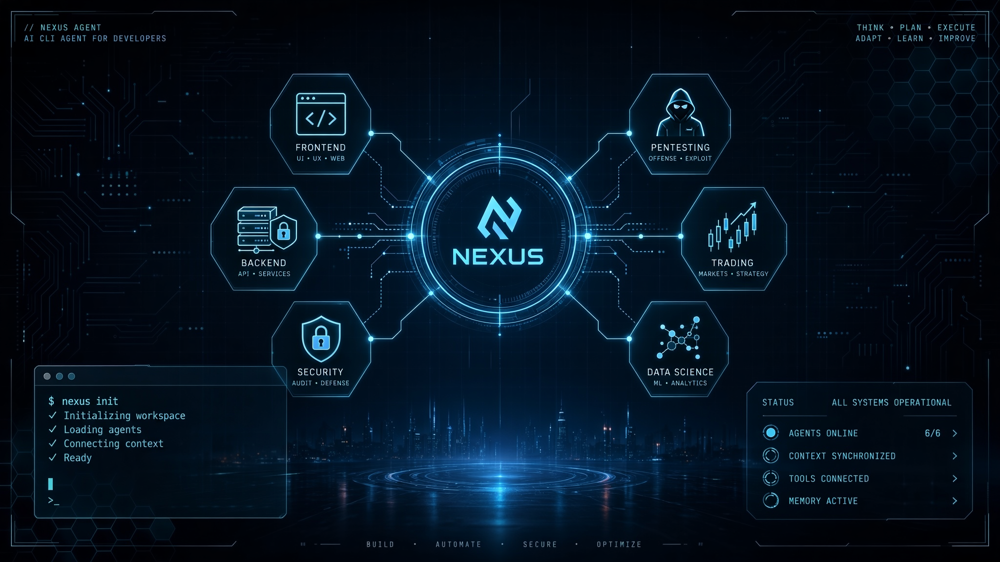
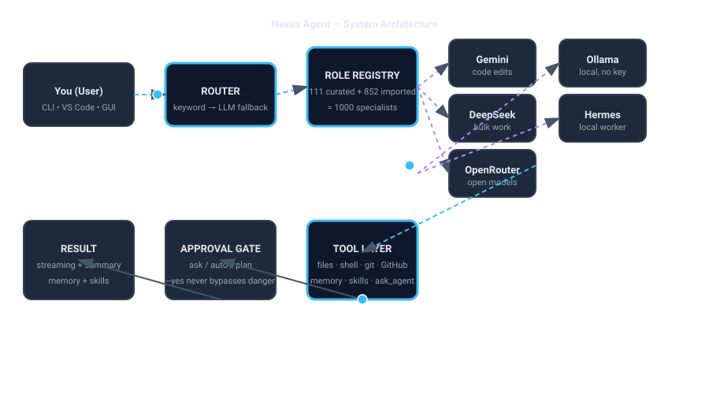
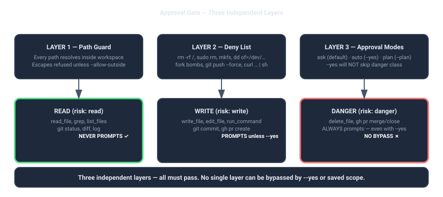
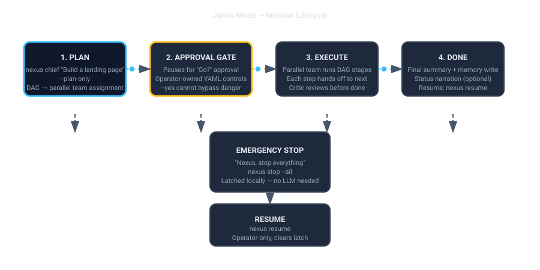

<p align="center">
  
</p>

<p align="center">
  <a href="https://github.com/BFH-HAMID/Nexus-Agent/actions/workflows/ci.yml">
    
  </a>
  <a href="LICENSE">
    
  </a>
  <a href="https://github.com/BFH-HAMID/Nexus-Agent/releases">
    
  </a>
  
  
</p>

<p align="center">
  <b>One CLI / VS Code agent, a whole team of specialists behind it.</b><br/>
  You describe a task. Nexus routes it to the right employee — <i>frontend</i>, <i>backend</i>,
  <i>pentesting</i>, <i>docs</i>, <i>trading</i>, <i>osint</i>, 111 curated roles (1000 with imported packs) —
  each running on the model that fits it best. Then it uses tools (files, shell, git, GitHub),
  <b>asks you before anything destructive</b>, and can open the PR for you.
</p>

<p align="center">
  
  <br/>
  <em>The router picks a role, the role picks its agent — `⇄ role: pentesting → agent: openrouter-uncensored` — all automatic, no role flag needed.</em>
</p>

<!-- end hero -->

## Table of Contents

- [What is Nexus](#what-is-nexus)
- [Key Features](#key-features)
- [Quick Start — 60 Seconds](#quick-start--60-seconds)
- [System Architecture](#system-architecture)
- [Approval Gate](#approval-gate)
- [GitHub Automation (Module 2)](#github-automation-module-2)
- [Permissioned Computer Tools (Module 3 Core)](#permissioned-computer-tools-module-3-core)
- [Jarvis Daemon (Module 4)](#jarvis-daemon-module-4)
- [Jarvis Mode Quick Start](#jarvis-mode-quick-start-safe-default-config)
- [Durable Delegation (Module 5 First Slice)](#durable-delegation-module-5-first-slice)
- [Opt-in Personal Assistant](#opt-in-personal-assistant)
- [Opt-in Multi-Role Project Planning (Module 1 Preview)](#opt-in-multi-role-project-planning-module-1-preview)
- [Router Logic (Phase 2)](#router-logic-phase-2)
- [Tools & the Approval Gate](#tools--the-approval-gate)
- [GitHub Workflow (Phase 4)](#github-workflow-phase-4)
- [GUI Dashboard (The Deck)](#gui-dashboard-the-deck)
- [VS Code (Phase 5)](#vs-code-phase-5)
- [Pipelines (Phase 6) and Memory (Phase 7)](#pipelines-phase-6-and-memory-phase-7)
- [Learning: It Grows With You (Hermes Loop)](#learning-it-grows-with-you-hermes-loop)
- [Project Layout](#project-layout)
- [Dashboard Workbench](#dashboard-workbench)
- [Configuration](#configuration)
- [Roadmap Status](#roadmap-status)
- [Testing & Development](#testing--development)
- [Safety & Ethics Note](#safety--ethics-note)
- [অনুবাদ: বাংলা বিভাগ (Bangla Section)](#অনুবাদ-বাংলা-কোর্টার-bangla-section)
- [License](#license)

---

## What is Nexus

**Nexus Agent** is a personal AI CLI agent that routes your tasks to specialist roles, each running on the model best suited for the job:

| Job | Agent | Model | Cost |
| --- | --- | --- | --- |
| Real code edits (frontend/backend/…) | `gemini` | `gemini-3.8-flash` | free tier |
| Routing / classification | `gemini-flash` | `gemini-3.5-flash-lite` | free tier |
| Bulk work (docs, QA, business, trading) | `deepseek` | `deepseek-flash` | ~$0.15/M in |
| Hosted open models | `openrouter` | `openrouter/free` (free-models router) | **$0** |
| Lowest-latency hosted | `openrouter-fast` | `nvidia/nemotron-3.5-lightning:free` | **$0** |
| Hermes without a GPU | `hermes-free` | `nousresearch/hermes-3-llama-3.1-405b:free` | **$0** |
| Local Hermes (no key at all) | `hermes` | `hermes3:8b` via Ollama | **$0**, offline |

Three API providers, one key each — and **no `.env` file**: paste keys once with
`nexus keys set gemini\|deepseek\|openrouter`, they are stored in
`~/.config/nexus/keys.json` (mode `600`, outside the repo).

## Key Features

<p align="center">
  
</p>

- **Smart routing** — Keyword fast-match + LLM classifier fallback picks the right role automatically
- **1000+ specialist roles** — 111 curated + 852 imported + 37 security specialists
- **Multi-provider support** — Gemini, DeepSeek, OpenRouter, Ollama (local, no key)
- **Approval gate** — Read tools never prompt; write tools prompt unless `--yes`; danger tools always prompt
- **Jarvis mode** — Background worker with emergency stop, local-first runtime, scheduled missions
- **Voice pipeline** — Wake word, STT, TTS with Bangla+English support; local stop phrase
- **Offline first** — `--demo` runs fully scripted with zero tokens; local Ollama lane needs no key
- **VS Code integration** — Tasks, launch configs, sidebar extension with Approve/Deny buttons
- **Self-learning** — Skills, memory, recall, curator loop (Hermes-compatible)
- **Defensive security** — Opt-in SSH/fail2ban/UFW monitoring, package-CVE snapshots, certificate expiry

## Quick Start — 60 Seconds

### Windows (PowerShell)

```powershell
$installer = Join-Path $env:TEMP 'nexus-install.ps1'
Invoke-WebRequest `
  -Uri 'https://raw.githubusercontent.com/BFH-HAMID/Nexus-Agent/4670f4b05dfb767cdcaff0b16ca3f9a2490ed1d2/install.ps1' `
  -OutFile $installer

# Review $installer before running it, then:
Unblock-File $installer
& $installer
nexus --demo
```

### macOS / Linux

```bash
git clone https://github.com/BFH-HAMID/Nexus-Agent && cd Nexus-Agent
python -m venv .venv && . .venv/bin/activate
pip install -e .

nexus doctor                                   # what's reachable, what's missing
nexus roles                                    # meet the team (1000 roles)
nexus roles --show pentesting                  # persona + keywords + agent
nexus addagent --list                          # the imported packs in roles.d/
nexus task 'add pagination to the users api' --demo --yes
```

`--demo` runs a **scripted, offline** version of the full loop — same routing, same tools, same
approval gate, same event stream, zero tokens. It writes `demo/nexus-demo-notes.md` so you can
see the diff and the PR-shaped output. Perfect for the VS Code sidebar on a fresh checkout.

### One command is the whole interface

Once installed, **typing `nexus` and pressing Enter opens the agent** — banner, live status,
prompt, streaming answers, everything. No subcommand, no flags, no `nexus chat` to remember:

```bash
nexus                      # → the agent (this is all you need)
nexus --demo               # same, offline and scripted (no key needed)
nexus gui                  # the same agent in the browser dashboard
```

Inside the REPL, `/help` lists everything (`/gui` starts the dashboard, `/local` checks Ollama,
`/keys` sets a key, `/roles` shows the team). Type a task in plain English and Nexus routes it.

`nexus keys set` prompts (input is hidden), stores the key with `chmod 600`, and never writes
anything into the repository. Prefer environment variables? `export GEMINI_API_KEY=...` works too
and always wins over the store. A pre-existing `.env` file is still read if present, but nothing
requires one.

Only one provider key? Fine: agents whose provider has no key fall back along
`gemini ⇄ deepseek ⇄ openrouter`, so a single key runs the whole roster.

## System Architecture

<p align="center">
  
</p>

The data flow is:

1. **You** send a task via CLI, VS Code, or GUI
2. **Router** matches keywords (instant, no LLM) or falls back to a narrowed LLM classifier
3. **Role Registry** maps the role to an agent (persona + model + tools)
4. **Tool Layer** executes with the approval gate guarding every mutation
5. **Result** streams back — written to memory and skills for next time

## Approval Gate

<p align="center">
  
</p>

Three independent layers keep Nexus safe:

| Risk | Examples | Behaviour |
| --- | --- | --- |
| `read` | `read_file`, `grep`, `list_files`, `git status/diff/log` | never prompts |
| `write` | `write_file`, `edit_file`, `run_command`, `git commit`, `gh pr create` | prompts unless `--yes` |
| `danger` | `delete_file`, `gh pr merge/close` | always prompts; `--yes` will **not** skip it |

1. **Path guard** — every path resolves inside the workspace; escapes are refused unless you pass `--allow-outside`.
2. **Deny list** — `rm -rf /`, `sudo rm`, `mkfs`, `dd of=/dev/…`, fork bombs, `git push --force`, `curl … | sh`, `npm publish`, `drop database`, … are refused outright.
3. **Approval modes** — `ask` (default), `auto` (`--yes`), `plan` (`--plan` / `nexus ask`: mutating tools are removed from the registry *and* the gate refuses them).

## GitHub Automation (Module 2)

The dashboard/direct-task GitHub transport now requires server-side
`GITHUB_TOKEN` (environment or `.env`), and those review-first commit flows enforce
secret scans and conventional messages. Typed legacy GitHub tools now use the
same token-only policy; `git_prepare` and typed `git commit` scan actual staged
blobs. Registered dangerous/known typed external mutations require fresh approval,
not `--yes` or saved scope. Local toolbar/typed push now uses constrained,
non-force HTTPS with token-only credentials and bounded outbound history scans;
SSH/ambient credentials and unscannable binary/history cases are refused.
New `nexus github create NAME --private`
and `nexus github issue OWNER/REPO --title "..." --body "..."` commands default to
**preview only**; `--execute` requires interactive exact approval.

Runnable Python/Node scaffolds now include tests, README, MIT license and push/PR CI,
with separate project Git folders and durable repo/branch/PR mappings. Use
`nexus github scaffold NAME --repo OWNER/REPO --stack python --execute`, then
`nexus github project NAME push|pr|merge --execute`. Exact-head successful test
checks are required before both PR creation and merge, revalidated after approval.

See [setup, commands, acceptance and explicit runtime limits](docs/github-extension.md).
Supported flows are offline integration-tested; live GitHub/native Windows acceptance
has not been performed. General shell containment is Module 3, not a GitHub feature.
No new autonomy is enabled.

## Permissioned Computer Tools (Module 3 Core)

`permissions.yaml` is now consumed by the existing agent approval gate. Default
`ASK_EVERY_TIME`, `READ_ONLY` and bounded `AUTO_ALLOW` cannot bypass existing role/tool
ceilings, fresh dangerous/external approval or workspace path checks. Shell execution
still requires fresh consent. Local typed file writes/edits/deletes now create bounded
pre-image snapshots. `nexus agent -C WORKSPACE snapshots` lists records;
`nexus agent -C WORKSPACE undo [ID]` previews and `--execute` requires exact fresh
confirmation. Later user edits block undo; proven agent-only chains support repeated
undo. Binary/directory/shell recovery is not claimed. See
[permission and recovery details](docs/permissions.md). Opt-in Playwright, isolated
VS Code launch and DOCX/XLSX/PPTX editing now share the same gate. CLI dry-run,
emergency `nexus agent kill`, Windows global-hotkey listener and optional no-network
Docker copy execution are implemented. See [computer setup, scope and platform
acceptance gates](docs/computer-control.md); live Windows/desktop/Docker acceptance
is not claimed.

**Task 12 — Environment control:** opt-in Linux X11/Windows UIA app control,
scriptless origin-locked browser search/draft/extract (separate form-submit approval),
scoped organize/rename/backup/duplicates/recoverable trash, operator-pinned YAML
macros with fresh approval per step, and exact-device Home Assistant/TLS MQTT.
Phone support uses authorized companion notifications, not invasive hooks. Computer
Studio now queues these tools through the existing Run/Approval Center; its legacy
file/browser mutations require one-use, payload-bound reviews. All new switches
remain **OFF** in `permissions.yaml`. See [enablement, CLI/voice examples, tests
and limits](docs/computer-control.md).

## Jarvis Daemon (Module 4)

`nexus jarvis -C WORKSPACE start|stop|pause|resume|kill|daemon-status` controls a
single-instance, crash-aware daemon. Existing Studio state persists priority jobs,
approvals, leases, budgets and notices; agents/router/learning are reused.
**Default L1, execution OFF, read-only/offline, context OFF.** Explicit policies
support L2/L3 source admission, narrow snapshot-backed reviewed edits, one-use
per-action consent and existing CI/scanned Module 2 project actions. Dangerous and
external actions never inherit autonomy approval. File/TODO/build/Git/CI/system/
inbox/queue-idle/schedule probes, offline→online deferral, inbox/digests/quiet/DND,
opt-in counts-only desktop notifications and reviewed OS user-service installers
have working consumers. Native host/account acceptance is distinct from fixture
tests; nothing is installed or remotely mutated implicitly. Module 5 implementation now includes delegation, native GUI operations, MCP/plugins, Telegram
and default-OFF context. Native/live acceptance boundaries remain explicit.
See [setup, commands, safety boundaries and acceptance](docs/jarvis.md).

## Jarvis Mode Quick Start (Safe Default Config)

Jarvis mode is Nexus's opt-in background worker: a Chief-of-Staff orchestrator
with a local-first runtime, emergency stop, and scheduled missions. Everything
ships **OFF** — you opt in by editing operator-owned YAML files.

<p align="center">
  
</p>

### 1. Install

```bash
git clone https://github.com/BFH-HAMID/Nexus-Agent && cd Nexus-Agent
python -m venv .venv && . .venv/bin/activate
pip install -e ".[dev,hud,voice]"
```

### 2. Safe default config (copy from `jarvis-mode.example/`)

```bash
cp jarvis-mode.example/voice.yaml .
cp jarvis-mode.example/persona.yaml .
cp jarvis-mode.example/autonomy.yaml .
cp jarvis-mode.example/permissions.yaml .
cp jarvis-mode.example/security.yaml .
```

Review each file, then flip the switches you want — one at a time:

- `chief.yaml enabled: true` — multi-agent mission orchestrator
- `autonomy.yaml runtime.enabled: true` — local model execution (L2/L3 only)
- `permissions.yaml second_factor.enabled: true` — PIN/Telegram for dangerous actions
- `security.yaml enabled: true` — passive defensive monitoring
- `voice.yaml enabled: true` — wake-word / STT / TTS voice pipeline
- `proactive.yaml enabled: true` — morning brief, reminders, monitors

### 3. Verify with `nexus doctor`

```bash
nexus doctor
```

Check every optional component shows the state you expect, and the security
posture (autonomy level, second factor, defensive mode, local runtime).

### 4. Run a mission

```bash
# Plan a multi-role build (pauses for "Go?" approval)
nexus chief "Build a landing page for my cafe" --plan-only

# Execute after approval
nexus chief "Build a landing page for my cafe" --confirm GO

# Voice stop (works even if LLM is unreachable)
nexus stop --all

# Resume (operator-only)
nexus resume
```

### 5. Voice (optional)

<p align="center">
  
</p>

```bash
# Stop everything by voice — matched locally, no LLM needed
"Nexus, stop everything"

# Resume requires CLI
nexus resume
```

Every new capability is OFF by default and enabled only through an
operator-owned YAML file. Agents cannot edit these files. `--yes` never
bypasses `permissions.yaml`.

See [Jarvis daemon](docs/jarvis.md), [Chief-of-Staff](docs/chief.md),
[Proactive assistant](docs/proactive.md), [Voice](docs/voice.md),
[Personal integrations](docs/integrations-personal.md),
[Environment control](docs/environment.md), [Security assistant](docs/security-assistant.md),
and [Vision](docs/vision.md) for full details.

## Durable Delegation (Module 5 First Slice)

`nexus delegate -C WORKSPACE create "TASK" --max-seconds 60` creates an
approval-pending Jarvis job. `tasks|status|report|cancel|resume` use actual persisted
jobs and per-attempt tool checkpoints. Parent-enforced deadlines, one-shot 80% time
alerts and explicit reapproval on recovery are implemented; tools are never replayed
from checkpoints. The subsequent Module 5 integrations are now implemented; see their guides. See [delegation safety/setup](docs/delegation.md).

## Opt-in Personal Assistant

`nexus assistant` adds Bangla/English wake-word/STT/TTS adapters, verified-speaker
fresh voice approvals, screenshot/upload/camera perception, Google/Notion/Obsidian
reads, reviewed Gmail draft/send, separate persistent personal memory with FAISS,
reminders/briefs/monitors, reviewed desktop/backup/smart-home automation,
planner→executor→critic repair and domain-allowlisted cited research. The same
authenticated dashboard now exposes memory editing/forgetting, real voice
waveforms, upload QA, reminders and reviewed email, plus an installable mobile
PWA and revisioned phone↔laptop reads.

Nothing activates a microphone, camera, external account, background worker or
desktop backend at import time. External sends need fresh approval; source text is
untrusted data; personal memory is a separate opt-in; Playwright stays disabled by
default. See [setup, commands and the live-acceptance boundary](docs/assistant.md).
Hardware, biometrics, OAuth delivery, MQTT and multi-device use are not claimed as
CI-verified merely because their adapters and deterministic tests are present.

## Opt-in Multi-Role Project Planning (Module 1 Preview)

A new `nexus orchestrate` path reuses the existing roles, model adapters, learning
storage and Studio workflows: local FAISS indexing, hybrid top-15 retrieval,
validated 3–7-role selection, and a phase DAG with bounded reviewer/repair gates.
It does not execute projects until you explicitly run a saved Studio workflow.

```bash
.\\.venv\\Scripts\\python.exe -m pip install -e ".[orchestrator]"
nexus orchestrate --encoder lexical-hash index
nexus orchestrate --encoder lexical-hash plan "Build an e-commerce website with login, admin panel and payment" --save-workflow
```

`lexical-hash` is offline lexical retrieval, **not semantic embeddings**. The
default semantic encoder requires your existing local Ollama embedding model.
Planning calls configured models and respects persisted Workbench local-only
policy. This is a tested **first Module 1 slice**, not a completed six-module
extension. See [usage, boundaries and verification](docs/orchestration.md), the
[Chief-of-Staff multi-agent orchestrator](docs/chief.md), and the
[full rollout/acceptance ledger](docs/agent-extension-plan.md).

```text
                         ┌─────────────────────────┐
                         │        User (you)        │
                         │  VS Code / Terminal CLI   │
                         └────────────┬──────────────┘
                                      │ task text
                                      ▼
                         ┌─────────────────────────┐
                         │         ROUTER           │
                         │ 1) keyword fast-match     │
                         │ 2) LLM classify fallback   │
                         └────────────┬──────────────┘
                                      │ role name
                                      ▼
                         ┌─────────────────────────┐
                         │      ROLE REGISTRY       │
                         │ frontend / backend / ... │
                         │ role → persona + agent    │
                         └────────────┬──────────────┘
                                      │ picks provider
              ┌───────────────┬───────────────┬────────────────┐
              ▼               ▼               ▼                ▼
         ┌─────────┐    ┌───────────┐   ┌────────────┐  ┌────────────────────┐
         │ Gemini  │    │ DeepSeek  │   │ OpenRouter │  │ OpenRouter         │
         │  (API)  │    │  (API)    │   │  (API)     │  │ uncensored model   │
         └────┬────┘    └─────┬─────┘   └─────┬──────┘  └─────────┬──────────┘
              └───────────────┴───────────────┴───────────────────┘
                                      │
                                      ▼
                         ┌─────────────────────────┐
                         │        TOOL LAYER        │
                         │ files · shell · git ·    │
                         │ GitHub · memory · peers  │
                         └─────────────────────────┘
```

The router is a **classifier**, not a model picker: it chooses a *role*, and the role is mapped
to an *agent* in `agents.yaml`. That indirection is the whole idea — pentesting/OSINT need an
uncensored model, frontend/backend need strong reasoning and reliable tool calling, and bulk work
(docs, QA, marketing, trading scripts) should go to the cheapest provider. Every agent also
declares a `fallback:`, so a run keeps going even if one provider has no key or is down.

## Router Logic (Phase 2)

**Step 1 — keyword fast-match (instant, no LLM).** Each role has weighted keywords; the router
scores every role against the task text with word-boundary matching (`api` does not fire on
`rapid`, but `next.js` and `c++` still work as substrings) and takes the highest score above
`settings.router_min_score`. Ties are not guessed — they are escalated to step 2.

```
$ nexus task 'run nmap against my lab box and try privilege escalation'
⇄ role: pentesting -> agent: openrouter-uncensored [keyword] hits: nmap, privilege escalation, pentest
→ agent: openrouter-uncensored  model: dolphin-mistral-24b-venice-edition  provider: openrouter  tools: text
```

The preceding example illustrates **role selection only**, not permission to run
a scanner. Raw scanner/exploit commands are refused; use the separately allowlisted
and freshly reviewed [defensive TCP check](docs/defensive-security.md).

**Step 2 — LLM classifier fallback (only if nothing matched).** The roadmap prompt, verbatim:

```
You are a routing classifier.
Pick exactly ONE role name from this list that best fits the task.
Reply with ONLY the role name, nothing else.

Roles: frontend, backend, database, devops, ...
Task: <user's task text>
```

The candidate list is **narrowed to the ≤40 most relevant roles** (by keyword/name/title overlap)
before the call, so even a 963-role roster costs a single cheap classifier call rather than one
per 40-role chunk; a tie among ≤8 roles is classified among exactly those. Output is
sanitized (lowercase, `a-z0-9-` only, code fences and prose stripped) and validated against the
full registry; anything unknown falls back to `general`. The classifier runs on `gemini-flash`
(configurable via `settings.router_agent`) at `temperature: 0`, `max_tokens: 32`.

## Tools & the Approval Gate

`list_files` · `read_file` · `grep` · `write_file` · `edit_file` · `delete_file` ·
`run_command` · `git` · `git_prepare` · `gh_create_pr` · `gh` · `gh_merge_pr` ·
`remember` · `ask_agent` · `finish`

| Risk | Examples | Behaviour |
| --- | --- | --- |
| `read` | `read_file`, `grep`, `list_files`, `git status/diff/log` | never prompts |
| `write` | `write_file`, `edit_file`, `run_command`, `git commit`, `gh pr create` | prompts unless `--yes` |
| `danger` | `delete_file`, `gh pr merge/close` | always prompts; `--yes` will **not** skip it |

Three independent layers keep it safe:

1. **Path guard** — every path resolves inside the workspace; escapes are refused unless you
   pass `--allow-outside`.
2. **Deny list** — `rm -rf /`, `sudo rm`, `mkfs`, `dd of=/dev/…`, fork bombs, `git push --force`,
   `curl … | sh`, `npm publish`, `drop database`, … are refused outright. With
   `--allow-dangerous` they become "ask, loudly" instead of "refuse". Your own extra patterns go
   in `settings.blocked_command_patterns`.
3. **Approval modes** — `ask` (default), `auto` (`--yes`), `plan` (`--plan` / `nexus ask`:
   mutating tools are removed from the registry *and* the gate refuses them).

Details, schemas and examples: [`docs/tools.md`](docs/tools.md).

## GitHub Workflow (Phase 4)

`git_prepare` does the whole delivery in one call:

* branch: `feat/<role>-<short-task>` (`slugify`d, collision-suffixed, prefix configurable)
* staging: given paths or `-A`
* commit message: generated conventional commit — `feat(backend): add cursor pagination`
  plus a body listing the changed files, the role, and a "generated with Nexus" trailer
* optional `push: true`

`gh_create_pr` then opens the PR: it fills `.github/PULL_REQUEST_TEMPLATE.md` (the `<!-- summary -->`
and `<!-- motivation -->` placeholders), and appends a **Nexus run** footer with the role → agent
mapping, branch, commit list and diffstat. Uses the `gh` CLI when installed, otherwise the REST
API with `GITHUB_TOKEN`. Labels and reviewers are optional arguments.

`gh_merge_pr` is `danger` risk: `merge`/`squash`/`rebase`/`close` always ask, even with `--yes`.

## GUI Dashboard (The Deck)

The CLI and the GUI are the same agent, the same server, the same run — the dashboard just makes the
process *visible* while it happens:

```bash
nexus gui                 # http://127.0.0.1:8787/dashboard  (opens your browser)
nexus gui --demo          # same deck, scripted run, no keys and no model calls
nexus gui --host 0.0.0.0 --token "$(openssl rand -hex 16)"   # reach it from another machine
```

Already inside the REPL? Type `/gui` — the server starts in a background thread, the URL is printed,
and your terminal session keeps running. Answers stream into the deck token by token.

`nexus panel` is the same command; `/panel` is the compact page the VS Code webview embeds, so
terminal, browser and sidebar all render the identical event stream.

Alongside it, `/console` serves [`nexus/panel/index.html`](nexus/panel/index.html) — the cinematic
**NEXUS AGENT** console: one self-contained file (inline HTML/CSS/JS, no libraries, no CDN, no images)
that draws the **real** configuration read from this server — every role in `roles.yaml` as a dot, its
real agent as a hub, real key state, real token/session counters — and lets you drive a real run from
the prompt (`status`, `agents`, `roles <text>`, `pipelines`, `keys`, `memory <role>`, `/role`, `/pipeline`,
`/plan`, `approve` / `deny` / `cancel`, or any text as a task). Nothing on it is hardcoded: if the server
is unreachable it says so and shows dashes.

**What you see while a task runs**

| Panel | What it shows |
| --- | --- |
| **Live process** (centre) | the run as a timeline: `route → role/agent`, `◉ thinking turn n/N`, `✎ tool_call` with the exact command or file, `✓ result` with duration, assistant text, memory writes, approvals, final summary |
| **Phase banner** | the current phase in words — routing, thinking, running a tool, waiting for your approval, done |
| **Cognition map** | every configured agent as a node around the Nexus core, with fallback edges; the active node pulses, a packet travels the edge while it works. Click a node for model, endpoint, key state, fallback and tool mode |
| **Orchestration** | the roster with live per-agent status dots (thinking / tool / error), so you can see who handed off to whom |
| **Router prediction** | which role won the task and why (keyword, LLM router, manual or pipeline) plus the matched keywords |
| **Telemetry** | turn counter vs `max_turns`, tool calls, input/output tokens (per call and cumulative), elapsed time, events/min, latency sparklines |
| **Security audit** | read/write/danger tool calls, denied approvals, errors, and a rolling audit log |
| **Approvals** | the pending dangerous call rendered with its arguments and **Approve / Approve & remember / Deny** |
| **Memory** | the live contents of `.nexus/memory/<role>.md` for whichever role is running |
| **Keys / local-first** | which provider keys are configured (masked, source only) and whether routing is local-first |

Everything is driven by the `/api/*` routes above, so the browser needs no build step, no npm and no
third-party assets: it is one HTML file, one CSS file and one vanilla JS file served by the same
stdlib server, and it degrades to a static, readable page when `prefers-reduced-motion` is set.

## VS Code (Phase 5)

**Works today, zero setup** — `.vscode/tasks.json` and `.vscode/launch.json` are in the repo:

* `Ctrl+Shift+P` → *Tasks: Run Task* → **Nexus: chat**, **Nexus: ask (read-only)**,
  **Nexus: task…**, **Nexus: plan**, **Nexus: pick a role…**, **Nexus: pipeline…**,
  **Nexus: roles**, **Nexus: doctor**, **Nexus: serve sidebar**, **Nexus: open panel**
* `F5` → debug configurations for chat / task / ask / pipeline / serve / pytest

**Sidebar extension** ([`vscode-extension/`](vscode-extension/)) — a real activity-bar view with
a live role/agent indicator and native **Approve / Approve & remember / Deny** buttons instead of
a terminal `y/N`:

```bash
cd vscode-extension && npm install && npm run compile   # then F5 in VS Code
```

It is a thin shell: it starts `nexus serve` and loads the same panel UI the browser uses, so CLI,
browser and sidebar behave identically. Settings: `nexus.pythonPath`, `nexus.serverPort`,
`nexus.autoStartServer`, `nexus.autoApprove`. Details: [`docs/vscode.md`](docs/vscode.md).

## Pipelines (Phase 6) and Memory (Phase 7)

```bash
nexus pipeline ship-feature 'add a rate limiter to the public API'
# backend → qa → security-audit → docs → devops, one run, each step gets the
# previous specialist's `finish` summary as a handoff note.
```

`bug-hunt`, `security-review`, `content-drop` and `release` ship in
[`pipelines.yaml`](pipelines.yaml); add your own the same way you add a role. Full guide:
[`docs/pipelines.md`](docs/pipelines.md).
Inside a run, any role can consult another with the `ask_agent` tool (one question, one answer,
no tools, no recursion).

Every role keeps its own memory file — `.nexus/memory/<role>.md` — injected into that role's
system prompt on the next run in the same repo. The agent writes to it with the `remember` tool,
you can write to it with `/remember` in the REPL.

## Learning: It Grows With You (Hermes Loop)

Nexus keeps what it learns in three layers and loads them again next time:

| Layer | Where | What |
| --- | --- | --- |
| **Skills** (procedural) | `~/.config/nexus/skills/`, `<project>/.nexus/skills/`, bundled `skills/` | portable `SKILL.md` files: steps, commands, pitfalls, verification |
| **Memory** (declarative) | `~/.config/nexus/memories/MEMORY.md` + `USER.md` | facts, decisions, gotchas, your stable preferences |
| **Sessions** (episodic) | `~/.config/nexus/sessions.db` (SQLite FTS5) | every run's task, summary and transcript — searchable |

```bash
nexus skills                  # what the agent has learned so far
nexus skills import           # import Nous Research's hermes-agent skill library (200+)
nexus learn "how we ship a release in this repo"
nexus recall flaky test       # search your own past runs
nexus memory                  # MEMORY.md + USER.md
nexus hermes                  # status of the Hermes bridge
nexus update                  # update Nexus itself
```

Inside the REPL: `/skills`, `/skill <name> [task]`, `/<skill-name> [task]`,
`/learn`, `/curate`, `/recall`, `/memory global`.

How the loop works:

* **Before** a run, matching skills (name + ≤60-char description) and your memory
  enter the system prompt; the full body is loaded on demand (`skill_view`) or
  when you pin a skill.
* **After** a non-trivial run (≥4 tool calls) a cheap model reviews the task, the
  tool trail and the result and may write **one skill**, **one patch** and up to
  three memory entries. It cannot touch code or your keys.
* Skills follow the [agentskills.io](https://agentskills.io) / Hermes format, so
  they are portable in both directions; imported skills are never overwritten.
* The curator archives stale skills — **nothing is deleted**.
* Turn it off with `NEXUS_LEARNING=0`; tune `learning_agent`, `learning_min_tools`,
  `skill_nudge_interval`, `skills_enabled` in the `settings:` block.
* Four starter skills ship with Nexus (`skills/nexus/`): add a role, add an
  agent, verify before commit, release & self-update.

Full guide: [`docs/learning.md`](docs/learning.md) · বাংলায়: [`docs/bangla.md`](docs/bangla.md). The GUI has a
**LEARNING BRAIN** card (skills, memory, recall) fed by `/api/brain`,
`/api/skills` and `/api/recall`.

## Project Layout

```
Nexus-Agent/
├── agents.yaml              # which model lives where (gemini/deepseek/openrouter + optional local Ollama lanes)
├── roles.yaml               # 111 curated roles → persona + keywords + agent  (generated)
├── roles.d/                 # 852 imported roles (5 packs) - `nexus addagent` writes here
├── pipelines.yaml           # multi-role handoff pipelines
├── teams.yaml               # the 48 teams of docs/teams.md: stages -> role names  (generated)
├── pyproject.toml           # `pip install -e .` → `nexus`
├── skills/                  # bundled SKILL.md skills (agentskills.io / Hermes format)
├── .vscode/                 # tasks.json, launch.json, settings.json, extensions.json
├── .github/
│   ├── PULL_REQUEST_TEMPLATE.md   # auto-filled by gh_create_pr
│   └── workflows/ci.yml           # tests + roles.yaml sync check
├── scripts/build_roles.py   # the role data + generator + validator
├── nexus/
│   ├── cli.py               # entry point, REPL, /commands (incl. /addagent)
│   ├── agent.py             # main loop: route → model → tools → repeat, pipelines
│   ├── router.py            # keyword match + narrowed LLM classifier fallback
│   ├── importers.py         # `addagent`: fetch a GitHub repo → discover agents → roles.d pack
│   ├── providers.py         # Gemini/DeepSeek/OpenRouter (OpenAI dialect) + fallback chain
│   ├── keys.py              # `nexus keys`: ~/.config/nexus/keys.json, no .env needed
│   ├── tools.py             # files, shell, git, GitHub, memory, skills, recall, ask_agent, approval gate
│   ├── skills.py            # SKILL.md discovery/authoring/import/curator (Hermes-compatible)
│   ├── memory.py            # MEMORY.md + USER.md with hard character caps
│   ├── sessions.py          # session store + FTS5 recall
│   ├── learning.py          # the self-improvement loop (/learn, nudges, review, apply)
│   ├── hermes.py            # bridge to NousResearch/hermes-agent + `nexus update`
│   ├── config.py            # agents/roles/roles.d/pipelines/settings loading + layering
│   ├── server.py            # HTTP + SSE server for the sidebar/panel
│   ├── demo.py              # scripted offline run
│   ├── env.py               # optional legacy .env loading (never required)
│   ├── types.py             # roles, messages, completions, events
│   └── panel/               # dashboard.html/css/js (the GUI deck + LEARNING BRAIN) + panel.html
├── vscode-extension/        # Phase 5 sidebar (TypeScript, no runtime deps)
├── tests/                   # 324 offline tests
└── docs/                    # architecture, configuration, tools, pipelines, vscode, security, roles, roadmap, addagent
```

## Dashboard Workbench

The dashboard now includes **Workbench** (or **Ctrl+K**) for provider checks, per-role
model policy, local-only routing, durable history, plan/review/execute, serial task
queues, safe failed-step retry, file diffs, Ollama management, sourced system metrics,
GitHub/PR review and saved bilingual layouts. All 20 features, confirmation rules and
external-service limitations: [Workbench guide](docs/workbench.md).

## Configuration

`agents.yaml` + `roles.yaml` + `roles.d/*.yaml` + `pipelines.yaml` + `teams.yaml` are loaded in layers, later wins:

1. bundled defaults (inside the wheel)
2. the repo checkout (incl. the committed `roles.d/` import packs)
3. `$NEXUS_HOME` (default `~/.config/nexus`) — your machine-wide overrides
4. `./.nexus/*.yaml` + `./.nexus/roles.d/*.yaml`, then `./agents.yaml` etc. in the project you are working on
5. environment variables (`${VAR:-default}` expansion works inside the YAML)

API keys are **not** part of that layering: they resolve per agent as
inline `api_key:` → environment variable (`GEMINI_API_KEY`, `DEEPSEEK_API_KEY`,
`OPENROUTER_API_KEY`) → the terminal store written by `nexus keys set`
(`~/.config/nexus/keys.json`, mode `600`). A legacy `.env` is read only if it already exists.

Behaviour knobs (`settings:` block) and every `NEXUS_*` override are documented in
[`docs/configuration.md`](docs/configuration.md).

## Roadmap Status

| Phase | Status | Where |
| --- | --- | --- |
| 1 — Core engine (providers, tools, loop, approval gate) | ✅ | `nexus/providers.py`, `nexus/tools.py`, `nexus/agent.py` |
| 2 — Auto role-routing (keywords + LLM fallback) | ✅ | `nexus/router.py`, `roles.yaml` |
| 3 — 100+ roles | ✅ **111 curated + 852 imported + 37 security specialists = 1000** | `roles.yaml`, `roles.d/`, `scripts/build_roles.py` |
| 3b — Import agents from any GitHub repo | ✅ **`/addagent`** | `nexus/importers.py`, `roles.d/*.yaml`, [`docs/addagent.md`](docs/addagent.md) |
| 4 — GitHub workflow polish (branch, commit, PR template) | ✅ | `git_prepare`, `gh_create_pr`, `.github/PULL_REQUEST_TEMPLATE.md` |
| 5 — VS Code integration | ✅ tasks/launch **and** sidebar extension + web panel | `.vscode/`, `vscode-extension/`, `nexus/server.py`, `nexus/panel/` |
| 6 — Multi-agent collaboration | ✅ `ask_agent` + **pipeline mode** | `pipelines.yaml`, `NexusAgent.run_pipeline` |
| 7 — Per-role memory | ✅ | `.nexus/memory/<role>.md`, `remember` tool |
| 8 — Model health & fallback | ✅ `fallback:` chain + `nexus doctor` | `agents.yaml`, `ProviderRegistry.call_with_fallback`, `cmd_doctor` |
| Streaming tokens (CLI + GUI live deltas) | ✅ | `nexus/providers.py`, `nexus/ui.py`, `nexus/panel/*` |
| 9 — Self-learning (skills, memory, `/learn`, curator, recall) | ✅ | `nexus/skills.py`, `nexus/memory.py`, `nexus/sessions.py`, `nexus/learning.py`, [`docs/learning.md`](docs/learning.md) |
| 10 — Hermes bridge + self-update | ✅ | `nexus/hermes.py`, `nexus skills import`, `nexus update` |
| Next — MCP tools, session resume, gateway platforms | ⏳ | [`docs/roadmap.md`](docs/roadmap.md), [`docs/architecture.md`](docs/architecture.md#whats-next) |

## Testing & Development

From a fresh clone, activate your virtual environment and install the checkout **before** running
`pytest`:

```bash
python -m pip install -e ".[dev]"
python -m pytest -q                     # all offline (scripted providers)
python scripts/build_roles.py --check   # validate the role data
python scripts/build_roles.py --stats   # counts by category / agent
ruff check nexus tests
```

The editable install is required because the Jarvis integration tests launch isolated
`python -I -m nexus` subprocesses. The `dev` extra also includes the screenshot, OCR, and FAISS
packages used by the context and orchestration tests, so a separate install is not needed.

Nothing in the test suite touches the network: providers are scripted, the server tests run
against a real socket on an ephemeral port, and `--demo` covers the loop end to end.

## Safety & Ethics Note

The `pentesting` / `osint` / `malware-analysis` / `reverse-engineering` / `ctf-player` /
`bug-bounty` roles are routed to an uncensored hosted model (via OpenRouter). That is for **your own systems, your
own repos, your CTF lab, and engagements you have written permission for**. A persona prompt does
not authorize anything: if you point it at a real third-party target you do not own, no system
prompt makes that legal or acceptable, and the personas say so explicitly. Nexus adds its own
guardrails on top (deny-listed commands, `danger` risk class, path guard, plan mode) — see
[`docs/security.md`](docs/security.md).

## License

MIT — see [LICENSE](LICENSE). © NXR HAMID

---

## Studio review workspace

The dashboard **Studio** button adds sessions, review inboxes, checkpoints and
verification evidence. See [exact implementation status and limits](docs/studio.md)
for the full selected-feature checklist, required runtimes and security/verification boundaries.

## Repository toolbar

Directly beneath the task description, the compact dashboard repository bar
provides local repo selection, current branch and
real diff counts, selected-file commits, push, PR creation/listing and reviewed
merge/squash/rebase. Use the diff chip to review files and the **⋯** menu for
commit/push/PR actions. Every mutation requires an expiring preview and typed
confirmation. See [Repository toolbar](docs/repository-toolbar.md) for safe usage
and the distinction between Git selection and the agent workspace.

## Hardware monitoring and live activity

The dashboard shows real server CPU/RAM, workspace disk, Nexus process memory and
available NVIDIA GPU telemetry in place of GitHub/VS Code setup instructions.
Approved command stdout/stderr now stream while commands run, with observed
exit/stop status, expandable tool output and applied code diffs. See
[hardware and live execution](docs/live-dashboard.md) for limits and verification.


### Reviewed MCP plugins and Telegram controls (Module 5)

`nexus extensions -C WORKSPACE list|run` and foreground model tools use real bounded
stdio/HTTP MCP, fresh existing approval gates and operator-declared manifests.
Discovery executes nothing; plugin additions need no core edits. See [MCP](docs/mcp.md).
`nexus telegram -C WORKSPACE` explicitly starts whitelist-only private-chat polling
with persisted offsets, one-use PIN challenges and quiet-hour count notifications;
see [Telegram](docs/telegram.md). Both are OFF by default. Delegation also supports
optional operator-priced local-model allocation caps (`--max-cost`), not fake invoice
costs. **Module 5 implementation/automated acceptance is complete; native/live host checks
remain separate.** [Context/privacy](docs/context.md) was implemented last and stays
OFF by default. Module 6 is now starting on existing session/learning storage.


### Opt-in local context and separately approved vision

`nexus context -C WORKSPACE status|collect|resolve|signal|clear|vision` has real
bounded consumers; opening the GUI does not enable context collection. The existing VS Code
extension adds **Share Active Editor Context Reference (Opt-in)**. Reference-bearing
agent runs cannot silently send context to cloud routing/learning/fallbacks. Local
capture and cloud upload need separate fresh existing-gate consent; unavailable
native identity/OCR refuses capture. See [setup, privacy and honest acceptance
boundaries](docs/context.md). No native Windows or live vision claim follows from
scripted native/HTTP tests.


### Module 6: measured learning, traces and safe inspection

`nexus evaluate -C WORKSPACE --days 7` and the GUI operations adapter consume the existing
sessions.db: measured outcomes/reviews/retries/approvals, time, usage and historical
operator-priced model/project/UTC-day cost snapshots. Missing billing/usage remains
unknown; agent claims and command exits are not independent test certification.
Evidence-weighted ranking retains exploration; weekly role advice never auto-deletes.

`nexus trace -C WORKSPACE inspect TRACE_ID` / `why TRACE_ID` expose bounded redacted
observations, not hidden reasoning. `replay TRACE_ID --step N` has **no effects**.
Explicit `--execute` is limited to eligible workspace file tools, requires fresh
bound consent plus current policy, and creates a separate linked trace. No terminal,
plugin, payment or external replay; no evaluation execution endpoint. Context stays OFF.

See [operation, privacy, costs and limits](docs/evaluation.md) and the
[six-module audit / six scripted integration demos](docs/six-module-audit.md).

### Module 7: World observatory · globe / public news / weather

The **original Nexus GUI World tab** includes a locally bundled interactive
3D world globe (Natural Earth borders, adaptive English/Bangla labels, hover/fly-to,
Dinajpur Home, quakes/news/terminator layers, night texture, SVG fallback), news tabs,
Bangladesh-first RSS news, public crypto quotes and WeatherAPI.com forecast/favorites.
It reuses the current theme, authentication and controls—no separate app, CDN or
model calls. Weather requires your own WeatherAPI.com account/key.

```powershell
python -m pip install -e .
nexus gui -C .
```

Uses the same optional `NEXUS_SERVE_TOKEN`/GUI session, not a separate World or HUD credential.
Defaults remain loopback-only; public requests start when the World tab opens. Configure
**News & weather settings** inside the original GUI (or `widget.yaml` for nonsecret
settings). Enter the WeatherAPI key there, not in chat; it stays server-side in
session memory, optionally the native OS vault. `WEATHERAPI_KEY` is also supported.
Internet is needed for the initial public fetch; stale cached data
is labelled offline, and an empty cache does not create sample news/weather/prices.
WeatherAPI requests three forecast days and displays only what your plan returns;
missing keys/failed requests are labelled, never silently switched to another provider.
Keyless Open-Meteo remains an explicit legacy option (free access is non-commercial). Publisher
RSS permissions also apply; Cointelegraph is permission-gated by default, not silently
scraped. External text never becomes agent instructions.

See [setup, source terms, privacy, demo steps and actual offline screenshots](docs/world-widget.md)
and the [honest dashboard control-coverage audit](docs/gui-control-coverage.md).

### Desktop Control Center follow-up

`nexus gui` opens a searchable desktop Control center; Run/chat and all existing
views remain one click away. Native desktop setup now edits Context/privacy,
MCP declarations and Telegram policy, and previews/downloads/explicitly installs
reviewed OS user-service manifests. No save starts a collector, bot or plugin.
See the [desktop guide and explicit remaining limits](docs/desktop-control-center.md).

Desktop setup also supports separately confirmed Telegram polling Start/Stop/status
and one-time local context collect/clear. It reuses the original Bot/Context and
shared Studio, with duplicate-poller locking and cancellation checks. No policy
save starts these actions; screen/cloud vision still needs separate approval.

OS service setup now adds read-only registration inspection, fresh observed-state
removal preview/confirmation, and non-executing recovery instructions. It refuses
foreign/modified/overridden registrations and reports partial outcomes; it does
not elevate, overwrite, force-repair or claim all independent workers are stopped.

#### Modern desktop discovery

The original `nexus gui` includes category filters, searchable/favourite controls, navigation-only **Compose a task** / **Review approvals** shortcuts, and browser-local **Compact layout** / **Reduce effects** preferences. The same visual system covers Run, Operations, World and native settings dialogs; existing approvals remain unchanged. See the [desktop appearance guide](docs/dashboard-appearance.md) for details and real screenshots, and the [Settings guide](docs/dashboard-settings.md) for where each preference is stored and how old the reported workspace values are.

### One-command updates

Run `nexus update` in your existing environment after stopping Nexus processes. Clean official `main` checkouts fast-forward safely; package installations use a pinned official GitHub archive. `nexus update --check` checks without installing; `--extras hud,mcp,context` updates selected optional dependencies. On Windows a worker waits for the launcher to exit and reports actual completion separately. Local code changes are never force-cleaned. See [updating and recovery](docs/updating.md) for safety limits, Windows receipts and first-install requirements.


## Defensive security assistant (Task 14)

`nexus security -C WORKSPACE status|monitor|watch|export|scan|respond|analyze|roles`
adds opt-in observation for SSH failures, fail2ban/ufw events, new TCP listeners,
users/cron/systemd changes, selected-file integrity, local package-CVE snapshots
and public-certificate expiry. Incidents have severity, deduplication/cooldowns,
read-only normalized evidence, JSON/Markdown timelines and optional local Piper
speech plus the existing owner Mission Control HUD alerts/DND.

All switches remain **OFF** in operator-owned [`security.yaml`](security.yaml).
Use only owned or explicitly authorized hosts. Active TCP checks require literal
IP/port allowlists **and fresh approval**; raw scanners/exploits are refused.
Enabling defensive mode also refuses opaque shell/Git/MCP/browser/desktop relays
in that workspace—use a separate trusted security workspace when appropriate.
IP blocks, account-disable and staged public SSH key rotations are **DANGEROUS
proposals only**, each with exact command/rollback review; nothing applies them.
Existing defensive roles provide separately reviewed, tool-free reports with no
provider fallback. No service or external notification is started automatically.

See [enablement, input schemas, approval boundaries, exports, tests and known
limits](docs/defensive-security.md). Optional certificate/SSH public-key validation
uses `.[security]`. Offline tests are not live host, firewall, audio or incident
response acceptance.


## Shared HUD, mobile presence and service (Task 13)

Open **Shared HUD** in the existing dashboard for English/Bangla conversation and
voice state, measured microphone waveform, mission DAG/cost, exact approval cards,
briefs, capture indicators and the same World widget using its cache-only adapter.
An authenticated SSE channel and bounded workspace state connect the HUD/PWA and
local voice pipeline. Revocable scoped device tokens never grant administration;
conversation/mission handoff does not transfer permission or execute a task.

Every new switch is **OFF** in operator-owned `hud.yaml` / `telegram.yaml`.
The PWA has static-shell caching and separately reviewed generic push; recordings
become drafts, not approvals. Optional Telegram notes use local STT/TTS and one-use
PIN-reviewed sends. `nexus service -C WORKSPACE export|install|status|remove` provides
reviewed systemd-user / Windows-logon-task setup, with bounded crash backoff,
private rotating lifecycle logs, `health` and `nexus doctor` integration.

See [enablement, pairing, TLS tunnels, handoff, service commands, tests and
limits](docs/presence.md). Nothing is installed or exposed automatically. Offline
fixtures/Chromium checks are not real-device, push-delivery or native-service
acceptance; those require operator testing.


## Vision and perception (Task 11)

Vision is **OFF by default** in operator-owned [`vision.yaml`](vision.yaml).
The new local-first pipeline adds on-demand foreground screen explanations,
image/PDF Q&A with page/region references, bounded local YOLOv8 camera sessions,
and separately opted-in consensual face recognition with native-keyring-backed
encrypted templates. No camera or model starts just by opening the HUD.

- Use `nexus vision -C . status`, `ask`, `screen`, or `camera`; face management is
  `nexus vision -C . faces list|enroll|delete`.
- The authenticated HUD/main dashboard accepts ephemeral uploads. Private
  whitelisted Telegram attachments and literal voice “look at this” requests
  use the same policy boundary.
- Camera/screen indicators reflect capture leases; **Vision hard off** (or
  `nexus vision -C . off`) is durable, works independently of YAML, and applies
  to legacy screenshot paths too. Resume needs fresh approval and starts nothing.
- Cloud upload, capture, enrollment, deletion and outbound answers retain fresh
  approval gates; `--yes` cannot bypass them. Camera/face pipelines never use a
  cloud provider. Cloud Q&A is for explicitly attested non-person material with
  a fail-closed local face preflight; detection is not proof that no face exists.
- OCR, pixels and VLM answers remain untrusted data, not tool instructions.
  Proactive person/owner/unknown events are local HUD advisories, not authentication.

See [Vision setup, privacy boundaries, commands and offline tests](docs/vision.md).
Extras are split into `vision` (camera/YOLO), `vision-documents` (images/PDF),
`vision-faces` (biometrics/encryption), and the existing `context` (screen OCR).

---

## 📺 Demo / Video

<p align="center">
  <b>📺 See Nexus in action</b><br/>
  <em>Coming soon: walkthrough video and interactive demo</em>
</p>

| Demo | Description |
| --- | --- |
| Quick start (60s) | Install → `nexus --demo` → first task |
| Jarvis mission | Plan → approve → execute → resume |
| Voice stop | "Nexus, stop everything" works offline |
| Approval gate | Write/danger tool prompts in action |

---

## অনুবাদ: বাংলা বিভাগ (Bangla Section)

### নেক্সাস এজেন্ট কী?

নেক্সাস এজেন্ট একটি ব্যক্তিগত AI CLI এজেন্ট যা আপনার কাজকে বিশেষজ্ঞ রোলে রাউট করে। প্রতিটি রোলের জন্য সেরা মডেল ব্যবহার করা হয়।

### দ্রুত শুরু (৬০ সেকেন্ড)

```bash
git clone https://github.com/BFH-HAMID/Nexus-Agent && cd Nexus-Agent
python -m venv .venv && . .venv/bin/activate
pip install -e .
nexus --demo
```

### মূল বৈশিষ্ট্যগুলো

| বৈশিষ্ট্য | বর্ণনা |
| --- | --- |
| স্মার্ট রাউটিং | কি-ওয়ার্ড দ্রুত মিল + LLM ক্লাসিফায়ার ফলব্যাক |
| ১০০০+ বিশেষজ্ঞ রোল | ১১১ কিউরেটেড + ৮৫২ ইম্পোর্টেড + ৩৭ সিকিউরিটি স্পেশালিস্ট |
| অনলাইন/অফলাইন | `--demo` পূর্ণ স্ক্রিপ্টেড, শূন্য টোকেন |
| অনুমোদন গেট | পড়ার টুলস কখনো প্রম্পট করবে না; লিখার টুলস `--yes` থাকলেও প্রম্পট করবে |

### জারবিস মোড

জারবিস মোড নেক্সাসের অপ্ট-ইন ব্যাকগ্রাউন্ড কর্মী। সবকিছু ডিফল্টভাবে **বন্ধ** (`OFF`) থাকে।

```bash
# মিশন পরিকল্পনা (অনুমোদনের জন্য অপেক্ষা করে)
nexus chief "আমার ক্যাফের জন্য ল্যান্ডিং পেজ বানাও" --plan-only

# অনুমোদনের পর চালু করুন
nexus chief "আমার ক্যাফের জন্য ল্যান্ডিং পেজ বানাও" --confirm GO

# ভয়সে বন্ধ করুন (এলএলএম অবলম্বন না হলেও কাজ করে)
নেক্সাস, সবকিছু বন্ধ করুন

# রেজুমে (শুধুমাত্র অপারেটর)
nexus resume
```

### সুরক্ষা নীতি

প্রতিটি নতুন ক্ষমতা ডিফল্টভাবে বন্ধ থাকে এবং শুধু অপারেটরের মালিকানাধীন YAML ফাইলের মাধ্যমে সক্ষম করা যায়। এজেন্টরা এই ফাইলগুলো সম্পাদনা করতে পারে না। `--yes` কখনোই `permissions.yaml` বাইপাস করতে পারবে না।

---

<p align="center">
  
  <br/>
  <sub>Built with ❤️ by NXR HAMID • MIT License</sub>
</p>
