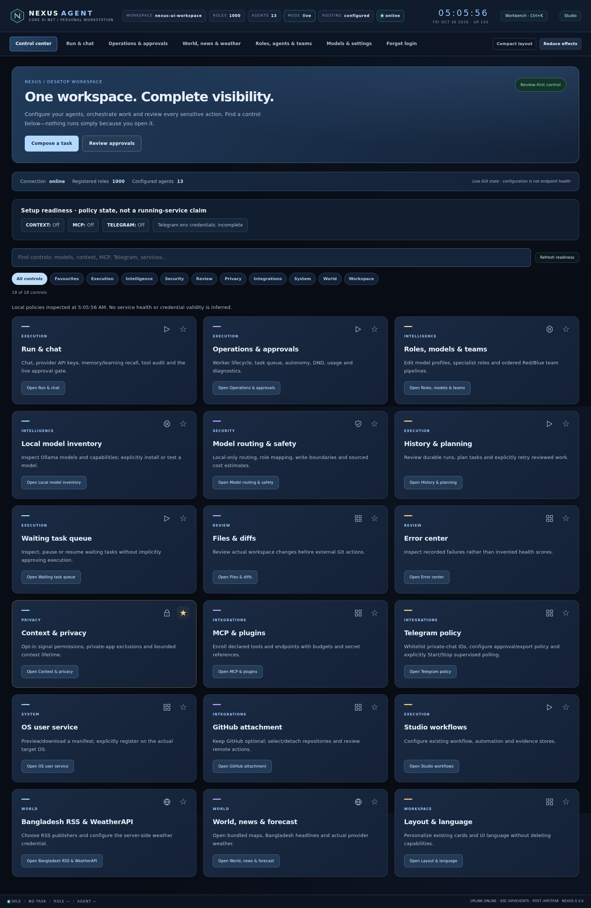

# Modern desktop dashboard

The original `nexus gui` has a shared surface system for Control center, Run & chat, Operations, World, and all native Workbench, repository and Studio dialogs. It preserves the existing controls, endpoints, approvals and workspace configuration. No separate dashboard or mobile feature is introduced.

## Finding and opening controls

- **Category chips** combine with text search and **Favourites**. The result count shows how many of the 18 controls match. Contextual empty states explain how to recover.
- **Clear filters** restores all controls and focuses search.
- **Stars** store predefined control titles in browser-local `nexus.ui.favourites`. Unknown titles are ignored; malformed or blocked storage cannot prevent using controls. Favourites apply across workspaces in that browser, not across devices/accounts.
- **Compose a task** opens the original composer and focuses the existing draft without executing it or clearing it.
- **Review approvals** opens the original approval list without approving an action.

## Appearance and real state

**Compact layout** reduces spacing. **Reduce effects** disables decorative CSS animations and transitions. OS reduced-motion preferences also take precedence. These two settings store booleans locally; no credentials or workspace policies are stored. Forget login keeps these non-secret appearance preferences. Existing globe rendering/interaction controls are separate: reducing CSS effects is not a worker-stop or global GPU-pause operation.

The configuration snapshot mirrors the existing GUI connection status, registered role count and configured agent count using local DOM observations, with no new polling. Counts are not endpoint health, active workers or model availability. Updated values receive a brief visual highlight. All sections share readable cards, focus rings, native settings surfaces, category icons and short entrance transitions. There are no invented metrics or remote font dependencies.

## Validation and screenshots

`tests/browser/appearance.test.mjs` covers combined filters, empty states, favourite persistence, preserving a composer draft, navigation-only quick actions, appearance persistence, reduced motion, layout overflow and malformed/blocked storage. Run it alongside the existing unified, desktop and management regressions against a disposable authenticated workspace:

```sh
cd tests/browser
NEXUS_GUI_TEST_TOKEN="$NEXUS_SERVE_TOKEN" node --test --test-concurrency=1 appearance.test.mjs unified.test.mjs desktop.test.mjs management.test.mjs
```

Actual local-GUI captures, not mockups or live-service verification:



[Run & chat](images/gui-smart-run.png) · [Operations](images/gui-smart-operations.png) · [World](images/gui-smart-world.png) · [Settings](images/gui-smart-settings.png)

Unavailable feeds and credentials remain explicitly unavailable. No model call or real service registration/removal is required by the visual tests.

Restoration validation: **11 browser regressions passed** (appearance/discovery, unavailable/malformed storage, unified navigation and identity, World scrolling/WebGL, original desktop service controls and native role/team editing); **75 GUI/session/server Python tests passed**. Ruff, JS syntax, diff checks and wheel build/asset inspection passed. These are real-server UI tests with a disposable workspace; they do not claim live provider credentials or physical Windows service validation.
