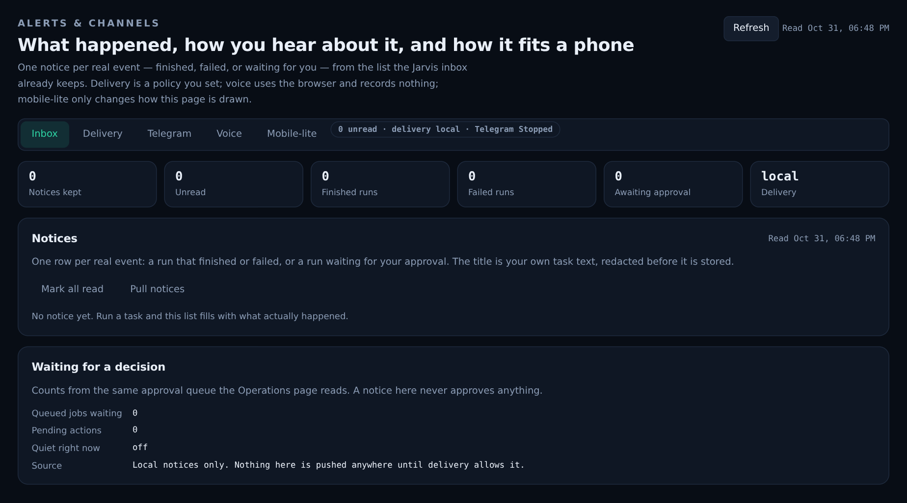
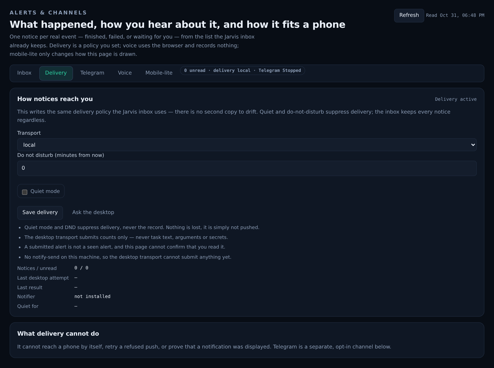
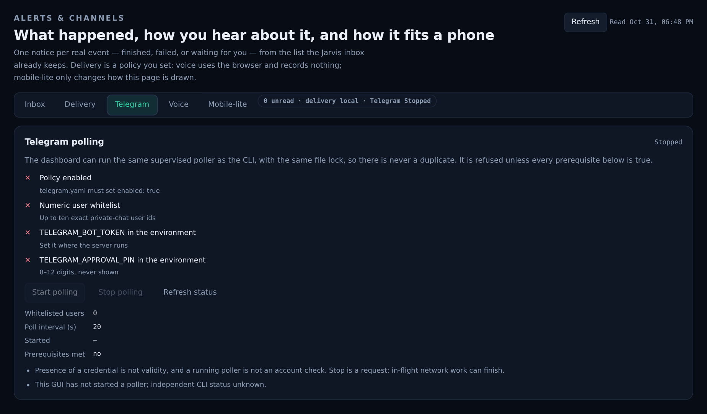
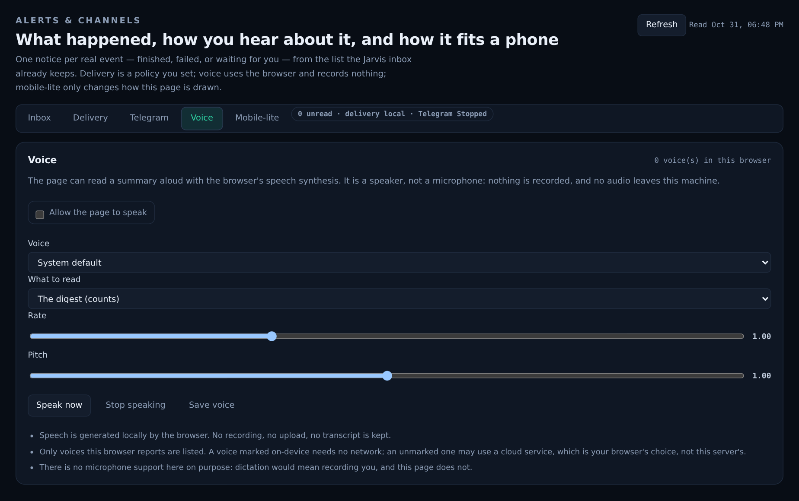
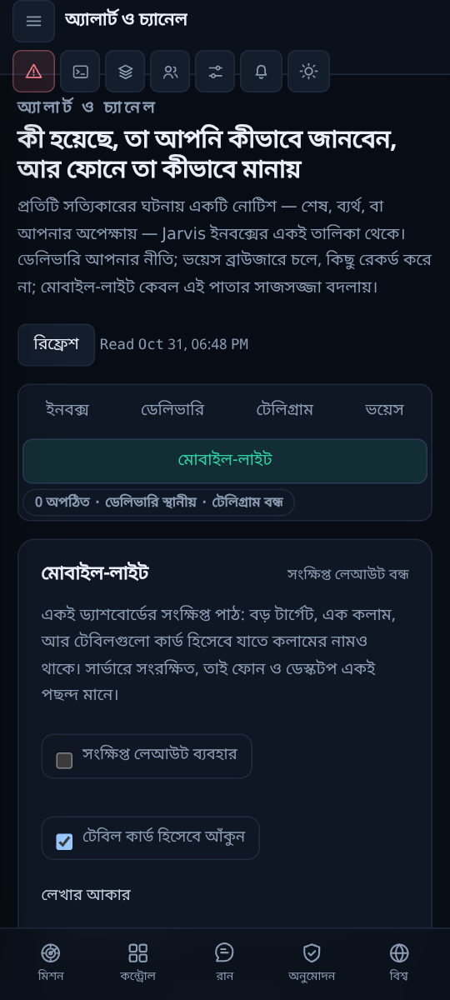
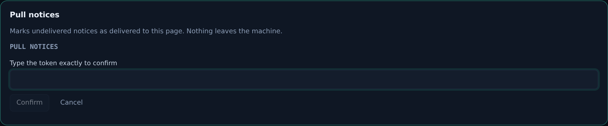

# Alerts & channels — what happened, how you hear it, and how it fits a phone

Prompt 11 of the dashboard build. Every run already writes a trace, and the
Jarvis inbox already keeps a notice per result; what was missing was one page
that showed *what happened*, *how you are told*, and *what this dashboard looks
like on a phone* — without inventing a second copy of any of it. This page is an
aggregation, not a new subsystem: notices come from the same `jarvis-notice`
rows the Jarvis inbox reads, delivery writes the same `jarvis-delivery` policy
that the queue obeys, and Telegram reuses the poller the desktop pane and the
CLI already supervise.

Code: `nexus/channels.py` (all of it), `nexus/server.py` (`/api/channels/*`,
`_notice()`), `nexus/panel/channels.js`, the mobile-lite layer in
`nexus/panel/shell.js` + `shell.css`, `nexus/jarvis/notifications.py`
(`native_available()`), `tests/test_channels.py` (24 tests),
`tests/browser/channels.test.mjs` (5 tests).



## Rules that shape the page

1. **A notice is written only by a real event.** `_notice()` runs inside the
   server's run loop: `done`, `error`, and `awaiting_approval` each append one
   row. Nothing on this page can create a notice — there is no "demo notice",
   no seeded row, and no back-filling from history. An empty inbox says so.
2. **It is the Jarvis list, not a copy.** Rows live in the `studio` table under
   kind `jarvis-notice`, the same store `Inbox.items()` reads, so the bell, the
   CLI and this page can never disagree.
3. **Redacted before it is stored.** The title is your own task text; it and the
   detail go through `studio.redact_text()` first (`sk-ant-…` in the test), and
   both are truncated (200 / 300 characters).
4. **A failed alert never fails a run.** `record()` swallows every exception and
   returns `None`; losing a notice is bad, killing a task because a table was
   locked is worse (`test_a_failed_alert_never_fails_the_run`).
5. **Quiet keeps the record.** Quiet mode and DND suppress *delivery*; the inbox
   keeps every notice (`test_a_quiet_pull_keeps_the_notices`).
6. **Voice is a speaker, never a microphone.** The browser's own
   `speechSynthesis` does the talking. No `SpeechRecognition`, no recording, no
   upload, no transcript kept.
7. **Mobile-lite is display only.** It changes spacing, touch targets and how
   tables are drawn. The same data, the same permissions, the same approvals.
8. **Every consequential write has its own typed token**, printed in the sheet
   and required exactly: `SAVE ALERT POLICY`, `PULL NOTICES`, `SEND OS ALERT`,
   `START TELEGRAM POLLING`, `STOP TELEGRAM POLLING`.

## What is stored, and where

```
<workspace>/.nexus/channels/policy.json   # 0600, atomic replace, sha256[:12] revision
studio table, kind "jarvis-notice"        # the notices themselves (max 500)
studio table, kind "jarvis-delivery"      # the authoritative Jarvis delivery policy
```

```json
{
  "schema": 1,
  "voice":  {"enabled": false, "voice": "", "rate": 1.0, "pitch": 1.0, "read": "digest"},
  "mobile": {"lite": false, "cards": true, "font_scale": 1.0}
}
```

Reading the preferences never creates the file (`test_reading_never_creates_a_store`).
Saving requires the `revision` the page read, so a change made in another tab is
refused rather than overwritten. `rate` is 0.5–2.0, `pitch` 0–2.0, `font_scale`
0.85–1.3, `read` is one of `digest | latest | notice`; unknown keys — at the top
level or inside either section — are refused by name.

The notice store is capped at 500 rows: the oldest is deleted when a new one
would cross the line (`test_the_store_keeps_at_most_its_limit`). The page shows
the newest 60 of at most 200 returned by the API.

## Delivery



The three transports are the Jarvis ones, unchanged: `off`, `local`, `native`.
`native` means the OS notifier — `notify-send` on Linux, `osascript` on macOS,
`powershell.exe` on Windows. This machine has **no `notify-send`**, and the page
says exactly that ("No notify-send on this machine, so the desktop transport
cannot submit anything yet") instead of implying an alert was delivered. A
refused submission is reported, never retried:

- the desktop transport submits **counts only** — never task text, arguments or
  secrets;
- a submitted alert is not a seen alert, and this page cannot prove you read it;
- `push` refuses unless the transport is `native` and the server is live.

`pull` marks undelivered, unread notices as delivered to this page. It never
leaves the machine and it cannot delete anything.

## Telegram



The dashboard starts and stops the same supervised poller as the CLI, under the
same file lock, so two pollers can never run at once. It refuses unless every
prerequisite really is true, and it lists all four either way:

| Check | Why it can fail |
| --- | --- |
| `policy` | `telegram.yaml` must set `enabled: true` |
| `whitelist` | numeric private-chat user ids must be present |
| `token` | `TELEGRAM_BOT_TOKEN` must be in the server's environment |
| `pin` | `TELEGRAM_APPROVAL_PIN` must be set (8–12 digits, never shown) |

Presence of a credential is not validity, and a running poller is not an account
check — both sentences are on the page. `Stop` is a *request*: in-flight network
work can finish. Start/stop are delegated to `gui_desktop.action()`, which owns
the revision check and refuses in demo mode; the typed token is verified here
first so the user is told *which* token to type rather than a generic refusal.

## Voice



Three read modes — the digest (counts), the latest notice, or one notice when
you press it — with a voice, rate and pitch remembered on the server. The page
lists only the voices the browser reports (a voice marked on-device needs no
network; an unmarked one may use a cloud service, which is the browser's choice,
not this server's). Without `speechSynthesis` the page still works and says the
spoken summary is unavailable.

## Mobile-lite



A server-saved display preference, applied by `shell.js` as
`body.mobile-lite` (+ `body.mobile-lite-cards`), scaled by one CSS variable
(`--mobile-scale`):

- every KPI strip collapses to one column, cards get roomier padding, buttons
  and tabs get a 40 px minimum target;
- with *cards* on, each table row becomes a card and every cell is labelled with
  its column name (copied from the `<thead>`), so nothing is hidden — only
  rearranged;
- a `MutationObserver` re-labels tables as pages repaint, and it only runs while
  mobile-lite is on.

Turning it off restores the full layout immediately; nothing is lost.

## The typed token



The sheet opens under the tabs, prints the exact token, and keeps Confirm
disabled until the text matches. Closing it writes nothing.

## Endpoints

| Method | Path | Purpose |
| --- | --- | --- |
| GET | `/api/channels/overview` | inbox, delivery, Telegram, preferences, tokens, limits |
| GET | `/api/channels/inbox?limit=` | notices newest-first, digest, pending counts |
| GET | `/api/channels/delivery` | transport, quiet, DND remaining, native program, revision |
| GET | `/api/channels/telegram` | runtime phase, policy, credentials present, four checks |
| GET | `/api/channels/policy` | voice/mobile preferences, revision, file |
| POST | `/api/channels/policy/save` | validated write (`revision`) |
| POST | `/api/channels/delivery/save` | `SAVE ALERT POLICY` + `revision` |
| POST | `/api/channels/notify` | `PULL NOTICES` |
| POST | `/api/channels/push` | `SEND OS ALERT` (native + live only) |
| POST | `/api/channels/ack` | mark notice ids read |
| POST | `/api/channels/telegram` | `START`/`STOP TELEGRAM POLLING` + `revision` |

Every route is behind the serve token or a GUI cookie, a per-client limiter
(`channels:` reads, `channels-write:` writes), JSON-only POST bodies and an
origin check. Reads are sampled into the audit chain (`channels.overview`,
`channels.inbox`, … every 120 s per action). Errors are `400 invalid_request`
(a refusal always names the token or the field), `401` without a session, `404`
for an unknown sub-path, `429 rate_limited` with a retry hint, and `503
store_unavailable` when a local store cannot be read — never a stack trace and
never private config.

## Manual test

1. Sign in, open **Alerts & channels** in the sidebar.
2. The header stamp shows when the page last read the server; the chip shows
   unread, transport and poller phase.
3. Run a task that finishes (or one that stops for approval). The inbox gains one
   row with your task text, a state chip and a timestamp; the KPI strip moves.
4. **Mark read** on the row, or **Mark all read**. The unread count drops.
5. **Pull notices** → type `PULL NOTICES` → Confirm. Nothing leaves the machine.
6. **Delivery**: change transport, set DND to 30, **Save delivery**, type
   `SAVE ALERT POLICY`. Reload: the values are still there and the stamp says
   *Suppressed · 30m left*.
7. **Telegram**: the four checks show what this machine really has. Start is
   disabled unless all four are true; Stop is disabled while stopped.
8. **Voice**: tick *Allow the page to speak*, **Save voice**, **Speak now**. If
   the browser has no voice, the card says so instead of going silent.
9. **Mobile-lite**: tick *Use the compact layout* and *Draw tables as cards*,
   **Save layout**. Narrow the window to 360 px: one column, no sideways scroll.
   Open another page (Cost, Memory) — its tables are cards with column names.
10. Switch to বাংলা at 360 px: every tab is still reachable and nothing
    overflows. Turn mobile-lite off and the full layout returns.

## What this page cannot do

- It cannot reach a phone by itself, retry a refused OS push, or prove that a
  notification was displayed. Telegram is the separate, opt-in channel for that.
- It cannot record, transcribe or listen: there is no microphone support here on
  purpose.
- It cannot approve anything. The "Waiting for a decision" card reports counts
  from the same queue the Operations page reads; a notice never approves a job.
- It cannot deliver while quiet or inside DND — by design, and the inbox keeps
  the record either way.
