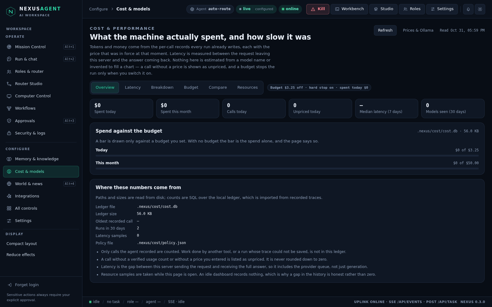
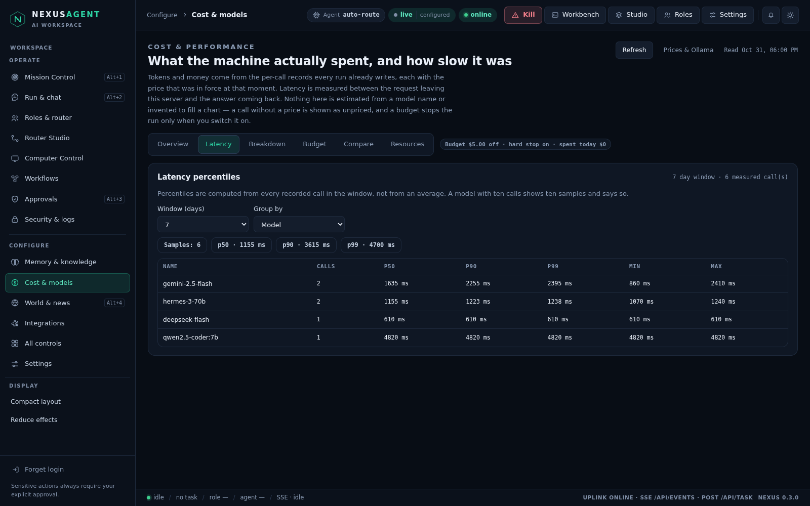
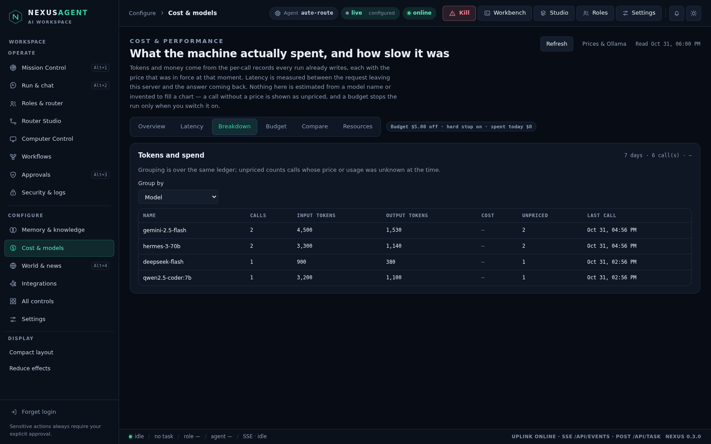
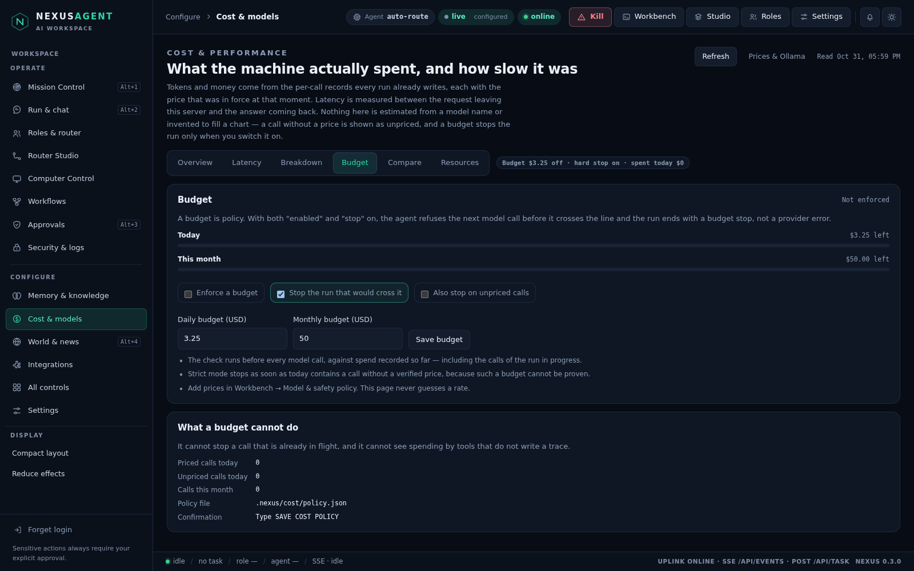
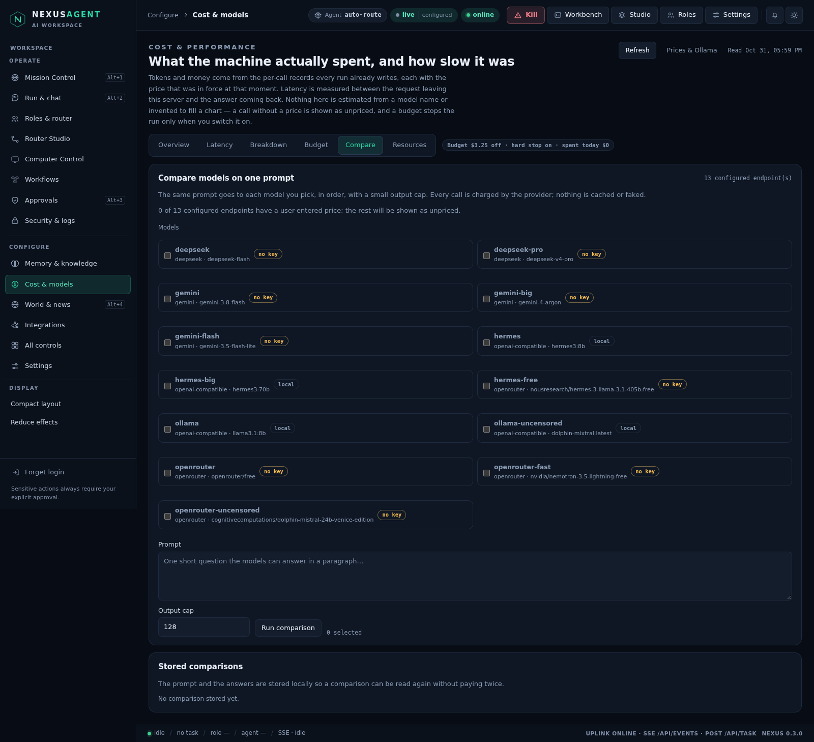
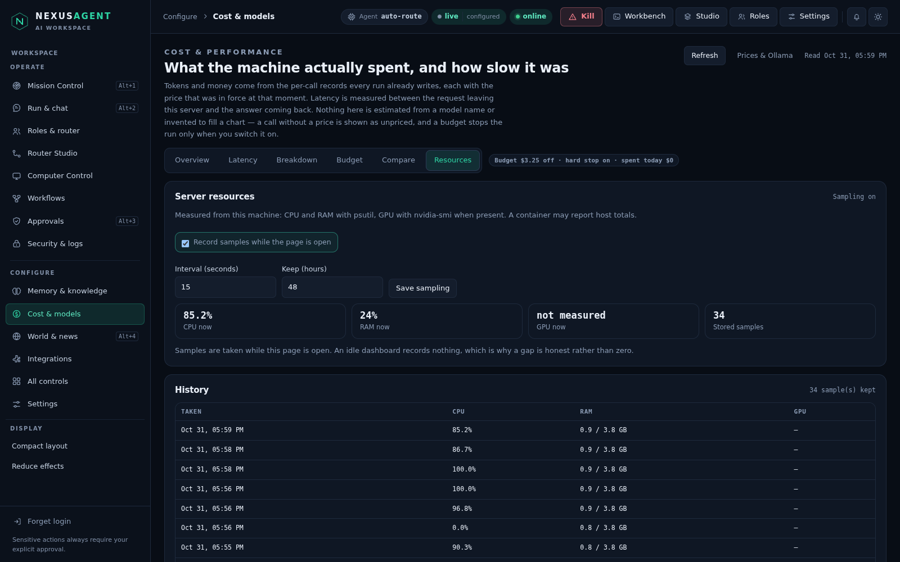
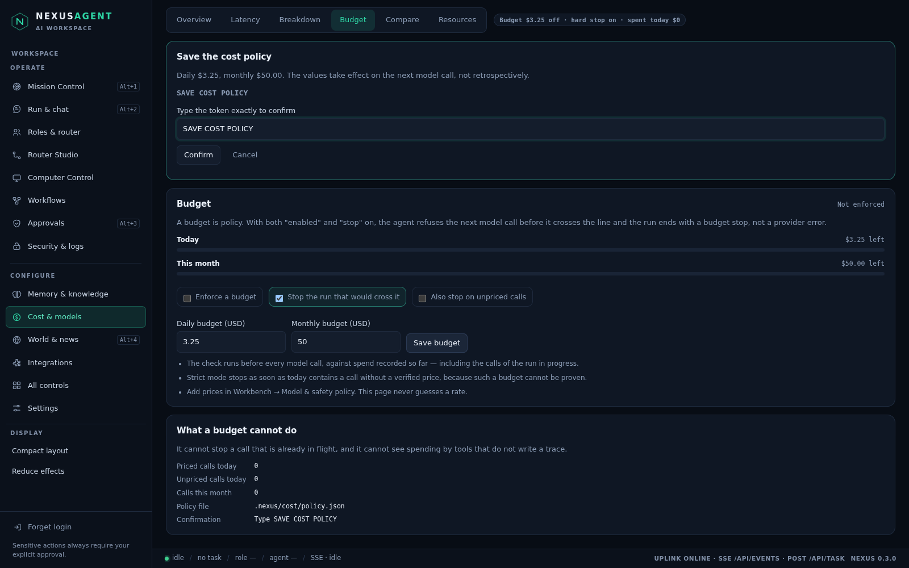
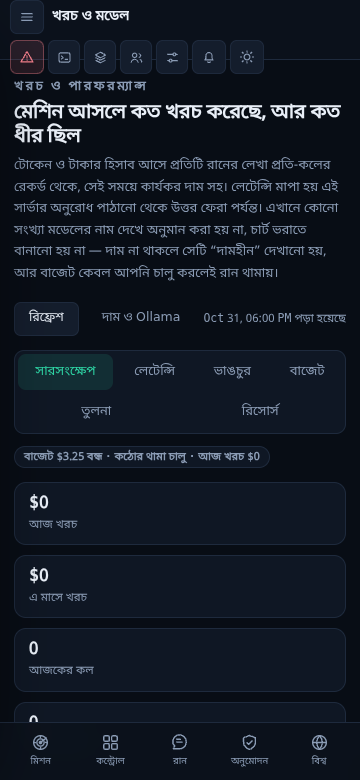

# Cost & models — what was really spent, and how slow it really was

Prompt 10 of the dashboard build. The dashboard could already *set* a model and
*name* a price, but nowhere could you see what a week of runs had actually cost,
how long a model really took to answer, or stop a runaway run before it went
over a line you drew. This page is that ledger: it imports the per-call records
every run already writes, measures latency between the request leaving this
server and the answer coming back, samples the machine it runs on, and turns a
budget into something that can stop a run.

Code: `nexus/costcenter.py` (all of it), `nexus/server.py` (`/api/cost/*`),
`nexus/panel/cost.js` + `shell.css`, `tests/test_costcenter.py` (33 tests),
`tests/browser/cost.test.mjs` (6 tests), plus the budget check in
`nexus/agent.py`.



## Rules that shape the page

1. **Only observed values.** Spend, tokens and latency come from
   `session_observations` — the same traces the Sessions page reads. A call that
   carries no verified usage, or a model with no price you entered, is listed as
   **unpriced** and counted; it is never rounded down to free. A breakdown where
   every call is unpriced shows `–`, not `$0`.
2. **Prices are yours, not guessed.** The page reads the rate that was in force
   when the call happened (the trace's `price_snapshot`). It never multiplies a
   model name by a remembered price list, and it ships no price table of its own.
3. **Latency is per call.** It is `model_response.at − model_wire.at` for the
   *same* call in the *same* trace, paired per agent so two calls in one run do
   not borrow each other's timings.
4. **A budget is off until you switch it on**, and it only stops anything when
   both `enabled` and `stop` are true. The check runs before every model call
   against spend recorded so far, including the calls of the run in progress.
5. **Every write has its own typed token.** `SAVE COST POLICY`,
   `START COMPARISON`, `CLEAR COST HISTORY`. The confirm button stays disabled
   until the text matches exactly, and the policy save also carries the
   `revision` it read, so a change from another tab is refused rather than
   overwritten.
6. **Nothing secret leaves.** `/api/cost/providers` reports `key_present` as a
   boolean and never the key, the environment or the endpoint URL.
7. **Demo mode cannot spend.** The page shows no invented numbers in demo mode
   either; `overview.demo` is passed through so a demo run is visible as one.

## The ledger

```
<workspace>/.nexus/cost/cost.db          # SQLite, created by the first import
<workspace>/.nexus/cost/policy.json      # 0600, atomic replace, symlinks refused
```

```
run(id, started, day, role, agent, task, duration_s, ok, imported)
call(id, run_id, seq, at, day, agent, role, model, input_tokens, output_tokens,
     cost_usd, priced, latency_ms, ok)         UNIQUE(run_id, seq)
resource(at, cpu, ram_used, ram_total, gpu_util, gpu_mem_used, gpu_mem_total)
compare(id, created, prompt, models, status, body)
setting(key, value)                            # last_sync, cleared_at
```

`sync()` reads the traces the workspace recorded in the last 365 days (at most
1000 bodies), imports each run **once** by trace id, and is throttled to one
pass every 3 seconds. Re-reading the same trace changes nothing
(`test_reimporting_the_same_trace_changes_nothing`). A run is kept even when it
recorded no model call, so "runs" and "calls" are two different, honest numbers.

The ledger is a cache of facts that live in the traces: clearing it removes the
imported rows, the samples and the comparisons, and records `cleared_at` so the
next cheap sync does not silently re-import what you just removed. The traces
themselves are untouched and still readable in Sessions.

## The policy

```
{
  "schema": 1,
  "budget": {
    "enabled": false,             # a budget nobody asked for must not stop work
    "daily_usd": 5.0,
    "monthly_usd": 50.0,
    "stop": true,                 # a budget that cannot stop is decoration
    "unknown_price_blocks": false # strict mode: unpriced calls also stop the run
  },
  "resources": { "enabled": true, "interval_s": 15, "keep_hours": 48 }
}
```

Validated on save: numbers must be finite and non-negative, the daily budget may
not exceed the monthly one, nothing above $1,000,000 (a typo), the sampling
interval is 5–300 s and the retention 1–720 h. Unknown keys — at the top level or
inside either section — are refused by name instead of being silently dropped.
Deleting the file restores these defaults.

## The budget stop

`nexus/agent.py` calls `costcenter.enforce(ws)` immediately before
`providers.call_with_fallback`. When a limit is reached it raises
`BudgetExceeded`, which the run loop turns into `stopped_reason =
"budget stop: <message>"` — not a provider error, and not a silent retry with the
next model in the fallback ladder.

```
BudgetExceeded: daily budget of $0.50 reached ($0.9000 spent today)
BudgetExceeded: monthly budget of $50.00 reached ($51.2000 this month)
BudgetExceeded: 2 call(s) today have no verified price; an unpriced budget
                 cannot be verified
```

There are no reservations and no estimated spend: the gate reads what the ledger
already recorded. A call that is already in flight cannot be recalled, and work
done by a tool that writes no trace cannot be seen — both are stated on the page
rather than papered over.

## Screens

Six tabs, one screen each, all reading the same ledger:

| Tab | What it shows |
| --- | --- |
| Overview | six KPIs, spend against budget, where the numbers come from, the store file |
| Latency | p50/p90/p99 with sample counts, grouped by model, agent or role |
| Breakdown | calls, input/output tokens, cost and unpriced counts by model, agent, role or day |
| Budget | the policy, the two budget bars, the typed save |
| Compare | the configured endpoints, a prompt, an output cap and the stored results |
| Resources | CPU / RAM / GPU now, the sampling policy, the stored history |



Percentiles are interpolated from the real samples in the window — a model with
one call shows one sample and says so. The screenshot above comes from a scratch
workspace seeded with three traces through `SessionStore` (six calls, 610–4820
ms) so the table is not empty; no model was called and **no price was invented**,
which is why every call is `unpriced`. The repository's own workspace has no
recorded model call yet, so its tables are empty and say so.



## Budget



The bars are drawn against the budget you set; with `enabled` off the page says
`Not enforced` instead of pretending to police anything.

## Compare



The same prompt goes to each model you pick, in order, with a small output cap
(16–512 tokens, 25 s per call). It is a **real, billable** call to every
endpoint, so it opens a confirmation that names the models and the cap before
anything is sent. The warning line counts how many of the endpoints have a price
you entered; the rest will be stored as unpriced. A failing provider is recorded
as a failed row and does not hide the answers that did come back.

Results are stored in `compare.body` and listed under Stored comparisons, so a
comparison can be read again without paying twice.

## Resources



`psutil` for CPU and RAM, `nvidia-smi` when present. Samples are taken **only
while the page is open**, at most once per `interval_s`, and pruned after
`keep_hours`. A gap in the history is a period when nobody was looking, which is
why it is not drawn as zero.

## The typed token



The sheet opens under the tabs, prints the exact token, and keeps Confirm
disabled until the text matches. Closing it writes nothing — the browser suite
asserts exactly that (`cancelling saves nothing`).

## Endpoints

| Method | Path | Purpose |
| --- | --- | --- |
| GET | `/api/cost/overview` | KPIs, budget state, store facts, tokens, limits |
| GET | `/api/cost/policy` | the policy, its revision and file |
| GET | `/api/cost/report?days=` | every table the page needs, in one round trip |
| GET | `/api/cost/latency?days&group` | percentiles by model, agent or role |
| GET | `/api/cost/breakdown?days&group` | calls, tokens, cost, unpriced by group |
| GET | `/api/cost/budget` | today/month spend, remaining, enforced or not |
| GET | `/api/cost/providers` | configured endpoints, key presence, priced or not |
| GET | `/api/cost/compare?id=` | one comparison job: running, done or failed |
| GET | `/api/cost/comparisons?limit` | stored comparisons |
| GET | `/api/cost/resources` | sample now (rate-limited) plus the history |
| POST | `/api/cost/policy/save` | validated write (`revision` + `SAVE COST POLICY`) |
| POST | `/api/cost/compare` | start a comparison (`START COMPARISON`) |
| POST | `/api/cost/clear` | empty the ledger (`CLEAR COST HISTORY`) |

Every route is behind the serve token or a GUI cookie, a per-client limiter
(`cost:` reads, `cost-write:` writes), JSON-only POST bodies with a size cap and
an origin check. Reads are sampled into the audit chain (`cost.overview`,
`cost.report`, … every 120 s per action). A 429 from the limiter is a "retry in
N seconds" and the page waits that second once before showing the error, so a
busy window does not look like a broken page.

Errors are `400 invalid_request`, `409 budget_exceeded` (a comparison refused by
the budget), `429 rate_limited`, `503 store_unavailable`.

## Manual test

```bash
python -m nexus gui --token "choose-a-token" --no-open
# open http://127.0.0.1:8787/dashboard, sign in, Configure → Cost & models
```

1. **Overview** — the store line says there is no ledger yet, and opening the
   page did not create `.nexus/cost/`. Run a task, come back, press Refresh: the
   run and its calls appear, with `Unpriced` counting anything without a rate.
2. **Latency** — switch the window to 1 day and the group to Agent; the sample
   count matches the number of calls in the breakdown.
3. **Breakdown** — group by Day: the rows are the real days, and a window with
   only unpriced calls shows `–` under Cost.
4. **Budget** — set a daily budget of `0.01`, tick "Enforce" and "Stop the run
   that would cross it", save with the typed token, then run any task: it ends
   with `budget stop: daily budget of $0.01 reached` and no model call is made.
   Untick "Enforce" and the same task runs normally.
5. **Compare** — pick two endpoints, write a one-line prompt, press Run
   comparison: the sheet names both models and the output cap before anything is
   sent. Confirm only if you mean to pay for it.
6. **Resources** — the cards show this machine, the history fills while the page
   is open, and turning sampling off stops new rows appearing.
7. **bn/en and 360 px** — switch language in Settings: every label, chip, note
   and tab follows. Narrow to 360 px: tabs wrap onto two rows, cards stack, no
   horizontal scrolling.



## Tests

```
.venv/bin/python -m pytest tests/test_costcenter.py -q   # 33 passed
cd tests/browser && node --test cost.test.mjs            # 6 passed
```

Unit tests cover: the defaults and "reading creates nothing", the token and
revision rules, every validation message (including unknown keys and a daily
budget above the monthly one), an unreadable policy file, importing a recorded
run, idempotent re-import, a run with no calls, latency being the call and not
the run, percentile interpolation, window bounds, grouping by model/agent/role/
day, the one-call report, the budget gate (off, on, not-stopping, monthly,
strict-unpriced), the agent stopping with a budget reason and making no model
call, the provider list never carrying a key, comparison validation, a real
scripted comparison with a failing provider, the comparison being refused by the
budget, resource sampling and its interval, sampling switched off, clearing with
and without its token (and not resurrecting on the next sync), and the HTTP
surface (401, 404, 400, 409, 429, clamped limits).

The browser suite drives the real page: KPIs against the API, all six tabs, a
budget saved through the typed token with a cancelled attempt in between, a
comparison confirmation that is opened and cancelled (it never spends), the
resource cards against a real sample, a Bengali pass and 360 px with a zero page
error count. It restores the budget it found, so a test run leaves no limit
behind.

## Known limits

- **Only traced calls are counted.** Work done by another tool, or a run whose
  trace could not be saved, is invisible here. The ledger is a mirror of the
  traces, not of the provider's invoice.
- **Prices come from you.** Nothing is bundled and nothing is fetched: a model
  with no rate stays unpriced forever, and the budget cannot include it unless
  strict mode is on.
- **Latency includes the queue.** It measures wire-to-response on this machine,
  so it contains the provider's queueing time as well as generation, and it is
  not comparable across different networks.
- **Resources are the host's.** In a container, `psutil` may report host totals,
  and GPU numbers exist only when `nvidia-smi` does.
- **The budget is a gate, not an accountant.** It checks before each call and
  cannot recall a call already sent; two runs crossing the line at the same
  moment can both be admitted.
- **Comparison is sequential and capped.** 2–4 models, one prompt, 512 output
  tokens each, 25 s per call. It is not a benchmark suite and the results are
  anecdotal, not statistically meaningful.
- **Samples stop with the page.** Nothing samples in the background, so a
  dashboard that is closed leaves a gap — on purpose.
