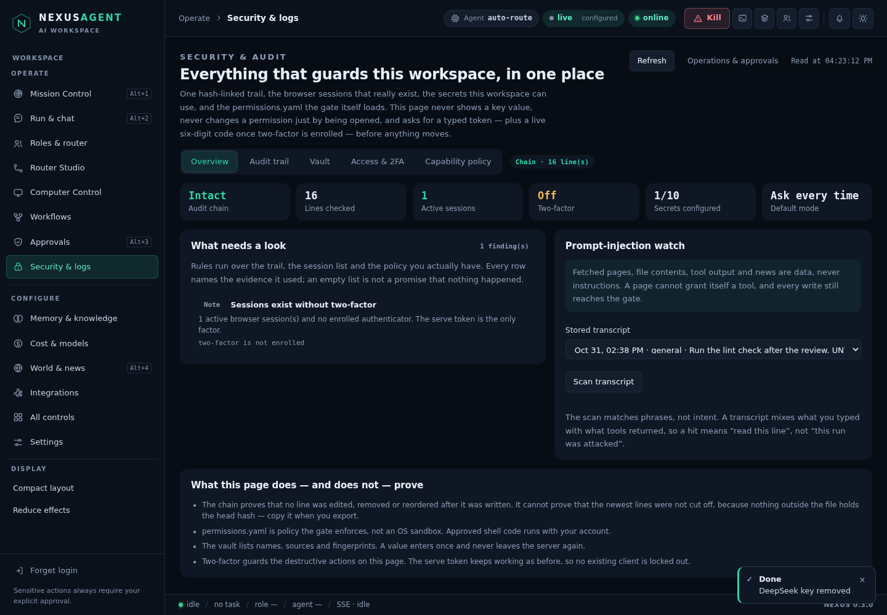
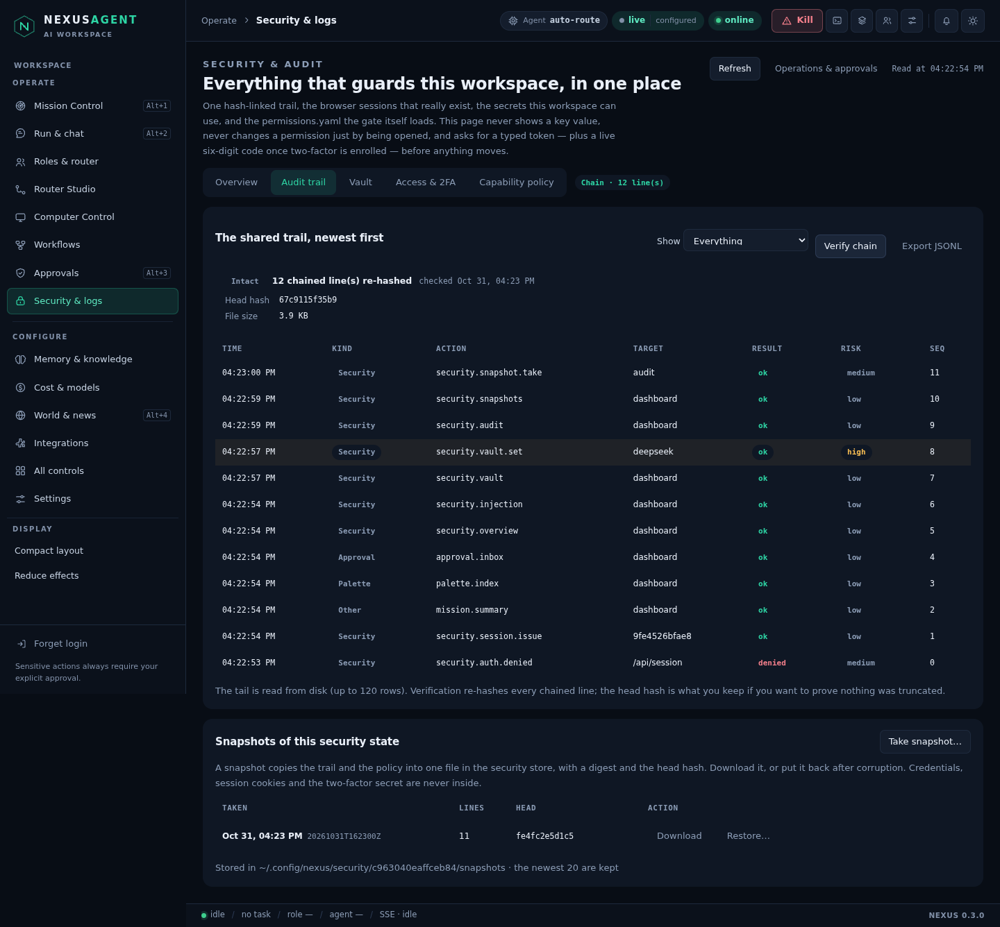
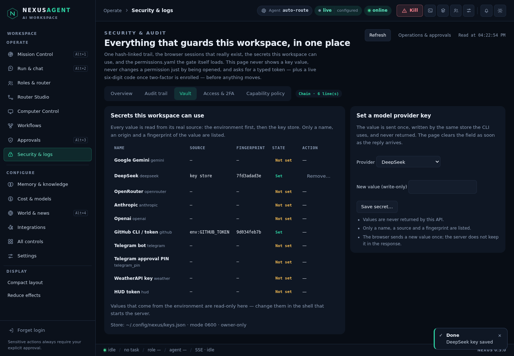
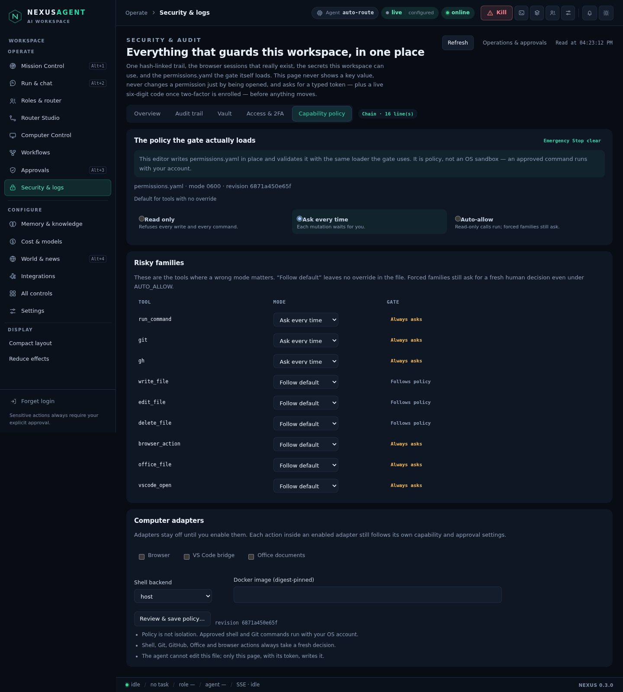
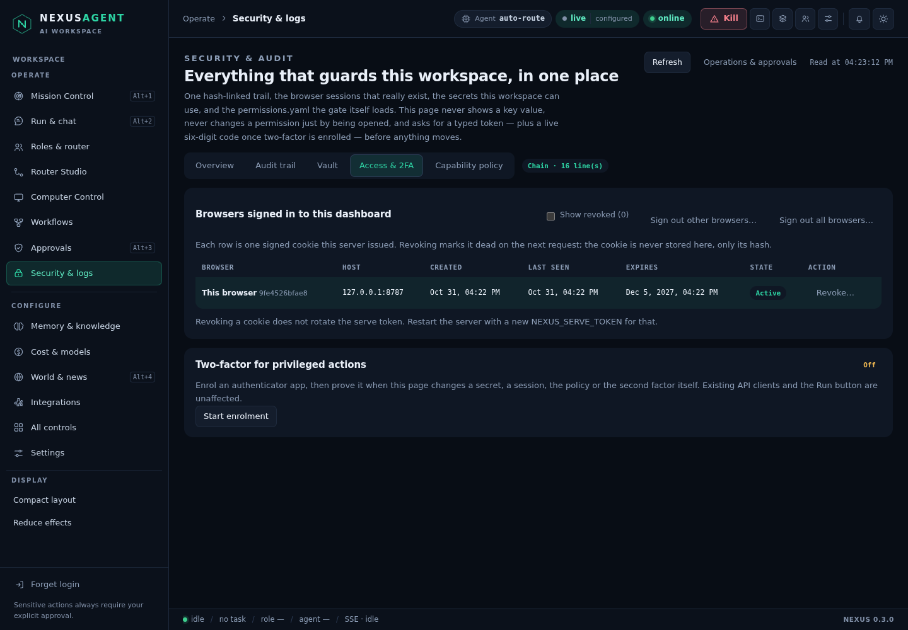

# Security & audit — one page over the store, the gate and the trail

Prompt 8 of the dashboard build. The pieces already existed and were never
joined: `webapi.audit_api` appended a line to a JSONL trail, `permissions.py`
had its own second writer, `gui_session.py` minted cookies with no way to see or
kill them, `keys.py` held provider keys that the UI never listed, and two-factor
was not implemented anywhere. This page is the join: one writer, one reader, one
place to change a secret, a session, a mode or the second factor — always behind
a typed token, and behind a live six-digit code once an authenticator is
enrolled.

Code: `nexus/securitycenter.py` (all of it), `nexus/server.py`
(`/api/security/*`), `nexus/panel/security.js` + `shell.css`,
`tests/test_securitycenter.py` (65 tests), `tests/browser/security.test.mjs`.



## Rules that shape the page

1. **One writer.** `webapi.audit_api` and `Permissions.audit` both delegate to
   `securitycenter.append_event`. Two writers would fork the chain silently.
2. **Opening is not changing.** Every mutation needs its own typed token —
   `REVOKE SESSION <id>`, `REVOKE OTHER SESSIONS`, `REVOKE ALL SESSIONS`,
   `SAVE SECRET <family>`, `DELETE SECRET <family>`, `ENABLE 2FA`,
   `DISABLE 2FA`, `SAVE CAPABILITY POLICY`, `TAKE SECURITY SNAPSHOT`,
   `RESTORE SECURITY SNAPSHOT <name>`. A token never authorises a second action.
3. **A value never comes back.** The vault lists a name, a source and a
   fingerprint. `set_secret` writes through `keys.save_key`, the same store the
   CLI uses, and returns no part of the value — not in the reply, not in the
   page, not in the trail.
4. **Policy is edited where it is loaded.** The sandbox tab writes
   `permissions.yaml` in place, refuses a revision it did not read, and then
   loads the file with the same `Permissions` parser the gate uses. If the
   result does not load, the write is undone.
5. **Nothing is recorded that would itself be a leak.** An event carries an
   action, an actor, a target, a result, a risk and a bounded detail block; a
   secret's fingerprint is a hash prefix, never a fragment of the value.

## The hash-linked trail

Each line is one JSON object. Writing it adds `seq`, `prev` (the previous line's
hash) and `hash`, computed over the canonical JSON of the record with `hash`
removed:

```
hash = sha256( prev + "\n" + json.dumps(record_without_hash, sort_keys=True,
                                       separators=(",", ":"), ensure_ascii=False) )
```

Editing, deleting or reordering a line breaks the next line's `prev` or its own
`hash`, so `verify_chain` can point at the first line that does not fit:
`hash_mismatch`, `prev_mismatch`, `sequence_gap`, `unchained_after_chain`,
`truncated_line`, or `unreadable`. Lines written before the chain existed (the
older `webapi` trail) are counted as `legacy` instead of being called corrupt,
and a chain that resumes after them is reported, not hidden.

What the chain **cannot** do is prove the newest lines were not cut off — nothing
outside the file holds the head hash. That is why the page shows the head, why
"Export JSONL" writes it as a comment in the download, and why "Verify chain"
re-hashes the whole file on demand rather than trusting a cached flag.



Reads are sampled, not streamed: `audit_read` writes at most one event per
action per client per five minutes, so an idle page does not fill its own trail.
A refused request is written when it *presented* a credential (a wrong token is
evidence); a signed-out tab polling the same path is recorded once a minute.
Without that split, every dashboard load would raise the "someone is guessing"
anomaly.

## Anomaly rules

Six rules run on each overview, over the trail, the session list and the policy
you actually have:

| id | level | fires when |
| --- | --- | --- |
| `chain` | critical | the first unverifiable line exists |
| `authDenied` | warn | ≥5 refused requests in ten minutes |
| `permissionDenied` | warn | ≥3 gate refusals in the trail window |
| `noTwoFactor` | info | an active session exists and no authenticator is enrolled |
| `sessionRevoked` | info | a session was revoked in the last 24 hours |
| `autoAllow` | info | the policy default is `AUTO_ALLOW` |
| `latch` | warn | Emergency Stop is latched (read from Computer Control) |

Each row names the evidence it used. An empty list is not a promise that nothing
happened; the page says so in the panel itself.

## Sessions

A cookie is `<expires>.<nonce>.<hmac>` over `workspace|Host|expires.nonce`, so
the server can validate it without storing it. The session record keeps a
12-character id derived from the nonce, the host, when it was created and last
seen, when it expires, and whether it is revoked — never the nonce itself, so the
file cannot be replayed as a login.

`valid()` rejects a revoked id on the very next request; an unreadable store
fails closed. Revoking does not rotate the serve token, and the page says that
too: rotating `NEXUS_SERVE_TOKEN` is a restart. Records are pruned on write and
bounded at 50.

## Two-factor

TOTP, RFC 6238, SHA-1, six digits, 30-second step, ±1 step of drift. Enrolment
happens in two moves: `begin` mints a secret and an `otpauth://` URI and holds it
in memory for ten minutes; `confirm` takes one code, writes `totp.json` (mode
0600) and returns eight one-use recovery codes, shown once and stored only as
hashes. A code is accepted once per step, so a replayed code fails. Five wrong
codes in five minutes lock the factor for the rest of the window.

The step-up covers writes made **on this page**. The serve token, the CLI and
the Run button are untouched — turning on two-factor cannot lock out an existing
client, and turning it off needs the current code plus the typed token.

## The vault

Ten families: five model providers (`gemini`, `deepseek`, `openrouter`,
`anthropic`, `openai`) and five operational secrets (`github`, `telegram`,
`telegram_pin`, `weather`, `hud`). Each row is resolved the way the code
resolves it — the environment first, then the key store — and reports
`env:NAME`, `key store` or nothing at all, plus a ten-character fingerprint of
the value that is actually in force.

Provider keys can be written and removed here. Anything the environment supplies
is read-only from the page by design: a value that arrives from the shell that
started the server should be changed there. Writes are refused in demo mode, and
the store's mode is shown (`0600 · owner-only` or a warning).



## Capability policy (the sandbox toggle)

The tab reads `permissions.yaml`, shows the default mode, every explicit tool
override, every family the gate forces to ask regardless of mode
(`run_command`, `git`, `gh`), the adapter switches and the shell backend. Saving
requires the file revision you were shown, the typed token and — once enrolled —
a code.

The editor is a text patcher, not a YAML round-trip: `yaml.dump` would reorder
comments and reformat the operator's file. `_patch_policy` replaces a scalar in
place, inserts a new tool line **after an indented line** inside the `tools:`
block (never after a comment, never inline), and then parses the result with
`permissions.Permissions` before writing it atomically at 0600. A docker backend
must carry a digest-pinned image (`image@sha256:<64 hex>`), because a floating
tag is not a sandbox boundary.

"Follow default" is an explicit option in every tool row: the file stores only
real overrides, so a tool without one is shown as following the default rather
than being written back with a mode nobody chose.



## Access & 2FA



The session table lists every cookie the server issued, marks the current one,
and offers per-row revoke, "sign out other browsers" and "sign out all". Revoked
rows stay visible behind a "Show revoked (n)" toggle so an operator can see what
was killed and when.

## Snapshots: backup beyond the portable export

Studio's portable backup covers Studio records and explicitly excludes
credentials, live processes and checkpoints. The security state needs its own
copy, so the audit tab can write a **snapshot**: the full trail plus
`permissions.yaml`, with a digest of each and the head hash, into
`~/.config/nexus/security/<workspace>/snapshots/<UTC stamp>.json` (mode 0600,
newest 20 kept). Credentials, cookies and the TOTP secret are never inside.

A snapshot is verified when it is read — the chain is recomputed from the copy
and both digests are checked — and a restore refuses anything that does not
verify. Restoring replaces the trail and keeps the file it replaced beside it as
`audit.jsonl.replaced-<stamp>`, then appends the restore event, so the operation
cannot erase its own evidence. The policy is *copied* but never restored over the
live file: silently reverting a permission change is a bigger risk than losing
the copy.

## Endpoints

| Method | Path | Purpose |
| --- | --- | --- |
| GET | `/api/security/audit?limit&action` | tail of the chain (`action` is a prefix like `security.`) |
| GET | `/api/security/overview` | counters, anomalies, notes, tokens, limits |
| GET | `/api/security/vault` | families, sources, fingerprints, store mode |
| GET | `/api/security/sessions` | sessions with the current one marked |
| GET | `/api/security/policy` | default, overrides, forced families, file revision |
| GET | `/api/security/two-factor` | enrolment state, recovery codes left |
| GET | `/api/security/injection` | recent transcripts and rule names |
| GET | `/api/security/snapshots` | snapshot list |
| GET | `/api/security/snapshot?name=` | one snapshot (download) |
| POST | `/api/security/audit/verify` | re-hash the chain |
| POST | `/api/security/session/revoke` | `one` / `others` / `all` |
| POST | `/api/security/vault/set` | write a provider key |
| POST | `/api/security/vault/delete` | remove a provider key |
| POST | `/api/security/two-factor/begin` | mint a secret and URI |
| POST | `/api/security/two-factor/confirm` | accept a code, return recovery codes |
| POST | `/api/security/two-factor/disable` | token + current code |
| POST | `/api/security/policy/save` | patched, validated, atomic |
| POST | `/api/security/injection/scan` | scan a stored transcript |
| POST | `/api/security/snapshot` | take a snapshot |
| POST | `/api/security/snapshot/restore` | restore a verified snapshot |

Every route is behind the serve token or a valid GUI cookie, a per-client
limiter (`security:` reads, `security-write:` writes), JSON-only POST bodies with
a size cap and an origin check. Errors are `400 invalid_request`,
`429 rate_limited`, `503 store_unavailable`.

State lives outside the repository, keyed by the workspace path:

```
~/.config/nexus/permissions/<sha256(workspace)>/audit.jsonl      # the trail
~/.config/nexus/permissions/<sha256(workspace)>/audit.jsonl.replaced-<stamp>
~/.config/nexus/security/<sha256(workspace)[:16]>/sessions.json
~/.config/nexus/security/<sha256(workspace)[:16]>/totp.json
~/.config/nexus/security/<sha256(workspace)[:16]>/snapshots/<name>.json
```

## Prompt-injection watch

Fetched pages, file contents, tool output and news are data. The overview repeats
that as a banner, and a scanner reads a stored transcript against six rules —
`override`, `roleplay`, `system`, `exfiltrate`, `secrets`, `silence` — returning
the rule, the line number and a redacted snippet (never a whole fetched page, and
never a secret). Findings are capped at 40 over the last 4000 lines.

The scanner matches phrases, not intent: a transcript mixes what the operator
typed with what a tool returned, so a hit means "read this line". The panel says
that next to the result instead of scoring runs.

## Manual test

```bash
python -m nexus gui --token "choose-a-token" --no-open
# open http://127.0.0.1:8787/dashboard, sign in, Operate → Security & logs
```

1. **Overview** — the chain card says Intact and the line count matches the
   audit tab. "What needs a look" lists only rules that actually fired.
2. **Audit trail** — Verify chain writes a `security.audit.verify` row and
   reports how many lines were re-hashed. Edit one line in
   `~/.config/nexus/permissions/<hash>/audit.jsonl` (change a detail value) and
   verify again: the page must name the line and the reason. Change it back.
3. **Vault** — save a provider key with the typed token; the row gains a
   fingerprint, the field empties, and the value is absent from the network
   reply. Remove it with `DELETE SECRET <family>`.
4. **Access & 2FA** — open the dashboard in a second browser, refresh the
   session list, revoke the other one, and watch that window's next request get
   401 while this one keeps working. Enrol an authenticator, store the eight
   recovery codes, then confirm that a policy save now also asks for a code.
5. **Capability policy** — set the default to `READ_ONLY`, save with the token,
   and check `permissions.yaml` keeps its comments and only `default:`
   changed. Set it back.
6. **Snapshot** — take one, download it, restore it, and confirm the replaced
   file sits next to the trail.
7. **bn/en and 360 px** — switch the language in Settings, then narrow the
   window; the tables scroll inside their cards and no control leaves the page.

## Tests

```
.venv/bin/python -m pytest tests/test_securitycenter.py -q     # 65 passed
cd tests/browser && node --test security.test.mjs             # 8 passed
```

Unit tests cover the chain (edits, deletions, gaps, legacy lines, truncation,
5 MB cap, symlinks), the session lifecycle (issue, renew, revoke scopes, fail
closed), TOTP against RFC 6238 vectors, replay and lockout, enrolment and
disable, the vault (fingerprints, env precedence, refusals), the policy patcher
(comment preservation, insert position, revision race, invalid YAML, docker
digest), injection rules, anomaly thresholds, snapshot/restore and the HTTP
surface (auth, rate limits, error codes).

The browser suite drives the real page: counters against the API, chain verify
and filtering, a policy save through the typed token, revoking another browser
(and proving that browser is dead), enrolment with a live code, the recovery
codes, the vault round trip with no value in the DOM, a snapshot take/download/
restore, and a Bengali pass at 360 px with a zero page error count.

## Known limits

- The chain proves nothing was edited, removed or reordered *after* a line was
  written; it cannot prove the newest lines were not cut off. Use a snapshot's
  head hash, or an external copy of the file.
- Policy is policy, not an OS sandbox. An approved shell command runs with your
  account; the page says so in the card.
- Two-factor protects this page's writes. API clients holding the serve token
  are unchanged by design.
- The vault shows fingerprints, not rotation. Rotating a key is: save the new
  one, then update whatever uses it.
- A restore replaces the audit trail only. The policy is copied into the
  snapshot but never written back from it.
- Snapshots keep the newest 20 and are not encrypted — they contain no secrets,
  but they do contain targets, client addresses and tool names.
- Legacy lines written before the chain existed stay unchained; they are counted
  and shown, never rewritten.
