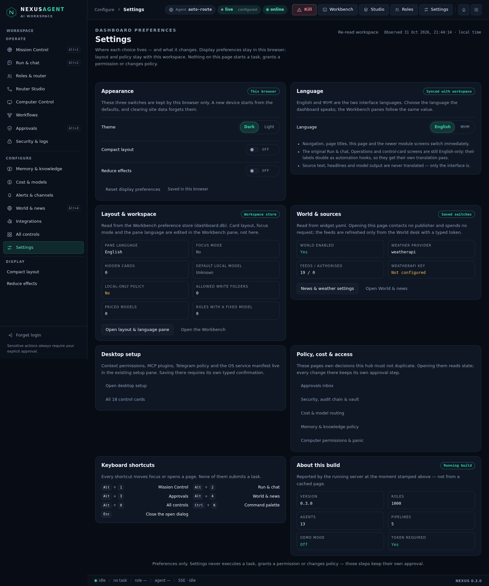
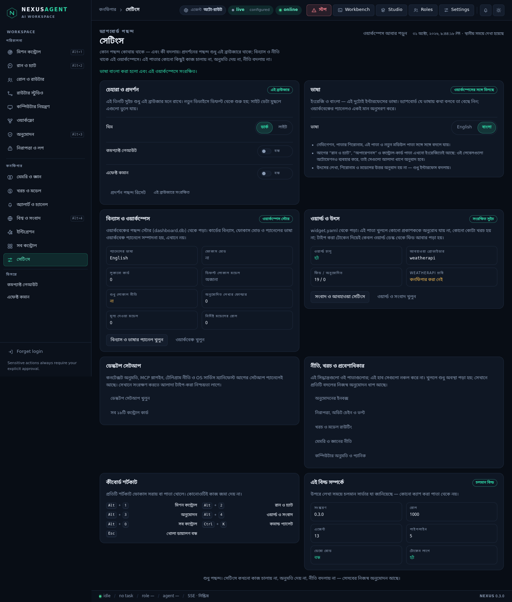
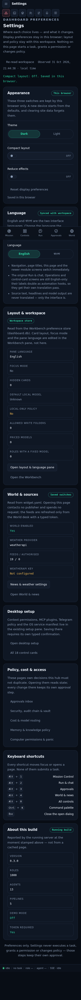

# Settings — where each choice lives, and what it changes

Prompt 13 of the dashboard build, and the last one. Twelve rounds added a
mission control, a run console, approvals, a router studio, computer control,
workflows, security, memory, cost, channels, world and the world desk. Each of
them stores something: a layout here, a language there, a switch in a YAML file
and two toggles in this browser. What was missing was one page that says, in
plain words, **which choice lives where, how old the stored value is, and what
editing it will not do.**

That page is **Settings** — the last row of the sidebar, the gear in the top
bar, `#settings` in the address bar, or `/settings` in the command palette.

Code: `nexus/settingshub.py` (the one read), one route in `nexus/server.py`
(`GET /api/settings/summary`), `nexus/panel/settings.js`,
`nexus/panel/settings.css`, `tests/test_settingshub.py` (12 tests),
`tests/browser/settings.test.mjs` (4 tests).



## The rule this round is built on

**A preference has exactly one owner, and this page asks it.** Nothing here
keeps its own copy of a setting:

| Choice | Owner | Where it is stored |
| --- | --- | --- |
| Theme, compact layout, reduce effects | `window.nexusAppearance` (`shell.js`) | this browser (`localStorage`) |
| Interface language | `window.nexusI18n.setLang` | this browser, mirrored to the workspace |
| Card layout, focus mode, pane language, model policy | the Workbench pane (`POST /api/workbench/settings`) | the workspace (`dashboard.db`) |
| World feeds, weather provider, credential reference | News & weather settings (`widget.yaml`) | the workspace |

Before this round two implementations of "compact layout" existed — the sidebar
button wrote `localStorage` itself and the Settings page would have been a
third. Both now call `window.nexusAppearance`, so pressing either control moves
the other, and the browser suite asserts exactly that
(`appearance and language are edited in one place and all surfaces agree`).

The language switch had the same problem in the other direction: the dashboard
spoke English while the Workbench panes could be saved in Bangla. Choosing a
language now writes both — the browser key and the workspace preference — and
saving the language in the Workbench layout pane tells the dashboard to follow
(`nexus:language-request`). One value, two surfaces, no third copy.

## What the page shows

| Card | What it says |
| --- | --- |
| Appearance | theme, compact layout, reduce effects — each with its real pressed state, plus **Reset display preferences** |
| Language | English / বাংলা, and where the choice is stored once you change it |
| Layout & workspace | the saved pane language, focus mode, hidden cards, default local model, local-only policy, write folders, priced models and fixed-model roles, read from the preference store |
| World & sources | `widget.yaml`: enabled, provider, feed count, whether a weather credential exists — never the credential |
| Desktop setup | opens the existing setup pane (context permissions, MCP, Telegram, OS service) |
| Policy, cost & access | navigation only: approvals, security, cost, memory, computer |
| Keyboard shortcuts | Alt+1…4, Alt+0, Ctrl+K, Esc |
| About this build | version, roles, agents, pipelines, demo mode, whether a token is required |

Every value is stamped with the instant the server reported it — *"Observed 31
Oct 2026, 20:06:13 · local time"* — and each card carries a chip saying where the
value came from: *this browser*, *workspace store*, *saved switches*, *running
build*.



## The one read

`GET /api/settings/summary` is read-only, limited per client
(`settings:<client>`), and sampled into the audit trail at most every two
minutes. It opens no socket, writes no file, and starts nothing. Its shape:

```json
{"schema": 1, "observed_at": 1793477164.7,
 "build": {"version": "0.3.0", "demo": false, "auth_required": true,
           "roles": 1000, "agents": 13, "pipelines": 5},
 "workspace": {"available": true, "language": "en", "local_only": false,
               "focus_mode": false, "hidden_cards": 0, "resized_cards": 0,
               "default_local_model": "", "write_folders": 0,
               "priced_models": 0, "mapped_roles": 0},
 "world": {"available": true, "enabled": true, "provider": "weatherapi",
           "language": "bn", "sources": 19, "authorized_sources": 0,
           "weather_key_present": false},
 "display": {"stored_in": "this browser",
             "keys": ["nexus.ui.theme", "nexus.ui.compact", "nexus.ui.still", "nexus.ui.lang"]},
 "notes": ["read_only", "browser_display_stored_locally", "no_secret_values", "presentation_only"]}
```

Two details are deliberate:

* **The browser's own values are reported as keys, not values.** The server
  cannot read `localStorage`, so it says which keys exist and lets the page read
  them locally. Reporting a theme from the server would be an invention.
* **An unreadable store is reported, not guessed.** A locked `dashboard.db` or a
  broken `widget.yaml` yields `{"available": false, "reason": …}` and the card
  shows *Unknown* — never a plausible zero
  (`test_an_unreadable_preference_store_is_reported_not_faked`,
  `test_broken_world_configuration_is_an_honest_unavailable`).

No credential leaves the server: a configured weather key is reported as
`true`, and `test_no_secret_is_echoed` greps the whole JSON for the marker and
for the workspace path.

## What it refuses to do

Settings is presentation only. Every button opens a pane that already existed —
the layout pane, the desktop setup pane, news & weather settings, World, the
security page — and the browser suite counts runs before and after the whole
tour to prove that nothing was started (`every button opens an existing pane and
nothing else`). Policy, cost and access live on their own pages with their own
confirmations; this hub links to them and changes none of them.

## A phone, and a fresh install

At 360 px the two-column grid becomes one column, the switches become full-width
rows, and nothing overflows (`the hub is readable at 360 px…`, screenshot below).
A blocked or malformed `localStorage` leaves the page working: the display keys
simply start from the defaults, exactly as they did before this round.



## Tests

* `tests/test_settingshub.py` — 12 tests: the snapshot shape, no file writes, no
  secret and no path in the payload, saved preferences reported, unreadable
  store and broken World YAML reported honestly, the route's auth, 404s, and the
  untouched `/api/workbench/settings`.
* `tests/browser/settings.test.mjs` — 4 tests against the real server: the facts
  match `/api/health` at a printed timestamp; appearance and language agree with
  the sidebar and the workspace, and survive a reload; every button opens an
  existing pane with no new run; and 360 px keeps its order without overflow.

## Known limits

* **Bangla coverage is not yet complete.** The shell, the newer module pages
  (Mission, World, Security, Cost, Memory, Channels, Workflows, Approvals) and
  this page switch language; the original **Run & chat**, **Operations** and
  **All controls** screens are still English-only. Their labels double as the
  accessible names that ~30 browser tests pin, so they need their own reviewed
  pass rather than a bulk replacement. The Language card says so on screen
  instead of promising a fully translated dashboard.
* Display preferences are per browser by design. A second device starts from the
  defaults; the page says so instead of pretending to sync them.
* The `nexus.ui.lang` mirror writes the workspace copy only when the page is
  reachable; if the POST fails the status line says *"changed in this browser
  only"* rather than claiming a save.
* The hub reports, it does not edit policy. Editing stays where each decision's
  approval step lives.
