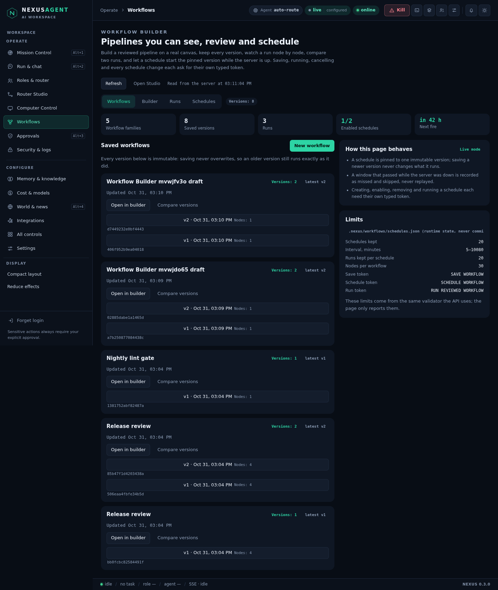
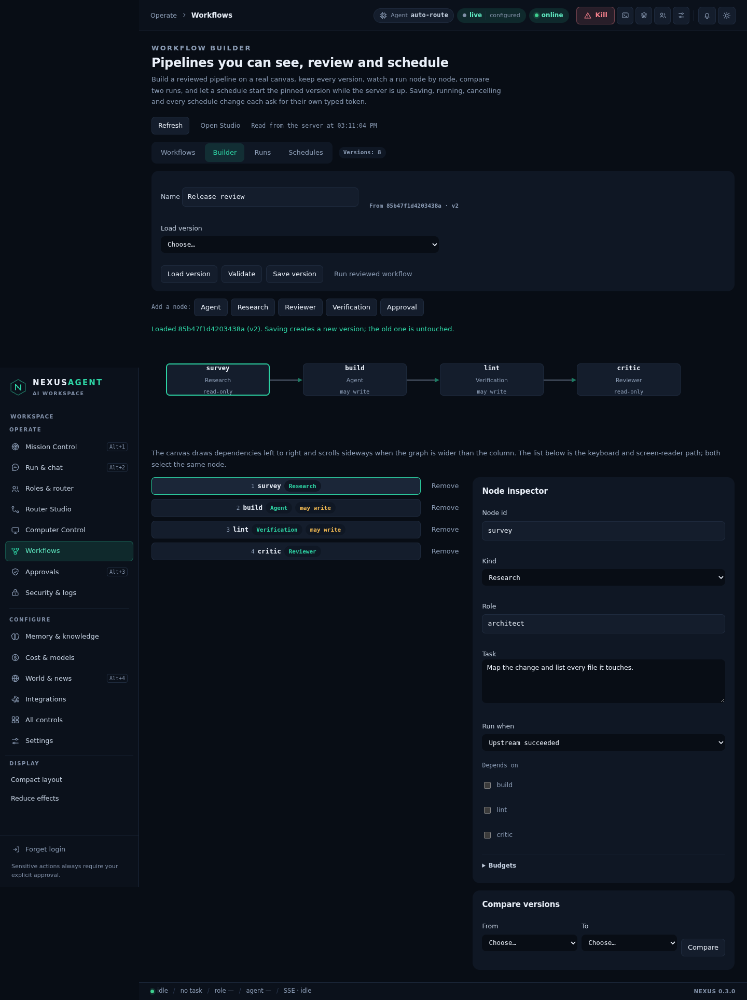
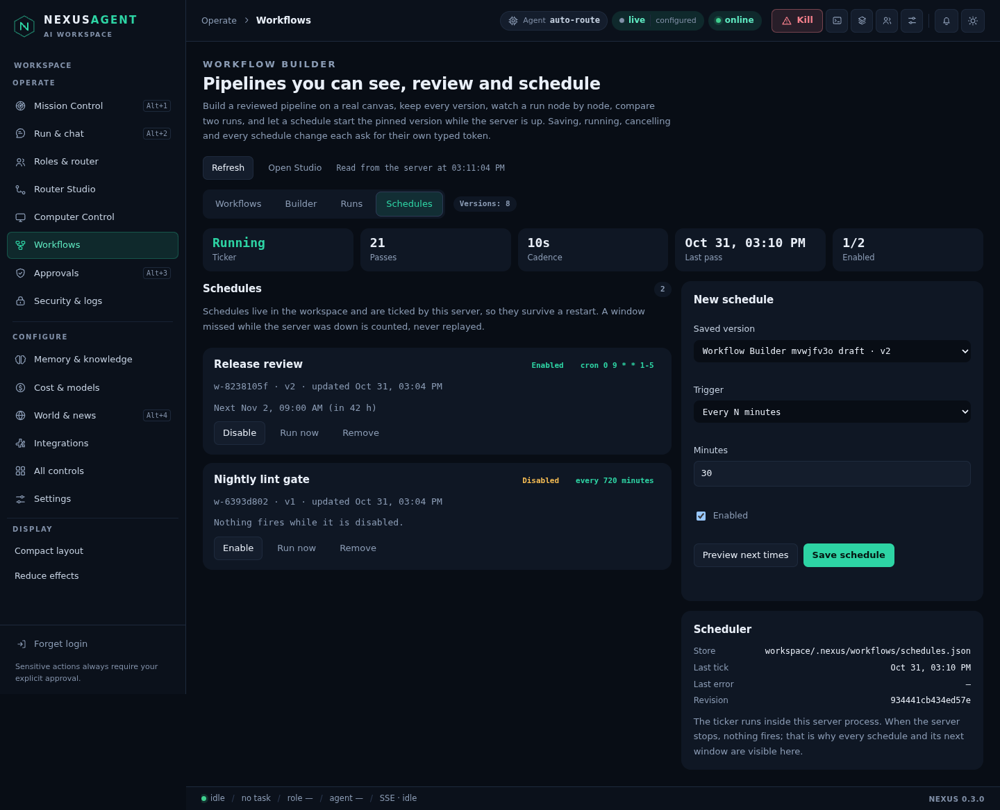

# Workflow Builder — a canvas over the engine that already runs workflows

Prompt 7 of the dashboard build. The engine was never missing: `nexus/studio_workflows.py`
already validated a DAG, stored immutable versions, executed nodes with real
budgets, ran verifications and asked for approvals. What was missing was a place
to *see* it — the only UI was a Studio pane listing rows — and any way to start
work on a schedule that survives a restart.

The Workflow Builder is that place. It is a **view and a scheduler**, never a
second executor: saving calls `Workflows.save`, running calls `Workflows.run`,
cancelling calls `Workflows.cancel`, and a node that may write still passes its
own approval gate. Nothing in this page can start work without the same token
the API demands.

Code: `nexus/workflowstudio.py` (service + scheduler), `nexus/server.py`
(`/api/workflows/*`, scheduler start/stop in `serve()`), `nexus/panel/workflows.js`
+ `shell.css`, `tests/test_workflowstudio.py`, `tests/browser/workflows.test.mjs`.

## Rules that shape the page

1. **No second control plane.** Every mutation delegates to the existing engine.
   The page adds schedules, layouts, diffs and run projections — not execution.
2. **Consent is typed, per action.** `SAVE WORKFLOW`, `SCHEDULE WORKFLOW`,
   `RUN REVIEWED WORKFLOW`, `ENABLE SCHEDULE <id>`, `DISABLE SCHEDULE <id>`,
   `REMOVE SCHEDULE <id>`, `RUN SCHEDULE <id>`, `CANCEL RUN <id>`. A token never
   authorises a second action.
3. **Nothing invented.** A count, a status, a duration, an evidence id or a next
   fire comes from a store the server read on that request. When a store cannot
   be read the page says so and changes nothing.
4. **A missed window is counted, not replayed.** If the server was not running
   when a window opened, that window is recorded as missed and skipped.
5. **A poll never eats typing.** Every background repaint skips a subtree that
   contains an open confirmation form or a focused field.

## Versions and the canvas

Versions live in the Studio store (`workflow` records) and are immutable: saving
always writes a new record with `version + 1` in the same `family`. The overview
groups by family, newest first, and collapses older versions behind "show N older
versions" so one busy workflow cannot fill the page.

`version_detail()` returns the *validator's* normalised definition plus a
left-to-right layout (`layer`, `row`, `x`, `y`, edges, width, height). The canvas
draws that grid as SVG edges with real arrowheads plus one card per node; the
list below it is the keyboard and screen-reader path. Both select the same node,
and the inspector edits id, kind, role, task, condition, dependencies, per-node
budgets and — for verification nodes — the check (`tests`/`lint`/`types`).

Validation is a dry run: `validate` normalises and orders the DAG, reports which
nodes may write, and writes nothing. Saving is offered only after it passes, and
the save form only enables its button when the exact token is typed.

Two versions can be compared field by field (`added`, `removed`, `changed` with
the exact fields and both values), and two runs node by node (`changed`,
`only_left`, `only_right`).

## Runs

`run_rows()` and `run_detail()` project the engine's own `workflow-run` records:
status, per-node status/ok/task id/evidence id/duration, and the recorded answer.
The run detail draws the same canvas coloured by outcome and lists each node with
its evidence. A running run offers **Cancel**, which asks the engine to stop
cooperatively — in-flight provider calls still finish under their own timeouts.

## Schedules that survive a restart

The scheduler is the only piece of state this page owns.

* Store: `<workspace>/.nexus/workflows/schedules.json`, schema 1, written
  atomically with mode `0600` inside a `0700` directory; the last 20 revisions are
  kept under `history/`. A damaged file is reported and left untouched — never
  silently repaired or truncated.
* One record per `(workflow_id, trigger)`: `id` (`w-` + 8 hex), family, pinned
  `version`, trigger, `enabled`, `next_run_at`, `last`, up to 20 `runs`, `missed`
  and `last_skip`. At most 20 schedules.
* Triggers: `interval` (5–10 080 minutes), five-field `cron` (UTC, `*`, ranges,
  lists, `/step`, weekday 0–7 with 7 = Sunday, Vixie dom-OR-dow) and `manual`.
  A manual trigger cannot be enabled — it is started explicitly with **Run now**.
* `NEXUS_WORKFLOW_TICK` sets the cadence (default 20 s, clamped 1–300 s). One
  tick starts at most one run per schedule; a busy engine defers and retries for
  up to 30 minutes, then records a skip and moves the window on.
* Windows that are older than the last tick after a downtime longer than the
  120 s grace are recorded as **missed**; a window that opened within the grace
  still runs once.
* A `filelock` on `.nexus/workflows/scheduler.lock` (timeout 0) guarantees only
  one process ticks; a second server reports `busy` and does nothing.
* The scheduler starts with the server (`serve()`) and stops in the shutdown
  block; opening the page also re-arms it, so a schedule added at runtime is
  picked up without a restart.

## Endpoints

Reads (GET, `workflows:` bucket, sampled audit once per five minutes):

| endpoint | returns |
| --- | --- |
| `/api/workflows/overview` | counts, next fire, busy/latch/queue state, limits, typed tokens, vocabulary (roles, agents), the three rules, store error |
| `/api/workflows/families` | every family with its versions, newest first |
| `/api/workflows/version?id=` | normalised definition, order, writes, layout |
| `/api/workflows/diff?a=&b=` | added / removed / changed fields between two versions |
| `/api/workflows/runs?limit=` | projected runs, newest first |
| `/api/workflows/run?id=` | one run with per-node results and layout |
| `/api/workflows/run-diff?a=&b=` | node-level comparison of two runs |
| `/api/workflows/schedules` | schedules, revision, last tick, plus the live scheduler status |

Writes (POST, `workflows-write:` bucket, every one audited with `risk=high`):

| endpoint | body |
| --- | --- |
| `/api/workflows/validate` | `{definition}` — dry run, no token needed, nothing written |
| `/api/workflows/version/save` | `{definition, family?, confirmation: "SAVE WORKFLOW"}` |
| `/api/workflows/run` | `{id, confirmation: "RUN REVIEWED WORKFLOW"}` |
| `/api/workflows/cancel` | `{id, confirmation: "CANCEL RUN <id>"}` |
| `/api/workflows/schedule/save` | `{workflow_id, trigger, enabled, revision?, confirmation: "SCHEDULE WORKFLOW"}` |
| `/api/workflows/schedule/toggle` | `{id, enabled, revision?, confirmation: "ENABLE|DISABLE SCHEDULE <id>"}` |
| `/api/workflows/schedule/remove` | `{id, confirmation: "REMOVE SCHEDULE <id>"}` |
| `/api/workflows/schedule/run` | `{id, confirmation: "RUN SCHEDULE <id>"}` |
| `/api/workflows/trigger/preview` | `{trigger}` — the next five times, no save |

Demo mode refuses save, run and schedule; running still refuses while another
run, task or queue holds the engine, exactly as the Run button does.

## The page



Four tabs (`Workflows`, `Builder`, `Runs`, `Schedules`) as an ARIA tablist with
Arrow/Home/End support:

* **Workflows** — five counters (families, versions, runs, enabled schedules,
  next fire) read from `/overview`, one card per family with its versions, and a
  sidebar stating the three rules, the limits and the exact typed tokens, plus a
  plain sentence when a run, the emergency latch or a paused queue is blocking
  new work right now.
* **Builder** — name, version picker, validate / save / run, node palette, the
  canvas, the ordered node list and the inspector, with version diffing beside
  it.
* **Runs** — the projected runs; opening one shows the outcome canvas, each
  node's status, task id, evidence id and recorded answer, and Cancel while it
  still runs.
* **Schedules** — the ticker's live state (running, passes, cadence, last pass,
  enabled), one card per schedule with its pinned version, trigger, next fire in
  local time *and* relative, missed count, last skip reason and last run, plus
  Enable/Disable, Run now and Remove behind their own typed tokens. The "new
  schedule" form previews the next five times before saving.




The sidebar **Workflows** row and `#workflows` open this page; Studio's own
Workflows pane is untouched and still opens from the palette, All controls and
the **Open Studio** button here. Desktop fits four columns of nodes without
scrolling, wider graphs scroll sideways inside their own box, and 360 px keeps
every control reachable with `scrollWidth − innerWidth = 0`. All labels exist in
English and Bangla (218 `workflows.*` keys per language) and the page re-paints
on a language switch without refetching.

## Manual test

```bash
.venv/bin/python -m nexus gui --port 8787 --no-open --host 0.0.0.0
# open http://127.0.0.1:8787/dashboard, log in with the serve token
```

1. Sidebar → **Workflows**. The counters match `GET /api/workflows/overview`;
   with no saved workflow the list says so.
2. **New workflow** → fill the name, remove the two template nodes, add a
   **Verification** node, pick `Lint`, press **Validate**. The page reports the
   order and writes, and the family count does not move.
3. **Save version**: the button stays disabled until `SAVE WORKFLOW` is typed
   exactly. Save twice and the family shows v1 and v2; **Compare versions**
   names the changed field.
4. **Run reviewed workflow** on the lint version: type
   `RUN REVIEWED WORKFLOW`. The run opens in the Runs tab, ends `done`, and its
   node shows the evidence id the check produced.
5. Schedules: pick the version, choose a cron (`0 9 * * 1-5`) or an interval,
   press **Preview next times**, then **Save schedule** with
   `SCHEDULE WORKFLOW`. The card shows the pinned version and the next fire.
6. Disable / Enable / Remove each ask for their own token; the ticker counters
   move while the server runs. Stop the server past a window and restart: the
   card's `missed` count grows and nothing starts.
7. Switch to Bangla and shrink to 360 px; the tabs answer the arrow keys.

## Tests

* `tests/test_workflowstudio.py` — 55 tests: store honesty (empty, damaged,
  private, atomic, bounded history, revision), cron maths (ranges, lists, steps,
  weekday 7 = Sunday, Vixie dom-OR-dow, refusals), layout layers, families,
  version and run diffs, typed tokens for every mutation, demo refusal, the
  schedule list bound, one tick starting exactly one run, deferral while busy,
  missed windows after downtime, grace-window runs, latch/pause/demo skips, a
  vanished pinned version, the cross-process lock, an unreadable store, the
  scheduler starting only when a schedule exists and picking one up after a
  restart, and the HTTP surface (401, 404, 400, 429, audit trail, scheduler
  status).
* `tests/browser/workflows.test.mjs` — 7 tests: sidebar entry plus API-verified
  counts and tokens, a draft validated without writing, the typed save token
  surviving two 8 s polls, a second save keeping v1 with a real field diff, a
  schedule created/disabled/enabled/removed through the page, a real lint run
  whose node statuses and evidence come from the engine, and Bangla at 360 px.

## Known limits

* Schedules fire only while this server process runs. There is no OS service
  integration here; a stopped server means missed windows (recorded as such).
* The lock prevents a second *process* from ticking, not a second human from
  editing `schedules.json` by hand — a hand-edited file is validated on read and
  reported if it does not parse.
* Deferral retries for up to 30 minutes; after that the window is skipped rather
  than queued.
* A run's node text is the engine's recorded answer, truncated to 2 000
  characters in the projection.
* The canvas is a layout of the DAG, not a free-form editor: moving nodes by hand
  is not offered, because the engine defines the order.
* Workflow versions are immutable by design, so there is no "delete version"
  action; the store keeps what it has.
