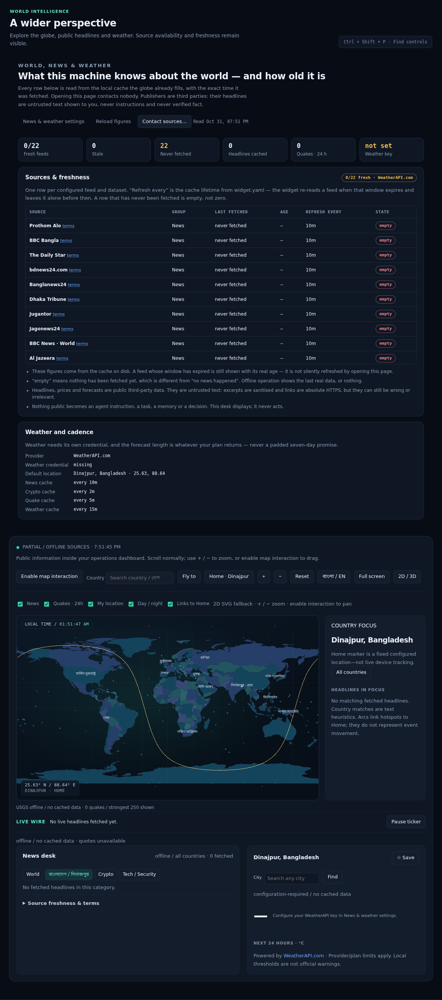
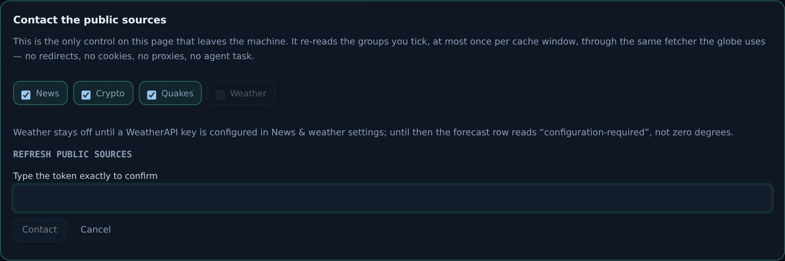

# World, news & weather — what this machine knows, and how old it is

Prompt 12 of the dashboard build. The globe, the news desk, the crypto tape and
the weather card already existed and already worked; what was missing was the
part a careful operator asks first: **where did this come from, when was it
fetched, when will it be fetched again, and what happens when the network is
gone?** This round adds that desk above the globe, and nothing else about the
Widget changed.

Code: `nexus/worlddesk.py` (all of it), two routes in `nexus/server.py`
(`/api/world/overview`, `/api/world/refresh`), `nexus/panel/worlddesk.js`,
`nexus/panel/shell.css` (`.worlddesk`), `tests/test_worlddesk.py` (17 tests),
`tests/browser/worlddesk.test.mjs` (6 tests).

## The rule this round is built on

**Reading the page never contacts a publisher.** Every figure on the desk comes
from the cache on disk that the widget already fills; `overview()` derives ages
from stored timestamps and makes zero HTTP calls. The browser suite proves it
the only way that means anything: it watches every request the page issues and
fails if a single one leaves for a public host (`the desk never sent a single
request to a public host while it was open`), and the unit tests count transport
calls instead of trusting the docstring.

The one control that *does* leave the machine is **Contact sources…**, and it
needs the exact token `REFRESH PUBLIC SOURCES`. It re-reads only the groups you
tick, through the widget's own fetcher — same 5 s/3 s timeouts, same 24
requests/minute and 5000/day budget, no redirects, no cookies, no proxies, no
ambient credentials — so a manual refresh cannot bypass one guard the automatic
one obeys.

## What the desk shows

| Part | What it says, and what it refuses to say |
| --- | --- |
| Six KPIs | fresh / stale / never-fetched feeds, cached headlines, quakes in 24 h, whether a weather credential exists |
| Sources & freshness | one row per configured feed and dataset: name, group, last fetched (absolute), age, cache lifetime from `widget.yaml`, state |
| Notes | cache-only, empty ≠ no news, public text is untrusted, nothing public becomes an instruction |
| Weather & cadence | provider, credential present or missing, default location, and the real refresh window per group |

States are three, and they are not interchangeable:

* **fresh** — present, and inside the cache lifetime;
* **stale** — present, past its lifetime. It is *shown* with its real age rather
  than silently re-fetched, because opening a page is not consent to call out;
* **empty** — never fetched. This is deliberately not `0`: "we have never looked"
  and "there is nothing there" are different facts, and the desk keeps them
  apart (`test_an_empty_feed_is_not_reported_as_zero_news`).

The cadence column is read from `widget.yaml`, so it changes when the operator
changes it and never before. On a phone the table becomes cards with their
column names attached, and the cadence column is dropped there only because the
same values are printed in full, and correctly, in the Weather and cadence card
below it.

## Sources

Fixed HTTPS destinations only — configuration enables *IDs*, never arbitrary
URLs (`settings()` refuses anything else). The default Bangladesh set is Prothom
Alo, BBC Bangla, The Daily Star, bdnews24, Banglanews24, Dhaka Tribune,
Jugantor and Jagonews24, with BBC World, Al Jazeera, DW, The Guardian and NPR in
the world group, CoinDesk / Cointelegraph / Decrypt for crypto, The Hacker News
/ BleepingComputer / Krebs for security, plus USGS quakes, CoinGecko (with an
explicit USDT Binance fallback) and WeatherAPI.com.

Every row links to that publisher's terms. Excerpts are stripped to plain text
by an HTML sanitiser that removes `script`/`style`/`iframe`/`object` bodies, and
links are refused unless they are absolute `https://` without credentials
(`javascript:`, `data:`, `file:` and protocol-relative URLs are dropped).

## Weather

Weather needs its own credential and is skipped entirely when it is missing —
the confirmation sheet disables the Weather group and says why
(*"configuration-required", not zero degrees*). The forecast length is whatever
the plan returns; the page displays the number of days actually delivered and
never pads a seven-day promise. Threshold banners (≥50 mm/day rain, ≥40 °C,
WMO 95/96/99) are local advisories and are labelled as **not official
warnings**.

## Refresh

The sheet lists the four groups, greys out Weather when it cannot work, prints
the token, and keeps Contact disabled until the text matches exactly. On confirm
it sends only `{confirmation, groups}`; the answer reports, per group, what
really happened — `ready`, `partial`, `offline`, `cached`, `configuration-required`
or `error` — with the number of items and, for news, how many sources were
offline. The desk repaints from the authoritative post-refresh state, so the
numbers you see afterwards are the ones the cache now holds.

A failing publisher never raises and never erases data: the cache keeps the last
real row, the group is reported offline, and the page says so
(`test_a_failing_source_keeps_the_cache_and_never_raises`).

## Offline

`gui_modules` marks these public paths as reachable so the globe can draw an
offline map from bundled Natural Earth files plus whatever was cached. The desk
reports the same reality: last-fetched timestamps stay visible, stale rows are
labelled stale, and never-fetched rows stay empty. Nothing is fabricated to fill
a gap — no invented headline, quote, price or forecast.

## Endpoints

| Method | Path | Purpose |
| --- | --- | --- |
| GET | `/api/world/overview` | enabled, provider, credential presence, every feed with age / TTL / state |
| POST | `/api/world/refresh` | `{confirmation: "REFRESH PUBLIC SOURCES", groups: [...]}` |

Both sit behind the serve token or a GUI cookie. Reads use the `world:` limiter
bucket and are sampled into the audit chain (`world.overview`, … every 120 s per
action); the write uses `world-write:` and records one `world.refresh` audit row
with the groups, per-group status and duration. Unknown `/api/world/*` paths are
`404`; a missing or wrong token is `400 invalid_request` naming the token; a
broken cache is `503 store_unavailable`. An audit store that cannot be written
does not undo a fetch the operator asked for
(`test_the_audit_store_failing_does_not_undo_the_fetch`).

The pre-existing public widget routes (`/api/news`, `/api/crypto`, `/api/quakes`,
`/api/weather`, `/api/cities`, `/api/countries`) are untouched and still answer
(`test_the_public_widget_routes_still_answer_after_the_desk_was_added`).

## Manual test

1. Sign in and open **World & news**. The desk is above the globe; the globe
   below is exactly as it was.
2. Read the six KPIs and the source table. Every row names a real publisher, its
   group, when it was last fetched (or *never fetched*) and its cache lifetime.
3. Open a `terms` link — it goes to that publisher in a new tab with
   `rel="noopener noreferrer"`.
4. **Contact sources…** → the sheet opens. Weather is greyed out unless a key is
   configured. Type a near miss: Contact stays disabled. Type
   `REFRESH PUBLIC SOURCES`: it enables.
5. **Cancel** — nothing is fetched; reload the figures and the timestamps are
   identical.
6. Offline (disable the network) or with a blocked host: confirm a refresh and
   the group reports *offline* while the table keeps the last real row.
7. Narrow to 360 px in বাংলা: the table becomes labelled cards, nothing scrolls
   sideways, the KPI strip is one column.

## What this page cannot do

- It cannot make a headline true, recent, or relevant. Country matching is a
  text heuristic over names and aliases, not geolocation; a story about Georgia
  can match the wrong Georgia.
- It cannot fetch a feed the operator has not enabled, or a URL that is not on
  the fixed list.
- It cannot deliver a hyperlocal Dinajpur feed that no publisher produces —
  Bangla feeds and title matching surface Dinajpur items only when they exist.
- It cannot promise a forecast horizon larger than the plan returns, or turn a
  threshold advisory into an official warning.
- It cannot feed public text into an agent: the desk displays, and nothing here
  writes to a task, a memory or a decision.
