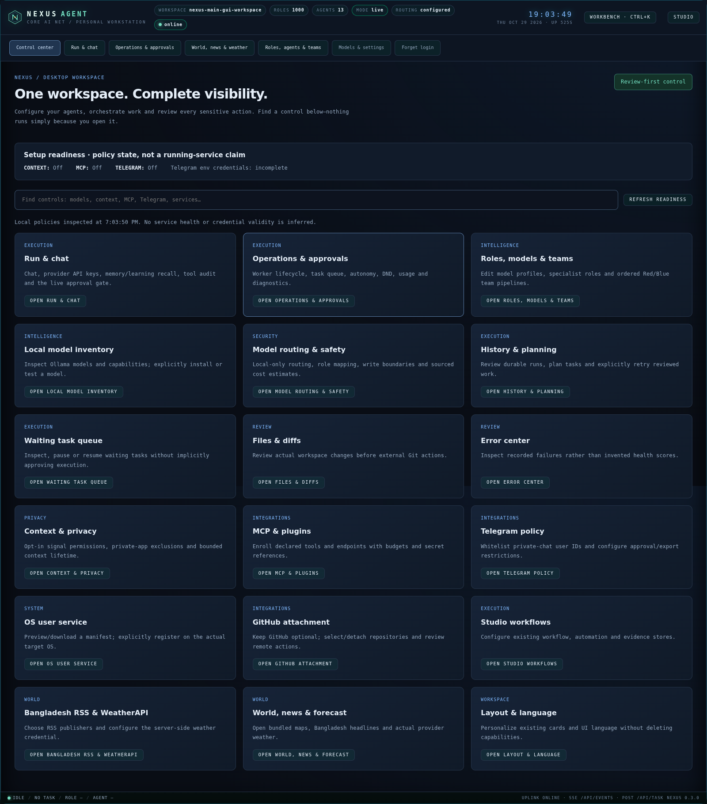
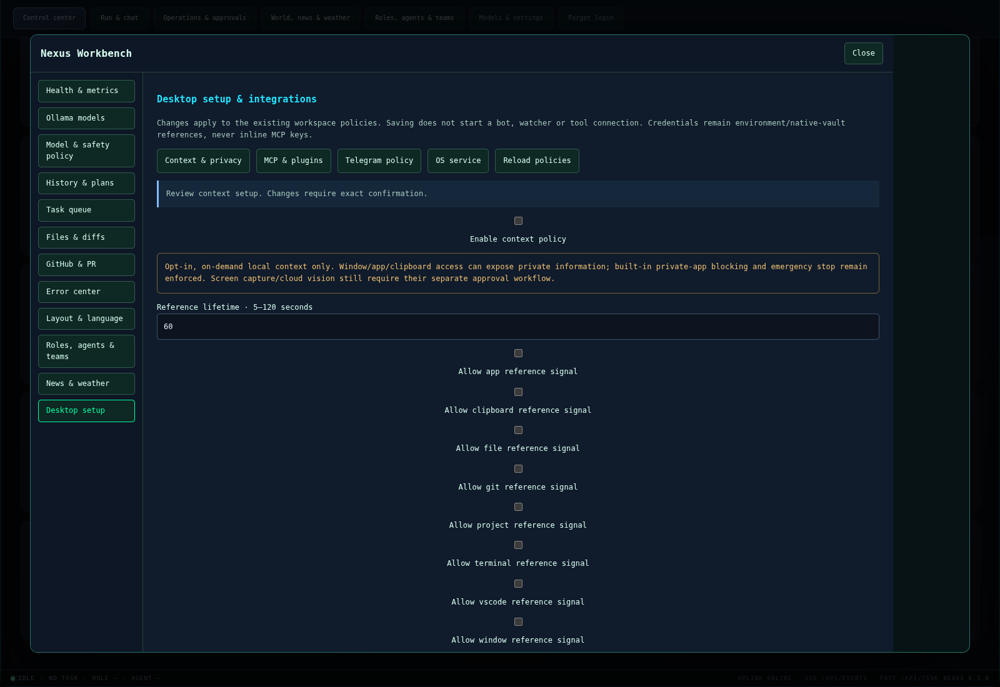
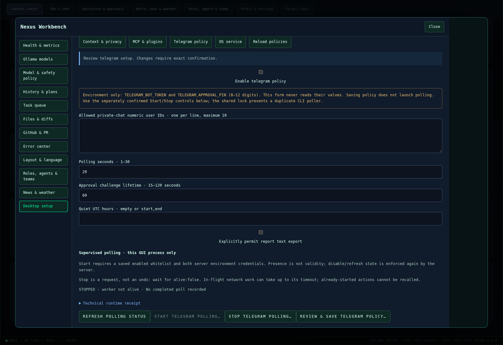

# Desktop Control Center

The original `nexus gui` now opens **Control center** by default. This is a
desktop-first workstation, not a separate app/server. **Run & chat**, Operations,
World, Workbench and Studio retain their existing IDs, APIs and approval behavior.
Direct links `#run`, `#operations`, `#world` and `#control` remain available.
No mobile-specific layout or features were added in this update.

## Find and operate controls

- Search eighteen capability cards by feature name, e.g. privacy, models, MCP or
  Telegram. **Ctrl+Shift+P** opens Control center and focuses search; existing
  **Ctrl+K** Workbench behavior is unchanged.
- Cards open the existing native controls. Opening a model/tool/worker card is
  not consent to download, execute, connect or approve anything.
- Setup readiness reads real local policy and credential **presence only**. An
  enabled policy is **not** a claim that a bot/daemon is running or a key is valid.
  Refresh is explicit and local; there are no background inference/endpoint probes.
- The professional desktop finish reduces decorative terminal effects, uses a
  restrained palette and clearer headings, spacing, borders and card hierarchy.
  Existing functionality is not removed to simplify the screen.

## Desktop setup: new native policy controls

Use the relevant Control center card or **Settings → Desktop setup**.

### Context & privacy

Enable/disable context policy, choose individual reference signals, TTL, additional
blocked-app terms, local vision agent and screenshot policy. Default is OFF.
Save requires exact `SAVE CONTEXT POLICY` consent. This does **not** collect a
window/clipboard, start a watcher, capture an image or approve an upload. Existing
private-app exclusions, emergency stop, short-lived references and separate fresh
vision/upload approvals remain enforced. The original task-reference/context
workflow consumes this policy; native desktop availability is still OS-dependent.

**Collect local context once** requires fresh `COLLECT LOCAL CONTEXT` consent and
the current enabled policy revision. It uses the existing Context collector and
shared Studio, never a second knowledge base. Only selected permitted signals are
read; screenshot capture/cloud vision are not part of this action. Additional
private-app blocking, emergency stop and collection-time policy checks still apply.
**Clear cached context references** separately requires `CLEAR LOCAL CONTEXT`;
it clears this workspace's reference records, not unrelated records or previously
exported images. Output is plain text/JSON, is not saved to browser storage, and
clears on pane switching or dialog close. It is one-time reference data, not a live
watcher and not agent instructions.

### MCP & plugins

Enable/disable discovery, select a confined plugin-manifest directory and edit
reviewable server declarations. An HTTP example is expandable, not auto-enrolled.
The original catalog validates transport, executable/URL restrictions, declared
JSON tool schemas, budgets and environment/keychain references, even when a server
policy is disabled. Saving connects nothing and does not execute manifests/tools.
Actual invocation still requires the original fresh approval boundary. Do not put
credentials in command arguments or descriptions; env/header secret fields accept
references, not inline values. Secret detection elsewhere is heuristic, not a
promise that every possible unknown secret can be identified.

### Telegram policy

Enroll exact numeric private-chat IDs, configure poll/challenge limits and UTC
quiet hours, and explicitly opt into report-text export if required. Bot token
and approval PIN stay in the server environment; GUI shows only their presence,
not validity or values. Save does not launch polling.

**Start Telegram polling** separately requires `START TELEGRAM POLLING` and a
matching enabled-policy revision. The original Bot runs in a GUI-owned supervised
thread, using the **same cross-process FileLock as the CLI** to refuse duplicates.
There is no automatic restart after failure. **Stop Telegram polling** requires
`STOP TELEGRAM POLLING`; status distinguishes starting, polling, stopping, stopped
and failed, with actual thread liveness and last completed-poll time. Use Refresh
polling status to observe acknowledgement. Polling is not account validity or a
claim that an independently launched CLI process is stopped.

Stop sets cancellation immediately. In-flight requests/already-started actions
cannot be recalled; wait for **alive:false**, not merely a Stop acknowledgement.
New update handling and outbound API calls recheck cancellation and current
policy/credential authority. Restart is refused while the old thread is alive.
Closing/logging out of a browser tab does not stop this server-owned poller.
GUI server shutdown requests cancellation and waits briefly; a daemon thread does not
become an orphan process. The foreground CLI remains an alternative, not a second
required service. Environment credentials and existing private-ID/PIN/fresh-action
approval restrictions are unchanged.

### OS user service

Preview and download the original generated Windows Task Scheduler XML or Linux
systemd user manifest. Windows requires an explicit local/domain user. Review
content and instructions, then installation requires the **exact filename/digest
confirmation** returned by the preview. The server regenerates that manifest and
uses the existing bounded installer; installation must target the actual OS.
There is no administrator elevation, password collection, shell command input,
execution-policy change, overwrite or automatic rollback.

An accepted registration is **not** a running-daemon confirmation. Partial manager
outcomes are displayed for manual review; do not retry blindly. Uninstall and OS
manager recovery remain OS-managed using the returned instructions. No OS service
was actually installed during automated validation.

## Persistence, privacy and current limits

The authenticated `/api/workbench/desktop` API is protected by the original
Host/Origin/session boundary. Saves use revision checks, exact consent, existing
validators, bounded regular-file/symlink checks and atomic YAML replacement.
Malformed/private policy errors never echo file content. Discovery/readiness
executes no plugin and reads no ambient context. There is no new learning store.

**Not every conceivable operation is now a GUI button.** Control of independently
launched CLI pollers, separately reviewed screen/cloud vision, plugin source-file
authoring, OS uninstall/recovery and environment/OS-vault credential revocation
still use their existing tools/workflows. These are explicit limits, not hidden
behind decorative controls. See [control coverage](gui-control-coverage.md).

When a Context/Telegram policy is malformed or private, the GUI withholds its
fields and disables collection/start/save. **Stop polling** and **Clear cached
references** remain available with their own fresh confirmations. They do not
repair or overwrite the private policy. The malformed-policy UI error path is
tested with an explicitly scripted read-only snapshot; its Stop/Clear posts still
reach the actual server.

