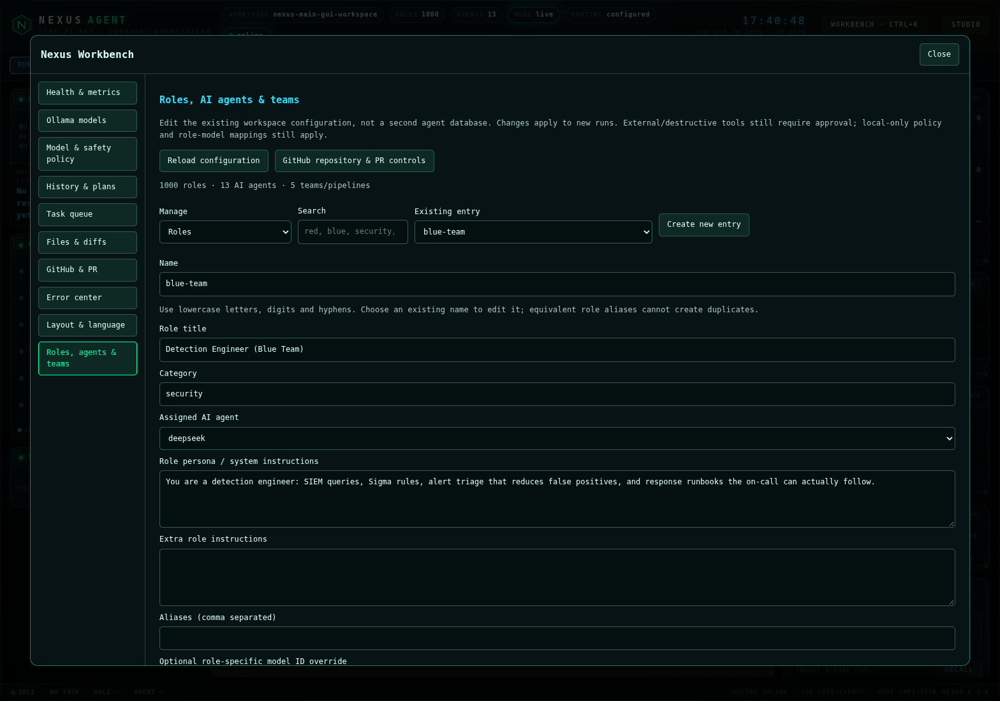
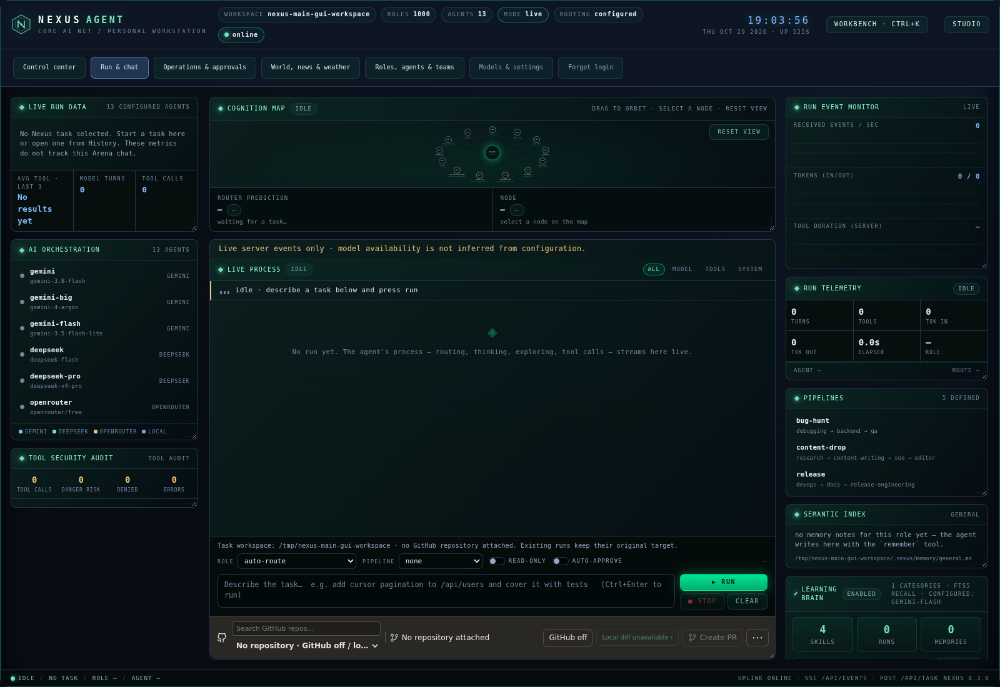
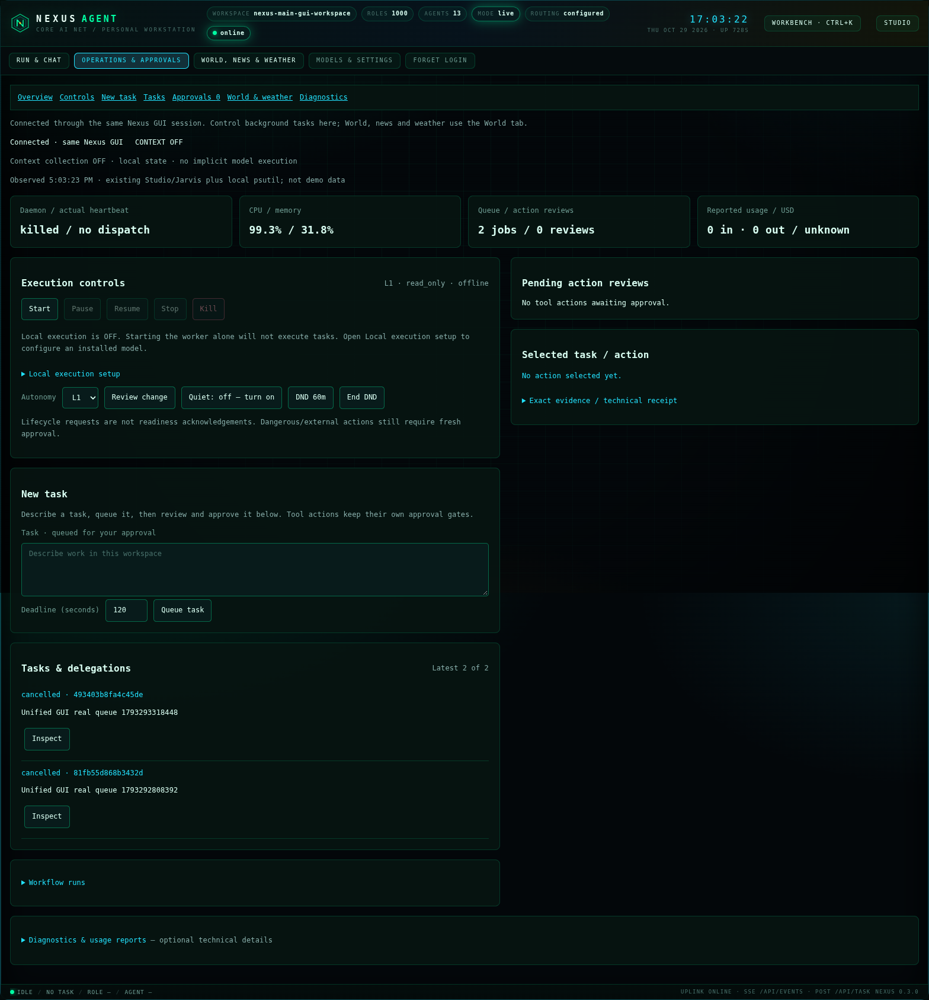
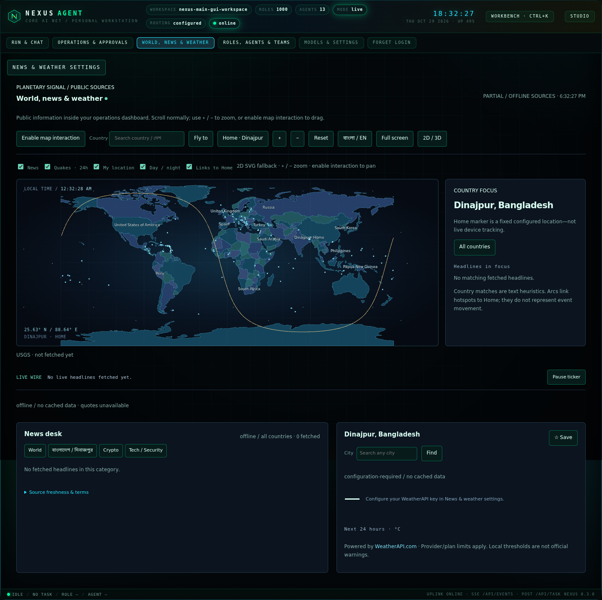

# Original Nexus GUI — one server, one dashboard

## Launch

From your existing checkout (Windows example):

```powershell
cd C:\Users\HAMID\Nexus-Agent
.\.venv\Scripts\python.exe -m pip install -e .
.\.venv\Scripts\nexus.exe gui -C .
```

Open **http://127.0.0.1:8787/dashboard**. This preserves `app/` and your existing
workspace; no clone, execution-policy change or reset is needed. Stop an already
running old server before updating/restarting. Do not run a second dashboard.
For an initial virtual environment, use `python -m venv .venv` first.

- **Run & chat:** original composer, agent roles/model routing, GitHub repository
  selection and task workflow, activity and tool approvals. Workbench/Studio
  remain dialogs in this GUI; **Settings** opens the original Workbench settings.
- **Operations & approvals:** real local background-worker Start/Pause/Resume/
  Stop/Kill, queue/approve/cancel tasks, autonomy/quiet/DND, measured usage,
  learning readouts, logs and diagnostics. The adapter shares the original Studio
  store; it does not create another learning knowledge base. Local background
  execution must be explicitly enabled with an installed Ollama model. Starting
  a worker alone does not approve tasks or enable execution. Lifecycle commands
  display actual acknowledgements; main Run/chat remains its original workflow.
- **World, news & weather:** native lazy-loaded globe/SVG map, public news,
  crypto quotes, weather and city search. Normal scrolling works on desktop and
  mobile; enable map interaction deliberately to rotate/zoom without trapping
  page scrolling. Data failures are labelled, not replaced by sample values.

Context collection stays OFF by default. Destructive/external actions still need
fresh approval at every autonomy level. Opening the GUI does not start model
inference, collect screenshots or activate a worker. Main-run approvals bring the
Run view back into view; background approvals have an attention banner when you
are on another tab. Review actions before approving them.

## Dashboard control: roles, agents/models, Red/Blue teams and GitHub

Click **Roles, agents & teams** in the main dashboard navigation (or the same
section inside Workbench). This is a native dialog in the original GUI, not a
separate dashboard/server. Nothing is executed just by opening it.

1. **AI agents / models:** create/edit a model profile; choose provider, exact
   model ID, endpoint, key **environment-variable name**, tool mode, token/timeout/
   temperature limits, fallback, streaming and default agent. Existing adapters
   are reused. Actual keys are never returned or accepted by this configuration
   API. The original API Keys card handles supported provider keys; GitHub
   credentials remain environment/`.env` only, as before.
2. **Roles:** search the existing role catalog, edit persona/instructions,
   category/title, assigned agent, optional model/temperature override, aliases,
   weighted routing keywords, focus and tool allowlist; or create a new role.
   Equivalent aliases cannot silently create duplicate roles. Existing workspace
   model-policy mappings still take precedence: manage them in Model & safety
   policy, especially if a role appears pinned to an older model.
3. **Agent teams / pipelines:** reuse the existing ordered pipeline engine. Add,
   remove and reorder members; edit each member's instructions and read-only
   setting. Buttons add the **existing** Red-team (`pentesting`) and Blue-team
   (`blue-team`) specialists without duplicating roles. New steps default to
   read-only; authorization and external/destructive-action approvals remain
   mandatory. This is a sequential handoff pipeline, not a claim of parallel
   agents. Any existing role can be a member, with its own model mapping.
4. Review the displayed configuration and type the exact confirmation. Saves
   persist to existing workspace `agents.yaml`, `pipelines.yaml`, or the drop-in
   `roles.d/zz-gui-managed.yaml`, not a second database/learning store. Revision
   checks refuse stale saves; writes are atomic UTF-8, and main Run selectors
   refresh without discarding your draft. Existing runs keep their config.
5. **Use in Run & chat** selects the saved role/team, without running it. Write
   the task, select the GitHub repository if needed, then explicitly Run. GitHub
   repository search, direct task branches, reviewed Create PR/Merge, and
   permission prompts remain in the original composer. The manager's GitHub
   button brings those same controls into view, not an external panel.

**Remove workspace override** removes only that YAML layer's entry. Bundled
entries may reappear from lower configuration layers. Referenced/default agents
and team-linked roles cannot be removed until reassigned. Raw provider keys,
GUI/GitHub/Telegram token reuse, credential-bearing URLs, unsafe interpolated
text, fallback cycles and invalid team/role references are refused. No network
probe, inference, clone, task launch or GitHub mutation occurs on configuration
save. Local model download/delete and server-enforced local-only routing remain
in the existing Ollama and Model & safety policy sections.



## Optional GitHub attachment — no repository required

Use **GitHub off** in the composer repository strip, or choose **No repository**
in its dropdown. You can then use ordinary chat and the local workspace without
attaching a GitHub repository. New Run requests omit `github_repo`; remote
Create PR/Merge controls are disabled. Explicit off survives reload on this
browser/origin, and the repo list is not fetched automatically while off. Late
inventory/status responses cannot reattach a repository.

**Connect GitHub** explicitly reloads the available repositories but leaves the
selection empty until you choose one. No key is deleted: this is a dashboard
attachment choice, not GitHub credential revocation, a global GitHub-tool/network
firewall, or cancellation of already-running tasks. Existing runs keep their
original target and approvals; stop those separately if required. Your local
workspace is still available (and can itself be a Git checkout). If browser
storage is unavailable the dashboard defaults to detached; clearing browser data
removes saved preferences.

## Optional one-time trusted-device login

Existing trusted **loopback-only** use without an access token remains supported.
To protect the GUI, configure `NEXUS_SERVE_TOKEN`, **not** a GitHub/provider key.
All tabs and original APIs use that same identity. For optional Windows Credential
Manager/macOS Keychain/Linux Secret Service reuse:

```powershell
.\.venv\Scripts\python.exe -m pip install keyring
# Generate only during initial enrollment, not on every launch:
$env:NEXUS_SERVE_TOKEN = .\.venv\Scripts\python.exe -c "import secrets; print(secrets.token_urlsafe(32))"
$env:NEXUS_SERVE_TOKEN | Set-Clipboard
.\.venv\Scripts\nexus.exe gui -C . --remember-token
```

Paste once in the GUI login dialog; keep **Remember this browser** checked only
on your trusted device. Clear your clipboard after pasting (`Set-Clipboard -Value ''`).
Later launch just `nexus gui -C .` from the **same resolved workspace** and OS user;
no token regeneration is needed. Enrollment stores the token only in a supported
native OS vault, under service `nexus-gui`. `NEXUS_HOME/gui-auth/` contains only
nonsecret enrollment markers. Plaintext keyring backends are refused. If an
enrolled vault is missing/locked, startup fails closed instead of silently
removing authentication. Explicitly supplied credentials override saved ones;
use `--remember-token` again if deliberately replacing the saved credential.

Remembering uses a signed, workspace-and-Host-bound HttpOnly SameSite=Strict
cookie, not localStorage or a token-bearing launch URL. It expires after 400 days
without renewal. Token rotation, a different hostname/workspace/browser profile,
private browsing, clearing cookies or **Forget login** requires login again.
Forget login deletes this browser cookie; it does not erase your OS-vault token
or revoke other devices. To revoke all sessions, rotate the configured token.
Windows native-vault behavior is unit-tested with mocks; no physical Windows
Credential Manager integration test was available in the Linux sandbox.

## Remote deployment

Default bind is `127.0.0.1`; wildcard bind requires a token. Use a real TLS reverse
proxy, set exact comma-separated `NEXUS_ALLOWED_HOSTS` hostnames, and explicitly
set `NEXUS_GUI_HTTPS_PROXY=1` **only behind that trusted TLS proxy**. This enables
Secure remote session cookies. Forwarded headers do not enable this implicitly.
Do not expose the raw HTTP worker port publicly. Cross-origin mutations and
unapproved Host headers are rejected. Browser requests use same-origin relative
URLs, including when the browser is remote from the server.

## Compatibility and implementation

`nexus panel`, `nexus hud` (including deprecated `--tui`) now launch this same GUI
on the same default port; `/panel`, `/console`, `/hud` and old HTML entry paths
redirect to `/dashboard`. No second HUD/console/TUI is launched. Legacy adapter
modules remain for API/tests/integrations, not as additional user-facing servers.
Existing GUI/VS Code consumers retain their API compatibility.

`nexus/gui_modules.py` reuses existing operations/World cores through the original
`ServerState`, with separate rate/concurrency budgets so public feeds cannot
starve private controls. `/api/operations/*`, public-information `/api/*`, and
`/api/session` share the original authentication and Host/Origin checks.




[Mobile view](images/gui-mobile.png)

## Verification

Python: `python -m pytest -q`; lint: `ruff check nexus tests`.
Browser fixtures: `cd tests/browser; npm ci; npm test`.
Actual-server integration: run `node --test tests/browser/unified.test.mjs tests/browser/management.test.mjs` from
repository root with `NEXUS_TEST_URL` and a disposable `NEXUS_GUI_TEST_TOKEN` set.
This suite exercises actual queue mutations and worker lifecycle (no model
inference): **use a disposable workspace, never your production queue**. Browser
support libraries/Chromium may need installation on minimal Linux hosts.


### Verified integration snapshot

- Full Python suite: **1,306 passed**, no skips; one upstream FastAPI/HTTPX
  deprecation warning.
- Original GUI browser regression + actual-server unified tests: **39 passed**
  (31 original/dashboard, including GitHub detach/reconnect + 7 unified + 1 actual-server configuration-management flow), including real queue/lifecycle, mobile/desktop scroll,
  native WebGL, hidden-view polling, remembered/session-only login and logout.
- Ruff, World asset build and VS Code TypeScript compilation passed. A clean
  **base-only wheel install** served original GUI/static assets and authenticated
  original/operations/World APIs using the same Studio store.
- Run full Python and browser suites sequentially on CPU-limited machines: an
  existing 15-second worker-fixture deadline timed out during simultaneous WebGL
  testing; its module and the full sequential suite passed on rerun.
- No physical Windows desktop/vault or live external-provider availability test
  was available. Screenshots document real offline state, not simulated feeds.
