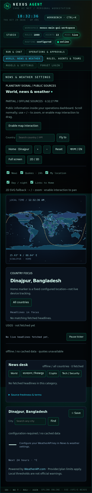

# World, news and weather — original Nexus GUI

A native **World, news & weather** tab inside the original `nexus gui` dashboard,
not a separate HUD, console, iframe or application. It shares the original server,
workspace and GUI session. Original chat, models, repository controls and settings
remain in the same interface. WeatherAPI.com requires an account/API key; no paid SDK, CDN,
location permission, model inference, trading or extra daemon is required.

**Internet is necessary for the first public-feed fetch.** Offline operation means
bundled maps plus previously fetched data, never invented headlines/quotes/weather.

## Start (PowerShell)

```powershell
python -m pip install -e .
nexus gui -C .
```

Open **http://127.0.0.1:8787/dashboard**, then **World, news & weather**.
Do not start a separate HUD server. `widget.yaml` controls public sources;
`hud.yaml` no longer selects the GUI port. Use `nexus gui --port` if necessary.
Optional token/native-vault/browser remembering is documented in [GUI setup](gui.md).
No execution-policy changes, native service installation or cloud screenshots
are required. Scroll the page normally; explicitly enable globe interaction for
map zoom/rotation. The SVG fallback works without WebGL.

## What works

- Locally bundled **globe.gl/three.js** WebGL globe; 242 Natural Earth admin-0 map
  units (countries, territories and disputed units, not a statement of recognition).
  Low-zoom 110m polygons, simplified 50m detail, shared-border-aware palette,
  visible cyan boundaries, atmosphere, grid/starfield, emissive night texture and
  approximate locally computed solar terminator.
- Hover highlights and tooltips: country/capital or seat, source population year,
  capital-zone local time. These are **dated Natural Earth estimates, not live
  population figures**. The source includes 213 capital/seat coordinate records;
  remaining units explicitly say absent. Uninhabited areas and countries without
  an official capital are not assigned fabricated coordinates; use city search.
- Search, fly-to, Home at **25.63 N / 88.64 E**, +/- zoom, reset, full-screen (with
  explicit refusal if the browser disallows it), Bangla/English labels and toggles.
  Collision-tested labels adapt to camera distance. Bengali glyphs are bundled.
  Tiny map units have selectable dots even when low-resolution polygons omit them.
- News hotspots sized by recent headline count; USGS quakes within 24h; pulsing
  rings and animated arcs to Home. Arcs are decorative links, **not inferred event
  movements**. The globe renders the strongest 250 quakes to bound draw calls;
  fetched counts/freshness are visible. Quakes older than 24h are hidden even when
  an offline cache is older. Home remains a configured point, not GPS tracking.
- Missing WebGL → actual interactive SVG map with borders, country hover/click,
  tiny-country dots, country labels, pan/zoom, Home and terminator. Manual 2D/3D
  switch is available. Full-screen support is a browser capability, not guaranteed.
- Auto-rotation stops during camera interaction and resumes after 20 idle seconds.
  Reduced-motion disables rotation/rings/dashed-arc animation/entry and CSS motion;
  hidden tabs pause WebGL rendering, decorative motion and public-feed polling.
  DPR is capped at 1.5, labels/rings/arcs/points are bounded. **60 FPS is a tuning
  target, not a certified result on every laptop/GPU or software renderer.**
- World, বাংলা/দিনাজপুর, Crypto and Tech/Security news tabs, plain-text excerpts,
  timestamps, new-since-last-observed badges, latest-headline ticker with pause,
  country focus and source-by-source freshness. Country matching uses names/aliases,
  not an LLM; ambiguous places (e.g. Georgia) can match incorrectly. There is no
  dedicated hyperlocal Dinajpur feed; Bangla feeds and title/summary matching
  provide Dinajpur items **when the publishers actually publish them**.
- CoinGecko public BTC/ETH/SOL/BNB/XRP/DOGE quotes with change/sparkline; Binance
  public fallback explicitly labels **USDT**, not USD. Fallback sparklines contain
  only locally observed samples (one sample is not a fabricated history).
- **WeatherAPI.com** current/feels-like temperature, humidity, wind, rain/chance,
  daily-max UV, sunrise/sunset and up to 24 available future hourly temperatures.
  Requests **three forecast days**, displays the actual number returned by your
  plan, and never invents a seven-day forecast.
  Country focus requests its bundled capital; city search requests geocoding.
  Favorites are explicit opt-in browser-local storage, maximum eight, removable;
  tokens and headlines are never stored there. Locations/queries are sent to
  the selected provider; nothing silently reads the user's physical location.
- Threshold banners: >=50 mm/day rain, >=40 C daily maximum, WMO 95/96/99 storms
  in the forecast. **Advisory thresholds, not official severe-weather warnings.**

## Native RSS and WeatherAPI setup

Open **World, news & weather → News & weather settings**, or **Settings → News &
weather**. Select the Bangladesh publishers, language and **WeatherAPI.com**.
Paste your key into the password field **in this GUI, never chat**, review and
confirm `SAVE NEWS AND WEATHER`. A key remains in server-session memory unless
you explicitly select native OS-vault persistence. Install the optional keyring
support for that option; an unavailable/locked vault fails closed, with **no
plaintext fallback**. Environment configuration (`WEATHERAPI_KEY`) is also supported.
Resolution is **GUI session → environment → native vault**. The settings response
contains only key presence/source, never its value. Password inputs clear on save,
cancel/close or reload; no key goes into YAML, browser storage, weather responses
or cache files. Query keys are redacted from HTTP client logging.

Without a key, weather/city lookup reports `configuration-required` **before any
provider request**. Forecast/auth/quota/network failures remain unavailable or
explicitly stale. There is **no silent Open-Meteo fallback**. To use that legacy
provider, select it explicitly and review its terms. Clearing the GUI session key
does not erase an environment/vault key or revoke a provider credential; remove
those through their respective environment/OS/provider controls. Session keys are
lost on server restart. Keys are workspace-scoped in the native vault.

Nonsecret settings use revision checks, existing schema validation and atomic YAML
replacement. These saves cannot enable context collection or approve agent work.
The same authenticated GUI/session protects the settings API; API routes remain
`/api/workbench/world-settings` (GET/POST). Public weather endpoints do not accept
keys or arbitrary upstream URLs. Credentials travel only backend-to-WeatherAPI
using HTTPS; browsers use same-origin Nexus endpoints.

## Backend and configuration

`widget.yaml` is read when the GUI World module initializes; native settings saves
invalidate that module automatically. Restart after manual file edits. It enables known
source IDs, language, default coordinates, layer defaults, hex theme colors and
TTL values. Unknown URLs/IDs, invalid coordinates and aggressive refresh values
are refused. `authorized_sources` is operator attestation of permission, **not** a
license issued by this application.

| Authenticated endpoint | Consumer / cache |
|---|---|
| `/api/countries` | Bundled metadata and validated config, no network |
| `/api/news` | Curated RSS/Atom via feedparser; each source 600s minimum |
| `/api/crypto` | CoinGecko, Binance fallback; 120s minimum |
| `/api/weather?latitude=25.63&longitude=88.64` | Selected provider (default WeatherAPI); 900s minimum, provider-separated cache, coordinates rounded to .01 degree |
| `/api/quakes` | USGS all-day GeoJSON; 300s minimum |
| `/api/cities?q=Dhaka` | Selected provider city search; 24h cache |

HTTP fetches run off the ASGI loop with **separate public-data slots**, so a slow
feed cannot consume the operation/snapshot slots. Five news workers isolate failed
sources. Per-request connect/read timeouts are 3/5 seconds, body limit 3 MB,
maximum two attempts with backoff for network/5xx failures; no retry of 429/4xx or
redirects. There is also a process-wide public-fetch budget of 24/minute and
5,000/day. Shared GUI auth/origin/request limits still apply.

Cache misses for the same key coalesce. Last-good snapshots persist atomically in
`NEXUS_HOME/world/<workspace-hash>/public-cache.json`, not the learning DB: 64 entries,
approximately 7.5 MB total, 3 MB/item, bounded locks and negative retry cooldown.
Failed/invalid responses never overwrite a last-good item. Each source retains its
own original update time. Empty caches say unavailable. Offline prices are labelled
stale, not live. Cache is public information, not another learning KB.

Visible authenticated clients poll due resources every 30 seconds. Successful cache
changes increment a revision included in the **existing `/ws` snapshot**; other
clients refetch changed cached public data on that notification. No separate socket,
scheduler or auto-started ingestion service is added. Browser requests are same-origin;
all external fetching is backend-side.

## Security

RSS/Atom bytes are parsed, never evaluated. HTML tags/scripts are stripped; text is
inserted with DOM `textContent`, never raw feed `innerHTML`. Links must be absolute
HTTP(S) without credentials/control characters, open with `noopener noreferrer`.
No external images, fonts, scripts or CDNs are fetched by the browser. Static vendor
CSS is extracted at build time; **CSP is not weakened with unsafe-inline/eval**.

Public API users cannot choose fetch URLs, upstream headers, redirects, proxy,
credentials or shell commands. Ambient proxy/authorization/cookies are not forwarded.
Feed text is never passed into agent prompts, delegation, tools, approvals or learning.
No assertion that sanitization makes external reporting true or makes it an instruction.

## Publisher terms / attribution — review notes updated 2026-10-30

**A publicly reachable RSS URL is not a blanket redistribution license.** This is a
private personal reader; excerpts/links retain attribution. No full-article scraper,
commercial republication, AI training/grounding or bulk export is supplied. Do not
publish this GUI or resell feeds without checking current source permissions.
Source availability/terms can change; blocked feeds remain isolated/offline.

| Source | Terms link / review note |
|---|---|
| BBC News · World / BBC Bangla | BBC Global terms [2](https://www.bbc.com/pages/terms-of-use), metadata/RSS section; personal/non-commercial and attribution restrictions; business use needs a license. No AI use. |
| Al Jazeera | [Terms](https://www.aljazeera.com/terms-and-conditions); content remains copyrighted; no commercial reuse grant assumed. |
| DW | [Terms](https://www.dw.com/en/terms-of-use/a-16578410); private reading only; no republication grant assumed. |
| The Guardian World | RSS guidance [1](https://www.theguardian.com/help/feeds), personal non-commercial aggregation under [terms](https://www.theguardian.com/help/terms-of-service). |
| NPR | [Terms](https://www.npr.org/about-npr/179876898/terms-of-use); private/non-commercial reader, preserve attribution and links. |
| Prothom Alo | [Terms](https://www.prothomalo.com/terms-of-use); no commercial reuse or full-text reproduction grant assumed. |
| CoinDesk | [Terms](https://www.coindesk.com/terms); private reader only, no scraping/republication rights assumed. |
| Cointelegraph | Terms [2](https://cointelegraph.com/terms-and-privacy) restrict automated scraping/content pipelines; **not fetched by default**, status `permission-required`. Requires appropriate authorization and `authorized_sources: [cointelegraph]`. Old cached articles are not surfaced while blocked. |
| Decrypt | [Terms](https://decrypt.co/terms-of-service); private reader, no automated commercial redistribution grant assumed. |
| The Hacker News | [Terms](https://thehackernews.com/p/terms-and-conditions.html); attribution/link only, no republication grant assumed. |
| BleepingComputer | [Terms](https://www.bleepingcomputer.com/terms-of-use/); copyrighted reporting, no commercial grant assumed. |
| Krebs on Security | [About/rights contact](https://krebsonsecurity.com/about/); RSS is not permission to reproduce full articles. |

The Bangladesh catalog also includes Daily Star, bdnews24, Banglanews24, Dhaka
Tribune, Jugantor and JagoNews24; native settings and per-source status expose
publisher/rights links. Some point to the publisher homepage rather than verified
terms; operators must find and review their current permissions. Fixed URLs were
sourced from the [awesome-rss-feeds catalog](https://github.com/plenaryapp/awesome-rss-feeds)
and secondary feed-discovery listings, **not live-validated here or certified for redistribution**. Prothom
Alo and BBC Bangla complete the eight Bangladesh sources selected in the shipped
`widget.yaml`. An existing workspace without that file retains the general catalog
until you select publishers in settings. Bangladesh is the default news tab.

Review limitation: current BBC/Guardian/Cointelegraph wording and Open-Meteo free-use
restriction were confirmed from indexed public material. Not every other publisher's
current full terms could be independently retrieved in this network-restricted
sandbox. Their links are recorded for operator review, **not falsely certified as
approved**. Remove any source from `sources` if its terms do not cover your use.

WeatherAPI.com requires your own account/key and appropriate plan; check its
[terms](https://www.weatherapi.com/terms.aspx). Attribution follows the selected
provider and stale/error states remain visible. No real WeatherAPI credential or
live RSS response was available for this sandbox validation.

**Legacy Open-Meteo free API access is for non-commercial use.** Data attribution is required;
see official project/access terms [1](https://github.com/open-meteo/open-meteo) and
[API terms](https://open-meteo.com/en/terms). Free API access and the CC BY 4.0 data
license are different things; a commercial deployment requires an appropriate plan.
[CoinGecko](https://www.coingecko.com/en/terms) attribution is shown; fallback
[Binance terms](https://www.binance.com/en/terms) and geographic limits apply.
[USGS feeds](https://earthquake.usgs.gov/earthquakes/feed/v1.0/geojson.php) are
attributed; feeds can be delayed and are not a safety/evacuation alert system.

## Local build, data and licenses

```
frontend/world/{package.json,package-lock.json,build.mjs,world.js}
nexus/hud/world/{core.py,sources.py,assets/}
scripts/build_world_data.py
widget.yaml
tests/test_world_widget.py
tests/browser/world.test.mjs
```

Runtime needs **no npm/CDN downloads**. To intentionally rebuild:

```powershell
npm ci --prefix frontend/world
python scripts/build_world_data.py
npm run build --prefix frontend/world
```

The data builder fetches pinned GitHub blobs recorded in `assets/provenance.json`:
Natural Earth admin-0 110m/50m and populated-places metadata (public domain), night
texture from the MIT-licensed `vasturiano/three-globe` examples, Noto Sans Bengali
under SIL OFL (full license bundled). Geometry has display simplification; it is
not a cadastral, navigation or political-boundary authority. Capital timezones are
built locally using `tz-lookup`; countries with several timezones show capital time,
not one supposedly universal national clock. Original geometry/estimates are dated.

`world.js` is a committed reproducible local bundle, alongside CSS/font/GeoJSON/image.
`THIRD-PARTY.txt`, `world.js.LEGAL.txt` and `OFL-Bengali.txt` preserve license notices.
No texture or population data is generated by AI.

## Tests, screenshots and demo

See [GUI verification](gui.md#verification) for the original-dashboard browser
regression and actual-server unified integration tests. Core public-source tests:
`python -m pytest tests/test_world_widget.py -q`. Internal legacy adapter browser
fixtures remain compatibility tests, not a different dashboard launch workflow.

The screenshots show the **actual main GUI in the network-restricted sandbox**:
external publisher/forecast requests cannot be certified here. Empty/offline data
is genuine, not fabricated current news, prices or forecasts.




Demo: `nexus gui` → World tab → search Bangladesh → select → inspect capital/year/
time → বাংলা → Home → toggle layers → zoom/reset → 2D/3D. To use weather, choose a
country with capital coordinates or search a city. On an unrestricted network,
inspect source timestamps after first fetch, then disconnect: last-good entries
remain labelled offline. Empty-cache panels remain empty. Hardware FPS and current
publisher/API availability are not certified by scripted tests.
