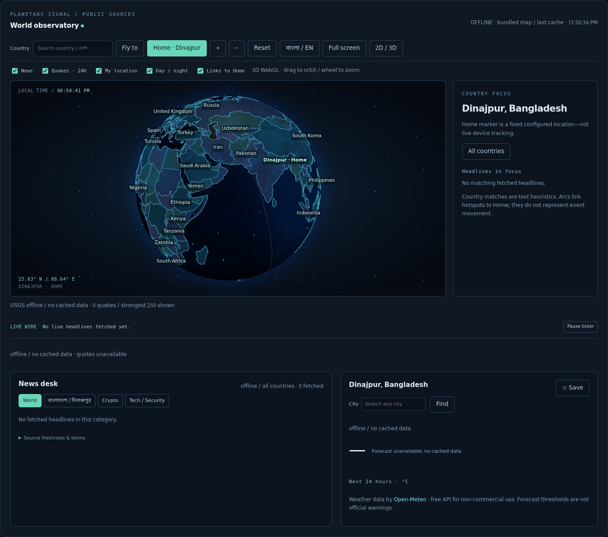
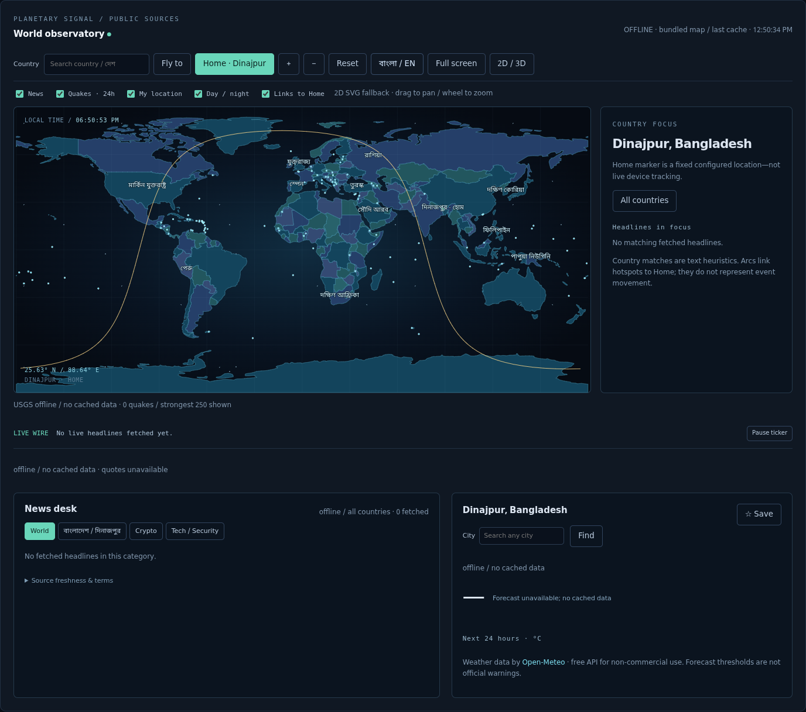
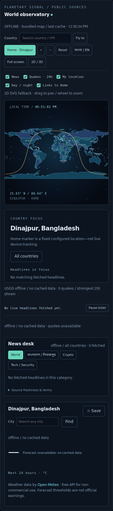

# Module 7 — World observatory inside the existing HUD

A public-information component of `nexus.hud.app.create_app`, **not a second app**.
It uses the existing fonts, panel spacing, cyan/blue borders, controls, bearer-token
boundary and WebSocket. No account/API keys, paid SDK, CDN, location permission,
model inference, trading, agent task or background daemon is required.

**Internet is necessary for the first public-feed fetch.** Offline operation means
bundled maps plus previously fetched data, never invented headlines/quotes/weather.
The existing **local HUD access token** is still required to protect operations;
it is not an API key. Default launch binds only to `127.0.0.1`. Do not expose your
operations HUD publicly. Sandbox preview uses explicit `0.0.0.0` and an exact
preview-host allowlist only because the browser is outside the sandbox.

## Start (PowerShell)

```powershell
python -m pip install -e ".[hud]"
# If you already have a private NEXUS_HUD_TOKEN, keep using it.
# Otherwise generate a local-only access token without an account/API key:
$bytes = New-Object byte[] 32
$rng = [Security.Cryptography.RandomNumberGenerator]::Create()
$rng.GetBytes($bytes)
$rng.Dispose()
$env:NEXUS_HUD_TOKEN = [BitConverter]::ToString($bytes).Replace('-', '').ToLower()
# Paste this local token into the existing HUD Connect field; never into a task.
$env:NEXUS_HUD_TOKEN | Set-Clipboard
nexus hud -C .
```

Open `http://127.0.0.1:8790` (the existing `hud.yaml` default). Choose another port
in `hud.yaml` if necessary; this does not replace the separate legacy `nexus serve`
command. The development preview for this change is on **8787**. No execution
policy changes, native service install or cloud screenshot consent is needed.

## What works

- Locally bundled **globe.gl/three.js** WebGL globe; 242 Natural Earth admin-0 map
  units (countries, territories and disputed units, not a statement of recognition).
  Low-zoom 110m polygons, simplified 50m detail, shared-border-aware palette,
  visible cyan boundaries, atmosphere, grid/starfield, emissive night texture and
  approximate locally computed solar terminator.
- Hover highlights and tooltips: country/capital or seat, source population year,
  capital-zone local time. These are **dated Natural Earth estimates, not live
  population figures**. The source includes 213 capital/seat coordinate records;
  remaining units explicitly say absent. Uninhabited areas and countries without
  an official capital are not assigned fabricated coordinates; use city search.
- Search, fly-to, Home at **25.63 N / 88.64 E**, +/- zoom, reset, full-screen (with
  explicit refusal if the browser disallows it), Bangla/English labels and toggles.
  Collision-tested labels adapt to camera distance. Bengali glyphs are bundled.
  Tiny map units have selectable dots even when low-resolution polygons omit them.
- News hotspots sized by recent headline count; USGS quakes within 24h; pulsing
  rings and animated arcs to Home. Arcs are decorative links, **not inferred event
  movements**. The globe renders the strongest 250 quakes to bound draw calls;
  fetched counts/freshness are visible. Quakes older than 24h are hidden even when
  an offline cache is older. Home remains a configured point, not GPS tracking.
- Missing WebGL → actual interactive SVG map with borders, country hover/click,
  tiny-country dots, country labels, pan/zoom, Home and terminator. Manual 2D/3D
  switch is available. Full-screen support is a browser capability, not guaranteed.
- Auto-rotation stops during camera interaction and resumes after 20 idle seconds.
  Reduced-motion disables rotation/rings/dashed-arc animation/entry and CSS motion;
  hidden tabs pause WebGL rendering, decorative motion and public-feed polling.
  DPR is capped at 1.5, labels/rings/arcs/points are bounded. **60 FPS is a tuning
  target, not a certified result on every laptop/GPU or software renderer.**
- World, বাংলা/দিনাজপুর, Crypto and Tech/Security news tabs, plain-text excerpts,
  timestamps, new-since-last-observed badges, latest-headline ticker with pause,
  country focus and source-by-source freshness. Country matching uses names/aliases,
  not an LLM; ambiguous places (e.g. Georgia) can match incorrectly. There is no
  dedicated hyperlocal Dinajpur feed; Bangla feeds and title/summary matching
  provide Dinajpur items **when the publishers actually publish them**.
- CoinGecko public BTC/ETH/SOL/BNB/XRP/DOGE quotes with change/sparkline; Binance
  public fallback explicitly labels **USDT**, not USD. Fallback sparklines contain
  only locally observed samples (one sample is not a fabricated history).
- Open-Meteo current/feels-like temperature, humidity, wind, rain/chance, daily-max
  UV, sunrise/sunset, 24 future hourly temperatures and seven forecast days.
  Country focus requests its bundled capital; city search requests geocoding.
  Favorites are explicit opt-in browser-local storage, maximum eight, removable;
  tokens and headlines are never stored there. Locations/queries are sent to
  Open-Meteo; nothing silently reads the user's physical location.
- Threshold banners: >=50 mm/day rain, >=40 C daily maximum, WMO 95/96/99 storms
  in the forecast. **Advisory thresholds, not official severe-weather warnings.**

## Backend and configuration

`widget.yaml` is read at HUD startup; restart/reload after edits. It enables known
source IDs, language, default coordinates, layer defaults, hex theme colors and
TTL values. Unknown URLs/IDs, invalid coordinates and aggressive refresh values
are refused. `authorized_sources` is operator attestation of permission, **not** a
license issued by this application.

| Authenticated endpoint | Consumer / cache |
|---|---|
| `/api/countries` | Bundled metadata and validated config, no network |
| `/api/news` | Curated RSS/Atom via feedparser; each source 600s minimum |
| `/api/crypto` | CoinGecko, Binance fallback; 120s minimum |
| `/api/weather?latitude=25.63&longitude=88.64` | Open-Meteo; 900s minimum, coordinates rounded to .01 degree |
| `/api/quakes` | USGS all-day GeoJSON; 300s minimum |
| `/api/cities?q=Dhaka` | Fixed Open-Meteo geocoding endpoint; 24h cache |

HTTP fetches run off the ASGI loop with **separate public-data slots**, so a slow
feed cannot consume the operation/snapshot slots. Five news workers isolate failed
sources. Per-request connect/read timeouts are 3/5 seconds, body limit 3 MB,
maximum two attempts with backoff for network/5xx failures; no retry of 429/4xx or
redirects. There is also a process-wide public-fetch budget of 24/minute and
5,000/day. Existing HUD auth/origin/request limits still apply.

Cache misses for the same key coalesce. Last-good snapshots persist atomically in
`NEXUS_HOME/world/<workspace-hash>/public-cache.json`, not the learning DB: 64 entries,
approximately 7.5 MB total, 3 MB/item, bounded locks and negative retry cooldown.
Failed/invalid responses never overwrite a last-good item. Each source retains its
own original update time. Empty caches say unavailable. Offline prices are labelled
stale, not live. Cache is public information, not another learning KB.

Visible authenticated clients poll due resources every 30 seconds. Successful cache
changes increment a revision included in the **existing `/ws` snapshot**; other
clients refetch changed cached public data on that notification. No separate socket,
scheduler or auto-started ingestion service is added. Browser requests are same-origin;
all external fetching is backend-side.

## Security

RSS/Atom bytes are parsed, never evaluated. HTML tags/scripts are stripped; text is
inserted with DOM `textContent`, never raw feed `innerHTML`. Links must be absolute
HTTP(S) without credentials/control characters, open with `noopener noreferrer`.
No external images, fonts, scripts or CDNs are fetched by the browser. Static vendor
CSS is extracted at build time; **CSP is not weakened with unsafe-inline/eval**.

Public API users cannot choose fetch URLs, upstream headers, redirects, proxy,
credentials or shell commands. Ambient proxy/authorization/cookies are not forwarded.
Feed text is never passed into agent prompts, delegation, tools, approvals or learning.
No assertion that sanitization makes external reporting true or makes it an instruction.

## Publisher terms / attribution — reviewed 2026-10-29

**A publicly reachable RSS URL is not a blanket redistribution license.** This is a
private personal reader; excerpts/links retain attribution. No full-article scraper,
commercial republication, AI training/grounding or bulk export is supplied. Do not
publish this HUD or resell feeds without checking current source permissions.
Source availability/terms can change; blocked feeds remain isolated/offline.

| Source | Terms link / review note |
|---|---|
| BBC News · World / BBC Bangla | BBC Global terms [2](https://www.bbc.com/pages/terms-of-use), metadata/RSS section; personal/non-commercial and attribution restrictions; business use needs a license. No AI use. |
| Al Jazeera | [Terms](https://www.aljazeera.com/terms-and-conditions); content remains copyrighted; no commercial reuse grant assumed. |
| DW | [Terms](https://www.dw.com/en/terms-of-use/a-16578410); private reading only; no republication grant assumed. |
| The Guardian World | RSS guidance [1](https://www.theguardian.com/help/feeds), personal non-commercial aggregation under [terms](https://www.theguardian.com/help/terms-of-service). |
| NPR | [Terms](https://www.npr.org/about-npr/179876898/terms-of-use); private/non-commercial reader, preserve attribution and links. |
| Prothom Alo | [Terms](https://www.prothomalo.com/terms-of-use); no commercial reuse or full-text reproduction grant assumed. |
| CoinDesk | [Terms](https://www.coindesk.com/terms); private reader only, no scraping/republication rights assumed. |
| Cointelegraph | Terms [2](https://cointelegraph.com/terms-and-privacy) restrict automated scraping/content pipelines; **not fetched by default**, status `permission-required`. Requires appropriate authorization and `authorized_sources: [cointelegraph]`. Old cached articles are not surfaced while blocked. |
| Decrypt | [Terms](https://decrypt.co/terms-of-service); private reader, no automated commercial redistribution grant assumed. |
| The Hacker News | [Terms](https://thehackernews.com/p/terms-and-conditions.html); attribution/link only, no republication grant assumed. |
| BleepingComputer | [Terms](https://www.bleepingcomputer.com/terms-of-use/); copyrighted reporting, no commercial grant assumed. |
| Krebs on Security | [About/rights contact](https://krebsonsecurity.com/about/); RSS is not permission to reproduce full articles. |

Review limitation: current BBC/Guardian/Cointelegraph wording and Open-Meteo free-use
restriction were confirmed from indexed public material. Not every other publisher's
current full terms could be independently retrieved in this network-restricted
sandbox. Their links are recorded for operator review, **not falsely certified as
approved**. Remove any source from `sources` if its terms do not cover your use.

**Open-Meteo free API access is for non-commercial use.** Data attribution is required;
see official project/access terms [1](https://github.com/open-meteo/open-meteo) and
[API terms](https://open-meteo.com/en/terms). Free API access and the CC BY 4.0 data
license are different things; a commercial deployment requires an appropriate plan.
[CoinGecko](https://www.coingecko.com/en/terms) attribution is shown; fallback
[Binance terms](https://www.binance.com/en/terms) and geographic limits apply.
[USGS feeds](https://earthquake.usgs.gov/earthquakes/feed/v1.0/geojson.php) are
attributed; feeds can be delayed and are not a safety/evacuation alert system.

## Local build, data and licenses

```
frontend/world/{package.json,package-lock.json,build.mjs,world.js}
nexus/hud/world/{core.py,sources.py,assets/}
scripts/build_world_data.py
widget.yaml
tests/test_world_widget.py
tests/browser/world.test.mjs
```

Runtime needs **no npm/CDN downloads**. To intentionally rebuild:

```powershell
npm ci --prefix frontend/world
python scripts/build_world_data.py
npm run build --prefix frontend/world
```

The data builder fetches pinned GitHub blobs recorded in `assets/provenance.json`:
Natural Earth admin-0 110m/50m and populated-places metadata (public domain), night
texture from the MIT-licensed `vasturiano/three-globe` examples, Noto Sans Bengali
under SIL OFL (full license bundled). Geometry has display simplification; it is
not a cadastral, navigation or political-boundary authority. Capital timezones are
built locally using `tz-lookup`; countries with several timezones show capital time,
not one supposedly universal national clock. Original geometry/estimates are dated.

`world.js` is a committed reproducible local bundle, alongside CSS/font/GeoJSON/image.
`THIRD-PARTY.txt`, `world.js.LEGAL.txt` and `OFL-Bengali.txt` preserve license notices.
No texture or population data is generated by AI.

## Tests, screenshots and demo

```powershell
python -m pip install -e ".[dev,computer,context]"
python -m pytest tests/test_world_widget.py tests/test_hud.py -q
python -m pytest -q
npm ci --prefix tests/browser
# Start the real HUD first; use its private local token, not an account key.
$env:NEXUS_WORLD_TEST_URL = 'http://127.0.0.1:8790'
$env:NEXUS_WORLD_TEST_TOKEN = $env:NEXUS_HUD_TOKEN
cd tests/browser
node --test world.test.mjs
```

Browser tests require a local Chromium installation (`CHROMIUM_EXECUTABLE_PATH`) or
the installed bundled Chromium, plus OS libraries. They use **explicit test-only**
HTTP feed/forecast fixtures, real auth/Three/WebGL/SVG, and fresh browser contexts;
no fixture news, prices or weather are seeded into the shipped app/database.

Verified: **27 dedicated Python widget tests**, **53 widget/HUD focused tests**,
**1,259 full Python tests passed with no skips**, **5 real widget browser tests**;
Ruff and local npm build passed. Existing HUD browser regression: **5 passed**, its
optional trace-fixture case skipped because no trace ID was supplied (not counted
as a pass). Live publisher/API availability and 60 FPS hardware performance are
not certified by these scripted tests.

Actual application screenshots below show the **genuine network-restricted offline
state**, not fabricated current news/prices/forecasts:





Demo: Connect → search Bangladesh → hover/click → observe capital/year/time → toggle
বাংলা → Home → toggle quakes/news/terminator → zoom/reset → full-screen → 2D/3D →
choose a news tab/country → city search → save/remove favorite. On an unrestricted
network, wait for first fetch, inspect source timestamps, then disconnect network:
last-good entries remain labelled offline. With an empty cache, empty panels are
correct. Test reduced motion via OS/browser preferences and background the tab to
verify animation/polling pause. Do not represent the screenshots as live data.
